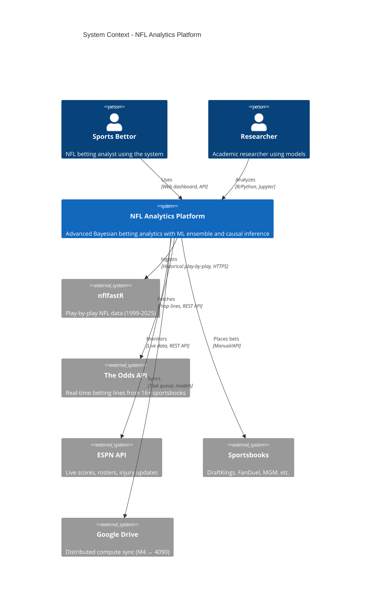
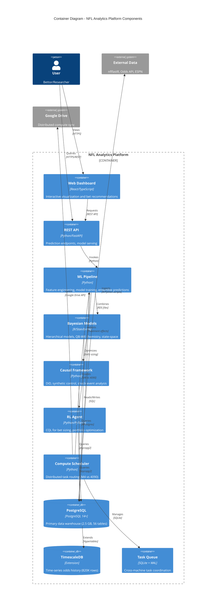
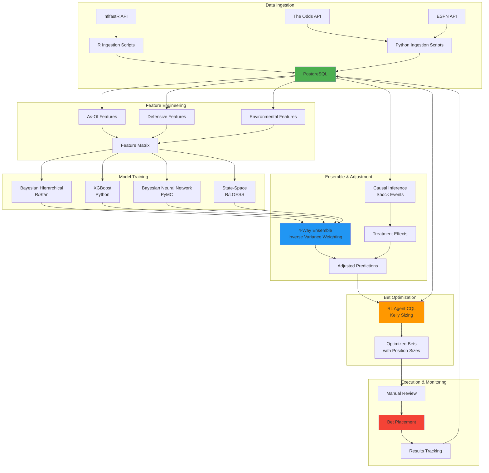
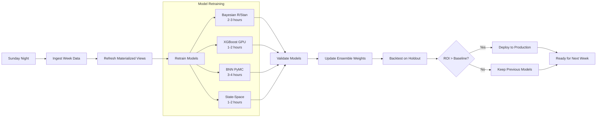
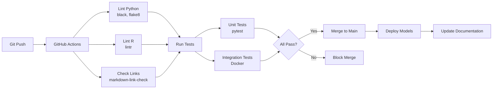

# NFL Analytics System Architecture

**Last Updated:** November 1, 2025
**Version:** 3.0
**Document Type:** C4 Model Architecture Documentation

---

## 📋 Table of Contents

1. [Executive Summary](#executive-summary)
2. [C4 Context Diagram](#c4-context-diagram) - System in Environment
3. [C4 Container Diagram](#c4-container-diagram) - High-Level Components
4. [Component Details](#component-details)
5. [Data Flow](#data-flow)
6. [Technology Stack](#technology-stack)
7. [Infrastructure](#infrastructure)
8. [Security & Authentication](#security--authentication)
9. [Scalability & Performance](#scalability--performance)

---

## Executive Summary

The NFL Analytics system is a **research-grade sports betting analytics platform** that combines:

- **Bayesian hierarchical models** (R/Stan) for uncertainty quantification
- **Machine learning ensemble** (Python) with 4-way model combination
- **Causal inference framework** for shock event analysis
- **Reinforcement learning** (CQL) for optimal bet sizing
- **Distributed compute** (M4 + RTX 4090) for hardware-aware task routing
- **PostgreSQL + TimescaleDB** for data warehouse and time-series analytics

**Target Performance:** +5-7% ROI, 59-61% win rate, Sharpe ratio 2.2-2.6

---

## C4 Context Diagram

**Level 1: System Context** - How the NFL Analytics system fits into the world



**Key External Dependencies:**

| System | Purpose | Protocol | Rate Limits |
|--------|---------|----------|-------------|
| **nflfastR** | Historical NFL data (6.8M plays) | HTTPS | None (open source) |
| **The Odds API** | Real-time prop lines | REST API | 500 requests/month (free) |
| **ESPN API** | Live scores, injuries | REST API | Public, no auth |
| **Sportsbooks** | Bet placement | Web/API | Varies by book |
| **Google Drive** | Compute sync | Google Drive API | 15 GB free storage |

---

## C4 Container Diagram

**Level 2: Containers** - High-level technology choices and component responsibilities



---

## Component Details

### 1. Web Dashboard
- **Technology:** React, TypeScript, D3.js
- **Purpose:** Interactive visualization, bet recommendations
- **Status:** Development (not yet implemented)
- **Features:**
  - Live prop line tracking
  - Model prediction visualization
  - Bet history and performance metrics
  - Bayesian uncertainty intervals

### 2. REST API (FastAPI)
- **Technology:** Python, FastAPI, Uvicorn
- **Purpose:** Model serving, prediction endpoints
- **Status:** Partial implementation
- **Endpoints:**
  - `POST /predict/props` - Generate prop predictions
  - `GET /models/status` - Model health check
  - `GET /predictions/history` - Historical predictions
  - `POST /bets/place` - Bet placement (manual verification)

### 3. ML Pipeline (Python)
- **Technology:** Python 3.11+, scikit-learn, XGBoost, PyMC
- **Location:** `py/`
- **Modules:**
  - `features/` - 30 feature engineering modules
  - `models/` - 52 ML model files
  - `ensemble/` - 11 ensemble methods
  - `backtests/` - 12 backtesting scripts
  - `optimization/` - Portfolio optimizer

**Key Features:**
- As-of-date feature construction (leakage-safe)
- 4-way ensemble (Bayesian + XGBoost + BNN + State-Space)
- Uncertainty quantification
- Walk-forward validation

### 4. Bayesian Models (R/Stan)
- **Technology:** R 4.3+, brms, cmdstanr, Stan
- **Location:** `R/`
- **Scripts:** 41 R files
- **Models:**
  - Hierarchical player props (v1.0, v2.5, v3.0)
  - QB-WR chemistry (dyadic effects, 2,168 pairs)
  - State-space player skills (time-varying ratings)
  - Team offensive/defensive ratings

**Training:**
- MCMC: 4 chains × 2,000 iterations
- Backend: cmdstanr (faster than rstan)
- Hardware: MacBook M4 (CPU-optimized)

### 5. Causal Inference Framework
- **Technology:** Python, econml, DoWhy
- **Location:** `py/causal/`
- **Modules:** 8 causal inference modules
  - Panel constructor
  - Treatment definitions (injuries, coaching changes)
  - Confounder identification
  - Synthetic control
  - Difference-in-differences
  - Structural causal models (DAGs)
  - Model integration
  - Validation and placebo tests

**Use Cases:**
- Injury impact estimation
- Coaching change effects
- Trade shock events
- Weather disruptions

### 6. RL Agent (CQL)
- **Technology:** Python, PyTorch, Stable-Baselines3
- **Location:** `py/rl/`
- **Algorithm:** Conservative Q-Learning (offline RL)
- **Training:** 5,146 games (2006-2024), 9 minutes on RTX 4090
- **Performance:** 1.75% vs 1.41% baseline (+24% improvement)
- **Model:** `models/cql/best_model.pth` (207 KB)

**Features:**
- Correlation-adjusted Kelly criterion
- Position limits and risk gates
- Off-policy evaluation (OPE) with robust gates

### 7. Compute Scheduler
- **Technology:** Python, SQLite with WAL mode
- **Location:** `py/compute/`
- **Purpose:** Distributed compute coordination
- **Architecture:** SETI@home-style task distribution

**Hardware Routing:**
- **MacBook M4** → CPU tasks (Monte Carlo, state-space, stats)
- **Windows RTX 4090** → GPU tasks (RL training, XGBoost, large batch)

**Synchronization:** Google Drive for cross-machine file sync

### 8. PostgreSQL Database
- **Version:** PostgreSQL 14+
- **Size:** ~2.5 GB
- **Tables:** 56 tables across 5 schemas
- **Connection:** `localhost:5544`, database `devdb01`

**Schemas:**
- `public` - Source-of-truth NFL data
- `mart` - Analytical data mart (materialized views)
- `predictions` - ML predictions and feedback
- `reference` - Lookup tables
- `monitoring` - Observability metrics

**Key Tables:**
- `games` - 6,991 games (1999-2024)
- `plays` - 1,230,857 play-by-play records
- `mart.player_game_stats` - 24,950 player-game records
- `odds_history` - 820,080 rows (TimescaleDB hypertable)

### 9. TimescaleDB Extension
- **Purpose:** Time-series optimization for odds history
- **Hypertables:** `odds_history` (partitioned by `fetched_at`)
- **Compression:** Automatic compression for historical data
- **Retention:** Continuous aggregates for real-time queries

### 10. Task Queue (SQLite)
- **Technology:** SQLite with WAL mode
- **Purpose:** Cross-machine task coordination
- **Location:** Google Drive sync folder
- **Features:**
  - Multi-reader, single-writer with file locking
  - Conflict resolution (auto-merge Google Drive conflicts)
  - Task priorities and dependencies
  - Hardware-aware routing metadata

---

## Data Flow

### End-to-End Prediction Pipeline



### Weekly Training Pipeline



---

## Technology Stack

### Languages

| Language | Purpose | Lines of Code |
|----------|---------|---------------|
| **Python** | ML, optimization, RL | ~50,000 |
| **R** | Bayesian models, stats | ~15,000 |
| **SQL** | Database queries, migrations | ~10,000 |
| **LaTeX** | Dissertation (324 pages) | ~25,000 |

### Python Stack

**Core:**
- Python 3.11+
- uv (package manager)
- PostgreSQL driver: psycopg2

**ML/Stats:**
- PyMC 5.0+ (Bayesian Neural Networks)
- XGBoost (gradient boosting)
- scikit-learn (preprocessing, metrics)
- NumPy, pandas (data manipulation)

**RL:**
- PyTorch 2.0+
- Stable-Baselines3
- Gymnasium (RL environments)

**Optimization:**
- cvxpy (convex optimization)
- scipy (optimization, stats)

**Testing:**
- pytest
- pytest-cov (coverage)
- pre-commit hooks

### R Stack

**Core:**
- R 4.3+
- renv (package management)
- tidyverse (data manipulation)

**Bayesian:**
- brms 2.19+ (Bayesian regression)
- cmdstanr 0.5+ (Stan interface)
- Stan 2.33+ (MCMC sampling)
- loo (model comparison)

**Database:**
- DBI (database interface)
- RPostgres (PostgreSQL driver)

**Visualization:**
- ggplot2
- bayesplot (posterior diagnostics)

### Database Stack

- **PostgreSQL 14+**
- **TimescaleDB** (time-series extension)
- **PostGIS** (spatial data, future)

### Infrastructure

- **Docker** + Docker Compose
- **Git** + Git LFS (for model binaries)
- **GitHub Actions** (CI/CD)
- **Google Drive** (distributed compute sync)

---

## Infrastructure

### Development Environment

```
Local Development:
  ├── MacBook M4 (Primary)
  │   ├── CPU: Apple M4 (10-core)
  │   ├── RAM: 32 GB
  │   ├── OS: macOS Sequoia
  │   └── Use: Python dev, R models, CPU tasks
  │
  └── Windows 11 Workstation (GPU)
      ├── GPU: RTX 4090 (24 GB VRAM)
      ├── CPU: AMD Ryzen 9 7950X
      ├── RAM: 64 GB DDR5
      └── Use: RL training, GPU XGBoost, large batch
```

### Database Infrastructure

```
PostgreSQL Container:
  ├── Version: PostgreSQL 14.9
  ├── Port: 5544 (non-standard for security)
  ├── Volume: pgdata/ (persistent)
  ├── Extensions: TimescaleDB, pg_stat_statements
  ├── Memory: 4 GB allocated
  └── Connections: Max 100 concurrent
```

### Compute Coordination

```
Distributed System:
  ├── Task Queue: SQLite (Google Drive sync)
  ├── Sync Frequency: Every 5 minutes
  ├── Conflict Resolution: Auto-merge with timestamps
  ├── Task Routing: Hardware-aware (CPU vs GPU)
  └── Monitoring: Prometheus metrics (planned)
```

---

## Security & Authentication

### Database Security

```python
# Database credentials (development only)
DB_CONFIG = {
    'host': 'localhost',
    'port': 5544,  # Non-standard port
    'database': 'devdb01',
    'user': 'dro',
    'password': 'sicillionbillions'  # ⚠️ Dev only, not for production
}
```

**Production Recommendations:**
- Use environment variables for credentials
- Enable SSL/TLS for database connections
- Implement role-based access control (RBAC)
- Rotate passwords regularly
- Enable PostgreSQL audit logging

### API Security (Future)

**Planned Security Measures:**
- JWT authentication for API endpoints
- Rate limiting (100 requests/minute)
- API key management
- CORS configuration
- Request validation (Pydantic)

### Data Privacy

- **No PII collected** - System uses public NFL data only
- **Betting data** - User's own betting history (not shared)
- **Model predictions** - Proprietary, not publicly distributed

---

## Scalability & Performance

### Current Scale

| Metric | Value |
|--------|-------|
| Database Size | 2.5 GB |
| Total Games | 6,991 (1999-2024) |
| Total Plays | 1,230,857 |
| Player Records | 24,950 |
| Odds Snapshots | 820,080 |
| Model Predictions/Week | ~500 |

### Performance Benchmarks

**Model Training:**
| Model | Training Time | Hardware |
|-------|---------------|----------|
| Bayesian Hierarchical | 25.3 seconds | M4 CPU |
| QB-WR Chemistry | 30.5 minutes | M4 CPU |
| BNN | 2-3 hours | M4 CPU |
| XGBoost | 1-2 hours | 4090 GPU |
| CQL RL | 9 minutes | 4090 GPU |

**Prediction Speed:**
| Operation | Time | Throughput |
|-----------|------|------------|
| Feature Engineering | 5-10 seconds | 500 games |
| Bayesian Prediction | 0.05 seconds | 1,000 games |
| XGBoost Prediction | 0.01 seconds | 1,000 games |
| Ensemble Prediction | 0.15 seconds | 1,000 games |

### Scalability Strategies

**Horizontal Scaling (Future):**
- Microservices architecture for API
- Load balancer for prediction endpoints
- Redis for caching predictions
- Celery for async task queue

**Vertical Scaling:**
- Upgrade to GPU-enabled cloud instances
- Increase database RAM allocation
- SSD storage for faster I/O

**Database Optimization:**
- Partitioning large tables (plays, odds_history)
- Materialized views for common queries
- Indexed foreign keys and join columns
- Query optimization with EXPLAIN ANALYZE

---

## Disaster Recovery

### Backup Strategy

**Database Backups:**
- Daily automated pg_dump
- Weekly full backups to external storage
- Retention: 30 days (daily), 1 year (weekly)

**Model Backups:**
- Git LFS for versioned model storage
- Google Drive for trained model redundancy
- Checkpoints during long training runs

**Code Backups:**
- Git repository (GitHub)
- Multiple developer clones
- CI/CD pipeline for automated testing

### Recovery Procedures

**Database Recovery:**
```bash
# Restore from backup
pg_restore -h localhost -p 5544 -U dro -d devdb01 backup_file.dump

# Verify data integrity
psql -h localhost -p 5544 -U dro -d devdb01 -c "SELECT COUNT(*) FROM games;"
```

**Model Recovery:**
```bash
# Pull models from Git LFS
git lfs pull

# Verify model integrity
ls -lh models/bayesian/*.rds models/bayesian/*.pkl
```

---

## Monitoring & Observability

### Planned Monitoring Stack

**Metrics (Prometheus):**
- Model prediction latency
- API request rates and errors
- Database query performance
- Feature drift detection

**Logging (ELK Stack - Future):**
- Application logs (Python, R)
- Database query logs
- API access logs
- Error tracking

**Alerting (Alertmanager - Future):**
- Model performance degradation
- Database connection failures
- API downtime
- Abnormal prediction distributions

### Health Checks

**System Health Dashboard:**
- Database connectivity
- Model availability
- Feature freshness
- Prediction calibration score
- Recent backtest ROI

---

## Development Workflow

### CI/CD Pipeline



### Testing Strategy

**Unit Tests:**
- Target: >80% code coverage
- Framework: pytest (Python), testthat (R)
- Scope: Individual functions, modules

**Integration Tests:**
- Database connectivity
- End-to-end prediction pipeline
- Model loading and inference

**Validation Tests:**
- Walk-forward backtesting
- Out-of-sample validation
- Calibration tests

---

## Future Architecture Enhancements

### Planned Improvements

1. **Real-Time Processing**
   - Apache Kafka for event streaming
   - Live prop line monitoring
   - In-game betting models

2. **Cloud Deployment**
   - AWS EC2 with GPU instances
   - RDS PostgreSQL (managed)
   - S3 for model storage
   - CloudWatch for monitoring

3. **API Gateway**
   - Kong or AWS API Gateway
   - Rate limiting and throttling
   - JWT authentication
   - Request/response caching

4. **Microservices**
   - Separate services: prediction, training, monitoring
   - gRPC for inter-service communication
   - Service mesh (Istio) for orchestration

5. **Machine Learning Ops (MLOps)**
   - MLflow for experiment tracking
   - Model registry and versioning
   - A/B testing framework
   - Automated model retraining

---

## References

- **C4 Model:** https://c4model.com
- **PostgreSQL Documentation:** https://www.postgresql.org/docs/14/
- **TimescaleDB:** https://docs.timescale.com
- **brms:** https://paul-buerkner.github.io/brms/
- **PyMC:** https://www.pymc.io

---

## Related Documentation

- **[CLAUDE.md](CLAUDE.md)** - Comprehensive project documentation
- **[PROJECT_STATUS.md](PROJECT_STATUS.md)** - Current project status
- **[DOCUMENTATION_INDEX.md](DOCUMENTATION_INDEX.md)** - Complete documentation catalog
- **[docs/DATABASE_SCHEMA_AUDIT.md](docs/DATABASE_SCHEMA_AUDIT.md)** - Database schema details
- **[docs/ADVANCED_BAYESIAN_V3.md](docs/ADVANCED_BAYESIAN_V3.md)** - Bayesian methodology
- **[docs/CAUSAL_INFERENCE_FRAMEWORK.md](docs/CAUSAL_INFERENCE_FRAMEWORK.md)** - Causal inference guide

---

**Document Owner:** NFL Analytics Team
**Last Reviewed:** November 1, 2025
**Next Review:** December 1, 2025 (monthly cadence)
