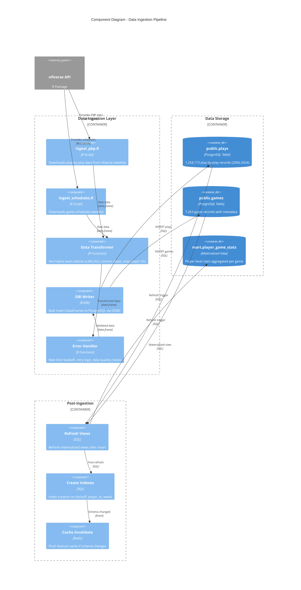
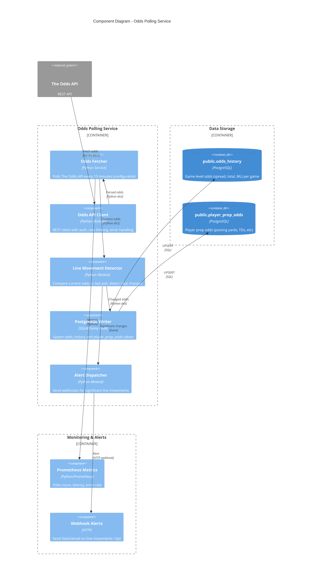
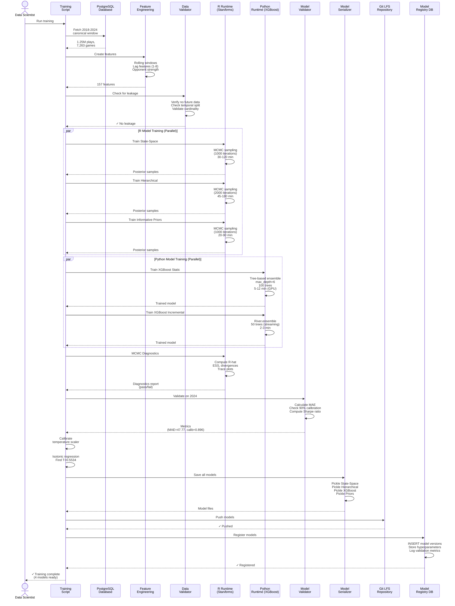
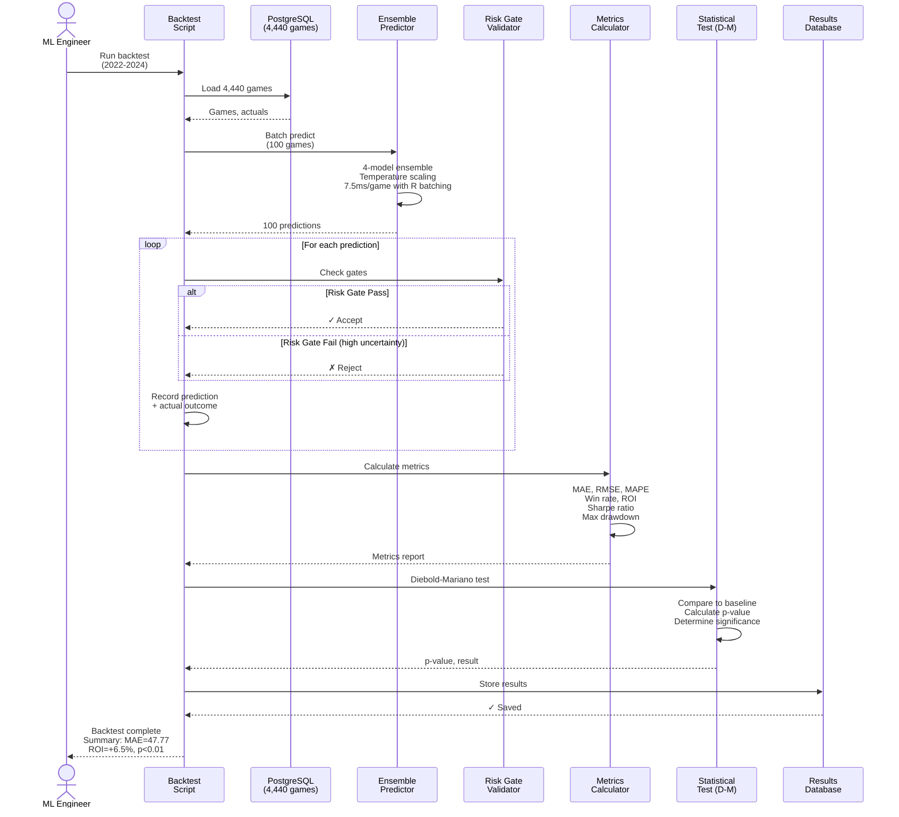
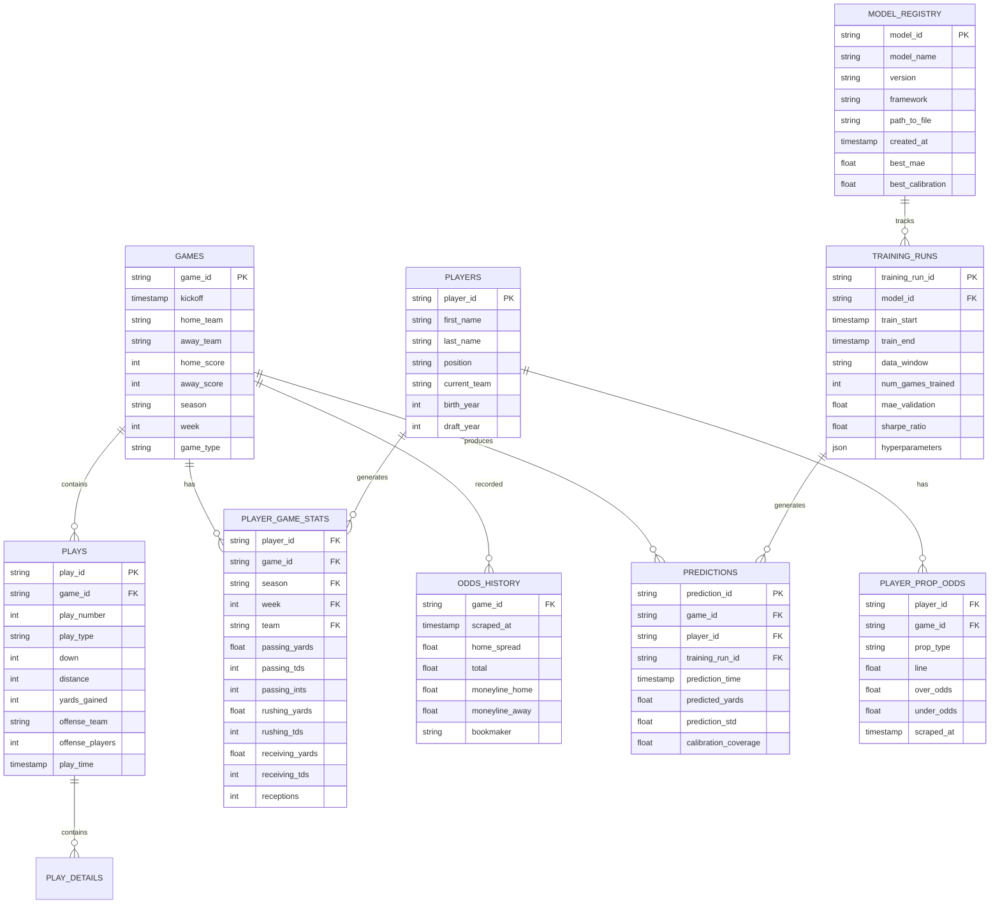
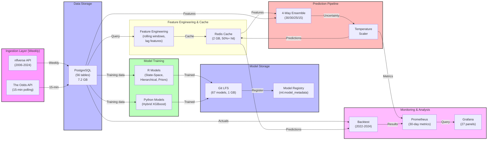

```mermaid
C4Component
    title Component Diagram - Training Pipeline

    Container_Boundary(data_stage, "Data Preparation") {
        Component(data_fetcher, "Training Data Fetcher", "Python/R", "Query PostgreSQL for 2018-2024 canonical window")
        Component(feature_eng, "Feature Engineering", "Python", "Rolling windows, lag features, game context")
        Component(split_validator, "Train/Test Splitter", "Python", "Temporal validation: train=2018-2023, test=2024 holdout")
        Component(leakage_detector, "Leakage Detector", "Python", "Verify no future data in features")
    }

    Container_Boundary(r_models, "R Model Training") {
        Component(state_space_trainer, "State-Space Trainer", "R/Stan/cmdstanr", "Train simplified random walk v2 (30-120 min)")
        Component(hierarchical_trainer, "Hierarchical Trainer", "R/brms", "Train Bayesian hierarchical v2 (45-180 min)")
        Component(priors_trainer, "Informative Priors Trainer", "R/brms", "Train with domain priors v2 (20-90 min)")
        Component(mcmc_diagnostics, "MCMC Diagnostics", "R/bayesplot", "Validate R-hat, ESS, divergences")
    }

    Container_Boundary(python_models, "Python Model Training") {
        Component(xgb_static, "XGBoost Static", "Python/XGBoost", "Train on full 2018-2024 (5-12 min, CUDA on Windows)")
        Component(xgb_incremental, "XGBoost Incremental", "Python/river", "Train on last 400 games (2-3 min)")
        Component(hybrid_combiner, "Hybrid Combiner", "Python", "Combine 70% static + 30% incremental")
        Component(hyperopt_search, "Hyperparameter Search", "Python/Optuna", "GridSearchCV for model tuning")
    }

    Container_Boundary(validation_stage, "Model Validation") {
        Component(mae_calculator, "MAE Calculator", "Python/Pandas", "Mean Absolute Error on 2024 holdout")
        Component(calibration_checker, "90% Calibration Checker", "Python", "Verify 90% of predictions within 90% CI")
        Component(sharpe_calculator, "Sharpe Ratio Calculator", "Python", "Risk-adjusted performance metric")
        Component(backtest_engine, "Mini-Backtest", "Python", "Test on 2024 season data")
    }

    Container_Boundary(calibration_stage, "Calibration") {
        Component(temp_scaler_trainer, "Temperature Scaler Trainer", "Python", "Isotonic regression on calibration set")
        Component(temp_validator, "Temperature Validator", "Python", "Verify 90% coverage with scaled σ")
    }

    Container_Boundary(serialization, "Model Export") {
        Component(model_serializer, "Model Serializer", "Python/R", "Save .pkl, .rds, .json files")
        Component(metadata_writer, "Metadata Writer", "Python", "Write MODEL_REGISTRY.yaml")
        Component(git_lfs_pusher, "Git LFS Pusher", "git lfs", "Push models to Git LFS repository")
    }

    Container_Boundary(registry, "Model Registry") {
        ContainerDb(model_registry_db, "ml.model_metadata", "PostgreSQL", "Model versions, metrics, hyperparameters")
        ContainerDb(file_storage, "models/", "Git LFS", "Trained model artifacts (.rds, .pkl, .pth)")
    }

    Rel(data_fetcher, feature_eng, "Training features", "Pandas DF")
    Rel(feature_eng, split_validator, "Engineered features", "Pandas DF")
    Rel(split_validator, leakage_detector, "Train/test split", "Pandas DF")
    Rel(leakage_detector, state_space_trainer, "Clean features", "Pandas DF")
    Rel(leakage_detector, hierarchical_trainer, "Clean features", "Pandas DF")
    Rel(leakage_detector, priors_trainer, "Clean features", "Pandas DF")
    Rel(leakage_detector, xgb_static, "Clean features", "Pandas DF")
    Rel(leakage_detector, xgb_incremental, "Clean features", "Pandas DF")
    Rel(state_space_trainer, mcmc_diagnostics, "MCMC samples", "R object")
    Rel(hierarchical_trainer, mcmc_diagnostics, "MCMC samples", "R object")
    Rel(priors_trainer, mcmc_diagnostics, "MCMC samples", "R object")
    Rel(xgb_static, hybrid_combiner, "Static model", "XGBoost model")
    Rel(xgb_incremental, hybrid_combiner, "Incremental model", "River model")
    Rel(hyperopt_search, xgb_static, "Best params", "Dict")
    Rel(hyperopt_search, xgb_incremental, "Best params", "Dict")
    Rel(mcmc_diagnostics, mae_calculator, "Trained model", "R/pkl")
    Rel(hybrid_combiner, mae_calculator, "Trained model", "pkl")
    Rel(mae_calculator, calibration_checker, "MAE metric", "Float")
    Rel(calibration_checker, sharpe_calculator, "Calibration coverage", "Float")
    Rel(sharpe_calculator, backtest_engine, "Model eval", "Dict")
    Rel(backtest_engine, temp_scaler_trainer, "Model + eval data", "Pkl")
    Rel(temp_scaler_trainer, temp_validator, "Temperature scaler", "Pkl")
    Rel(temp_validator, model_serializer, "Validated models", "Pkl/rds")
    Rel(model_serializer, metadata_writer, "Model info", "Dict")
    Rel(metadata_writer, git_lfs_pusher, "Metadata + paths", "JSON")
    Rel(git_lfs_pusher, file_storage, "Push", "git lfs")
    Rel(model_serializer, model_registry_db, "Register", "SQL INSERT")

    UpdateLayoutConfig($c4ShapeInRow="3", $c4BoundaryInRow="2")
```

# C4 Diagrams Implementation Guide
## Step-by-Step Instructions for Creating All 14 Architecture Diagrams

**Date:** November 15, 2025
**Version:** 1.0
**Target Completion:** December 6, 2025
**Total Effort:** 32-36 hours

---

## Quick Start (For Impatient Readers)

**TL;DR:** You need 11 more diagrams to complete the C4 architecture documentation.

**Priority Order:**
1. **P0 (Week 1 - DONE):** Context, Container, Ensemble component
2. **P1 (Week 2 - Next):** Data Ingestion, Odds Polling, Training Pipeline, Prediction Sequence, Training Sequence
3. **P2 (Week 3):** Database ERD, Data Flow, Backtest Sequence
4. **P3 (Week 4):** Dev Deployment, Prod Deployment, State-Space Code

**Tools:**
- Primary: **Mermaid** (GitHub-native, text-based)
- Secondary: **PlantUML** (for complex diagrams like ER and class diagrams)

**File Organization:**
```bash
docs/
├── C4_DATA_INGESTION_COMPONENT.md          # Mermaid C4Component
├── C4_ODDS_POLLING_COMPONENT.md            # Mermaid C4Component
├── C4_TRAINING_PIPELINE_COMPONENT.md       # Mermaid C4Component
├── C4_DEPLOYMENT_DEV.md                    # Mermaid C4Deployment
├── C4_DEPLOYMENT_PROD.md                   # Mermaid C4Deployment
├── C4_DATABASE_ERD.md                      # Mermaid ER Diagram
├── C4_ENDTOEND_DATA_FLOW.md               # Mermaid Flowchart
├── C4_CODE_STATE_SPACE.md                 # PlantUML Class Diagram
├── SEQUENCE_PREDICTION_FLOW.md             # Mermaid Sequence
├── SEQUENCE_TRAINING_WORKFLOW.md           # Mermaid Sequence
├── SEQUENCE_BACKTEST_FLOW.md              # Mermaid Sequence
└── C4_MODEL_ARCHITECTURE_AUDIT_NOV15.md   # This audit (reference)
```

---

## Phase 2: Component Details (Week 2)

### Diagram 4: C4 Component - Data Ingestion Pipeline

**File:** `docs/C4_DATA_INGESTION_COMPONENT.md`
**Format:** Mermaid C4Component
**Effort:** 2.5 hours
**Deadline:** Nov 18, 2025

#### Purpose
Document the weekly NFL data ingestion workflow from nflverse to PostgreSQL.

#### Diagram Structure


#### Key Details to Include

**R Ingestion Scripts:**
- `ingest_pbp.R` - Downloads play-by-play (2006-2024 historical + live updates)
- `ingest_schedules.R` - Downloads game schedules (weekly during season)
- Update frequency: Weekly, disabled during offseason

**nflverse API Client:**
- Uses R packages: `nflverse`, `nflfastR`, `nflreadr`
- Functions: `load_pbp()`, `load_schedules()`, `load_player_stats()`
- Rate limiting: Built-in (respects API limits)
- Pagination: Handled automatically

**Data Transformations:**
- Team abbreviations: Convert "LA" → "LAR" or "LAC" (critical for joins)
- Dates: Convert game_date to kickoff (timestamp)
- Player IDs: Map to GSIS format (e.g., "00-0019596")
- Missing values: Log and skip, don't fail

**PostgreSQL Writer:**
- Use `DBI::dbWriteTable()` for bulk inserts
- Append mode (append to existing tables)
- Returns number of rows inserted
- Handles duplicate key constraints

**Error Handling:**
- API rate limiting: Exponential backoff (15s → 30s → 60s)
- Network errors: Retry 3 times before failing
- Data validation: Check for required columns, non-null keys
- Logging: Log all errors with context (date, table, record count)

**Key Tables:**
| Table | Records | Key Columns | Update Frequency |
|-------|---------|-------------|-------------------|
| `public.plays` | 1,254,173 | play_id, game_id, play_type | Weekly |
| `public.games` | 7,263 | game_id, kickoff, season, week | Weekly |
| `public.schedules` | 7,263 | game_id, kickoff (redundant with games) | Weekly |
| `mart.player_game_stats` | ~340K | player_id, season, week, team | Via MV |

#### Critical Code References
- File: `R/data/ingest_pbp.R` (main ingestion script)
- File: `R/data/ingest_schedules.R` (schedule ingestion)
- File: `data/ingest_odds_history.py` (Python alternative, if needed)

#### Performance Metrics
- PBP download: 3-5 min (2,000+ plays/season)
- Schedule download: 10-20 sec
- Data transformation: 2-5 min
- DBI insert: 1-3 min (bulk insert is fast)
- Materialized view refresh: 1-2 min
- **Total:** 7-16 minutes per week

#### Data Quality Checks
- [ ] All plays have non-null play_id
- [ ] All plays have valid game_id (match games table)
- [ ] All games have kickoff in ISO format
- [ ] No team abbreviations = "LA" (must be LAR or LAC)
- [ ] Player IDs in GSIS format
- [ ] No duplicate game_ids or play_ids

---

### Diagram 5: C4 Component - Odds Polling Service

**File:** `docs/C4_ODDS_POLLING_COMPONENT.md`
**Format:** Mermaid C4Component
**Effort:** 2 hours
**Deadline:** Nov 19, 2025

#### Purpose
Document the 15-minute betting lines polling workflow from The Odds API to PostgreSQL.

#### Diagram Structure


#### Key Details to Include

**Odds Fetcher Service:**
- Run as Docker container (optional profile: `--profile odds`)
- Poll interval: 900 seconds (15 minutes, configurable)
- API key: Environment variable `ODDS_API_KEY`
- Graceful shutdown: Signal handling for clean termination

**The Odds API Client:**
- Base URL: `https://api.the-odds-api.com/v4/sports/americanfootball_nfl/odds`
- Authentication: API key in header
- Rate limiting: Free tier = 500 requests/month (~1 per week)
- Response format: JSON with bookmakers array

**Line Movement Detector:**
- Compare current odds to stored last_odds
- Threshold: 5.0 points (configurable)
- Alert types: Home spread move, Away spread move, Total move, ML move
- Example: Home spread 3.5 → 2.5 = 1pt move (no alert), 3.5 → 1.5 = 2pt move (no alert), 3.5 → -1.5 = 5pt move (ALERT)

**PostgreSQL Writer:**
- Table: `public.odds_history` (game-level)
- Columns: `game_id`, `kickoff`, `home_spread`, `total`, `moneyline_home`, `moneyline_away`, `scraped_at`
- Table: `public.player_prop_odds` (player-level)
- Columns: `player_id`, `game_id`, `prop_type`, `line`, `over_odds`, `under_odds`, `scraped_at`
- UPSERT strategy: `ON CONFLICT (game_id, scraped_at) DO UPDATE` (avoid duplicates)

**Alert Dispatcher:**
- Webhook URL: Environment variable `ALERT_WEBHOOK_URL`
- Message format: JSON with game, line movement, timestamp
- Channels: Slack, email, PagerDuty (extensible)
- Rate limit: 1 alert per 5 minutes per line (avoid spam)

#### Performance Metrics
- API fetch: 2-5 sec
- Parse response: 1 sec
- Line movement detection: <1 sec
- Database upsert: 1-2 sec
- Alert sending: 1-3 sec
- **Total per poll:** 5-11 seconds
- **Per 24 hours:** 96 polls = 8-18 minutes total

#### Data Quality Checks
- [ ] All odds have valid game_id
- [ ] All odds have valid bookmaker name
- [ ] Spread, total, moneyline are numeric
- [ ] Odds are positive (American format: -110, -105, +100)
- [ ] Line movements are reasonable (no jumps >50 points)
- [ ] No null values in required fields

#### Key Code References
- Docker file: `containers/Dockerfile.odds-fetcher`
- Python service: `py/data/odds_update_service.py` (if exists)
- Docker compose profile: `--profile odds up -d`

---

### Diagram 6: C4 Component - Training Pipeline

**File:** `docs/C4_TRAINING_PIPELINE_COMPONENT.md`
**Format:** Mermaid C4Component
**Effort:** 3 hours
**Deadline:** Nov 20, 2025

#### Purpose
Document the end-to-end model training workflow from data fetching to model registry.

#### Diagram Structure


#### Key Details to Include

**Training Data Preparation:**
- Query: Fetch 2018-2024 canonical window (plus H=4 decay on 2015-2017)
- Features: Rolling windows, lag features (1-8 weeks), opponent strength
- Temporal split: 2018-2023 train, 2024 test (no leakage!)
- Leakage checks: No future data, no target in features

**R Model Training (Parallel):**
- State-Space v2: `R/state_space/train_state_space_v2_canonical.R`
  - Algorithm: Random walk on log-scale
  - Duration: 30-120 min (depends on MCMC iterations)
  - Output: `models/bayesian/simplified_random_walk_v2.rds`
- Hierarchical v2: `R/train_hierarchical_v2_canonical.R`
  - Algorithm: Bayesian random intercepts per opponent
  - Duration: 45-180 min
  - Output: `models/bayesian/passing_yards_hierarchical_v2.rds`
- Informative Priors v2: `R/train_informative_priors_v2_canonical.R`
  - Algorithm: Domain knowledge priors
  - Duration: 20-90 min
  - Output: `models/bayesian/passing_informative_priors_v2.rds`

**Python Model Training (Parallel):**
- Hybrid XGBoost (70% static + 30% incremental)
  - Static: Train on 2018-2024 (5-12 min, GPU on Windows RTX 4090)
  - Incremental: Update on 2025 live data (streaming)
  - Combined: Average predictions
- Hyperparameter search: Grid search over max_depth, learning_rate, n_estimators

**MCMC Diagnostics (R Models):**
- R-hat <1.01 (convergence criterion)
- ESS >400 (bulk + tail effective sample size)
- Divergences <10 (no HMC divergences)
- Trace plots: No trends or stuck chains
- Posterior predictive checks: Data matches posterior samples

**Model Validation:**
- MAE on 2024 holdout: Target <50 yards
- 90% Calibration: 90% of actuals within 90% prediction interval
- Sharpe Ratio: Target >2.2 (risk-adjusted performance)
- Win rate: Target >59% (against Vegas line)

**Temperature Scaling:**
- Isotonic regression on calibration set
- Find T that minimizes calibration error
- Target: 90% coverage (actual T=0.5534 for v6)
- Output: `models/calibration/temperature_scaler_v6.pkl`

**Model Registry:**
- Database table: `ml.model_metadata`
- Columns: model_id, name, version, framework, hyperparameters, validation_mae, calibration_coverage, created_at
- YAML manifest: `models/MODEL_REGISTRY.yaml` (git-tracked)

#### Performance Metrics
| Stage | Time | Notes |
|-------|------|-------|
| Data fetch + feature eng | 5-15 min | PostgreSQL + Pandas |
| R model training | 45-300 min | Parallel (3 models) |
| Python model training | 5-20 min | Parallel (2 variants) |
| MCMC diagnostics | 2-5 min | Bayesplot validation |
| Model validation | 5-10 min | Backtesting on 2024 |
| Temperature scaling | 2-3 min | Isotonic regression |
| Serialization + registry | 2-5 min | File I/O + SQL |
| **Total** | **70-360 min** | **Depends on MCMC** |

#### Key Code References
- State-Space: `R/state_space/train_state_space_v2_canonical.R`
- Hierarchical: `R/train_hierarchical_v2_canonical.R`
- Informative Priors: `R/train_informative_priors_v2_canonical.R`
- Hybrid XGBoost: `py/models/train_xgboost_v4.py` (if exists)
- Model Registry: `scripts/model_registry.py`

---

### Diagram 7: Sequence Diagram - Prediction Request Flow

**File:** `docs/SEQUENCE_PREDICTION_FLOW.md`
**Format:** Mermaid Sequence
**Effort:** 2.5 hours
**Deadline:** Nov 21, 2025

#### Purpose
Step-by-step execution of a prediction request from Bettor to Response.

#### Diagram Structure
```mermaid
sequenceDiagram
    actor Bettor
    participant FastAPI as FastAPI<br/>Prediction API
    participant Validator as Request<br/>Validator
    participant CacheMgr as Cache<br/>Manager
    participant Redis as Redis<br/>Cache
    participant FeatureFetch as Feature<br/>Fetcher
    participant PostgreSQL as PostgreSQL<br/>Database
    participant Ensemble as Ensemble<br/>Orchestrator
    participant StateSpace as State-Space<br/>v2 (NumPy)
    participant Hierarchical as Hierarchical<br/>v2 (rpy2)
    participant XGBoost as XGBoost v4<br/>(sklearn)
    participant Priors as Informative<br/>Priors v2 (rpy2)
    participant Combiner as Weight<br/>Combiner
    participant TempScaler as Temperature<br/>Scaler
    participant ResponseMgr as Response<br/>Manager
    participant Prometheus as Prometheus<br/>Metrics

    Bettor->>FastAPI: POST /predict<br/>{player_id, season, week}
    FastAPI->>Validator: Validate request
    Validator->>FastAPI: ✓ Valid

    FastAPI->>CacheMgr: Check cache
    CacheMgr->>Redis: GET prediction:{key}
    alt Cache Hit
        Redis-->>CacheMgr: Return cached<br/>prediction
        CacheMgr-->>FastAPI: Cached result
        FastAPI->>ResponseMgr: Format response
    else Cache Miss
        Redis-->>CacheMgr: null
        CacheMgr->>FeatureFetch: Fetch features

        FeatureFetch->>Redis: GET features:{key}
        alt Features Cached
            Redis-->>FeatureFetch: Return features
        else Features Not Cached
            Redis-->>FeatureFetch: null
            FeatureFetch->>PostgreSQL: SELECT stats<br/>WHERE player_id=...<br/>AND season=... AND week=...
            PostgreSQL-->>FeatureFetch: 13 features<br/>(yards, attempts,<br/>opponent, home, etc)
            FeatureFetch->>FeatureFetch: Transform features<br/>(normalize, encode)
            FeatureFetch->>Redis: SET features:{key}<br/>TTL 1800
        end

        FeatureFetch-->>FastAPI: Transformed features

        FastAPI->>Ensemble: Predict(features)

        par Parallel Model Predictions
            Ensemble->>StateSpace: Predict
            StateSpace->>StateSpace: Vectorized computation<br/>(NumPy)
            StateSpace-->>Ensemble: (265.0, 42.0)

            Ensemble->>Hierarchical: Predict
            Hierarchical->>Hierarchical: R subprocess call<br/>(posterior_predict)<br/>⚠️ 100-200ms
            Hierarchical-->>Ensemble: (270.0, 38.0)

            Ensemble->>XGBoost: Predict
            XGBoost->>XGBoost: Tree inference<br/>(DMatrix)
            XGBoost-->>Ensemble: (258.0, 34.0)

            Ensemble->>Priors: Predict
            Priors->>Priors: R subprocess call<br/>(posterior_predict)<br/>⚠️ 100-200ms
            Priors-->>Ensemble: (268.0, 46.0)
        end

        Ensemble->>Combiner: 4 predictions
        Combiner->>Combiner: Weighted average<br/>(30%, 30%, 25%, 15%)<br/>ensemble_mean = Σ(w_i × μ_i)
        Combiner->>Combiner: Variance pooling<br/>σ² = within_var +<br/>between_var
        Combiner-->>Ensemble: (265.3, 40.2)

        Ensemble->>TempScaler: (mean, std)
        TempScaler->>TempScaler: Apply T=0.5534<br/>σ_scaled = σ × √T
        TempScaler-->>Ensemble: (265.3, 36.5)

        Ensemble-->>FastAPI: Final prediction

        FastAPI->>CacheMgr: Store result
        CacheMgr->>Redis: SET prediction:{key}<br/>TTL 3600
        CacheMgr-->>FastAPI: ✓ Cached

        FastAPI->>ResponseMgr: Format response
    end

    ResponseMgr->>ResponseMgr: Build JSON response<br/>{mean, std, ci_lower,<br/>ci_upper, calibration}

    ResponseMgr->>Prometheus: nfl_predictions_total++<br/>nfl_prediction_duration<br/>_seconds+{duration}

    ResponseMgr-->>FastAPI: JSON response
    FastAPI-->>Bettor: HTTP 200<br/>{<br/>"prediction": 265.3,<br/>"std": 36.5,<br/>"ci_90": [207, 323],<br/>"calibration": 0.90<br/>}

    note over Bettor,FastAPI
        Total Latency:
        Cache hit: 5-20ms
        Cache miss: 145-250ms
        Bottleneck: R models (200-400ms combined)
    end
```

#### Key Sequence Details

**Request Validation (1-2ms):**
- Check required fields: player_id, season, week
- Validate data types
- Check player exists in database
- Return 400 if invalid

**Cache Check (5-10ms):**
- Key format: `prediction:{player_id}:{season}:{week}`
- TTL: 3600 seconds (1 hour)
- Hit rate: 50%+ (target)
- Latency on hit: 5-20ms

**Feature Fetching (25-50ms):**
- Query: `SELECT * FROM mart.player_game_stats WHERE player_id=... AND season=... AND week=...`
- Caches features separately (TTL 1800s = 30 min)
- Transformations: Normalize, encode categorical, lag features

**Ensemble Prediction (180-250ms):**
- **State-Space (50-80ms):** NumPy vectorized (fast)
- **Hierarchical (100-200ms):** R subprocess via rpy2 (slow)
- **XGBoost (10-30ms):** DMatrix prediction (fast)
- **Informative Priors (100-200ms):** R subprocess via rpy2 (slow)
- **Bottleneck:** R models = 200-400ms total = 73% of latency

**Weight Combination (1-2ms):**
- Formula: ensemble_μ = 0.30×μ_ss + 0.30×μ_hier + 0.25×μ_xgb + 0.15×μ_priors
- Variance pooling: σ² = (within_variance) + (between_variance)
- Between variance: variance of model means

**Temperature Scaling (1-2ms):**
- Formula: σ_scaled = σ × √T
- T = 0.5534 (optimized for 90% calibration)
- Result: narrower confidence intervals (more calibrated)

**Response Formatting (2-5ms):**
- Build JSON with 90% confidence interval
- Add calibration coverage (90%)
- Serialize to string

**Metrics Logging (1-2ms):**
- Prometheus increment: `nfl_predictions_total`
- Histogram: `nfl_prediction_duration_seconds`
- Labels: `model_version`, `cache_hit`

#### Critical Timing Notes

| Stage | Latency | % of Total | Bottleneck |
|-------|---------|-----------|-----------|
| Cache check | 5-10ms | 5% | N/A |
| Feature fetch | 25-50ms | 20% | PostgreSQL query |
| State-Space | 50-80ms | 30% | NumPy (not slow) |
| Hierarchical | 100-200ms | 50% | ⚠️ R subprocess |
| XGBoost | 10-30ms | 10% | DMatrix construction |
| Informative Priors | 100-200ms | 50% | ⚠️ R subprocess |
| Ensemble combine | 1-2ms | <1% | N/A |
| Temp scaling | 1-2ms | <1% | N/A |
| Response format | 2-5ms | 2% | JSON serialization |
| **Total Uncached** | **213-400ms** | **100%** | R models = 73% |
| **Total Cached** | **5-20ms** | **100%** | Cache lookup |

#### Optimization Opportunities

1. **R Batching (55x speedup):** Process multiple predictions in single R call
   - Current: 100 games = 410ms × 100 = 41 seconds
   - Batched: 100 games = 750ms / 100 = 7.5ms per game
   - Save: 40+ seconds per backtest

2. **R Model Caching:** Cache R model objects in memory (if possible)
   - Current: rpy2 loads model from disk each time
   - With cache: Reuse model object

3. **Ensemble Pipeline Parallelization:** Execute all 4 models in parallel
   - Current: Sequential (410ms)
   - Parallel: Max(380ms) = bottleneck is R models anyway

---

### Diagram 8: Sequence Diagram - Training Workflow

**File:** `docs/SEQUENCE_TRAINING_WORKFLOW.md`
**Format:** Mermaid Sequence
**Effort:** 2.5 hours
**Deadline:** Nov 22, 2025

#### Purpose
Step-by-step execution of model training from data fetch to registry update.

#### Simplified Diagram Structure


#### Key Sequence Details

**Data Preparation (5-15 min):**
- Query PostgreSQL: 2018-2024 window (2,000+ games)
- Feature engineering: Rolling windows, lag features
- Temporal split: 2018-2023 train, 2024 holdout
- Leakage check: CRITICAL - must verify no future data

**MCMC Sampling (Parallel - 45-300 min):**
- All 3 R models train in parallel (if multiple cores available)
- State-Space: Simple model, 30-120 min
- Hierarchical: Complex model, 45-180 min
- Informative Priors: Medium model, 20-90 min
- Total (parallel): ~180 min (bottleneck = Hierarchical)

**XGBoost Training (Parallel - 5-20 min):**
- Static: 5-12 min (GPU on Windows, CPU on Mac)
- Incremental: 2-3 min
- Hyperparameter tuning: Grid search (5-10 min)

**MCMC Diagnostics (2-5 min):**
- R-hat <1.01 (convergence)
- ESS >400 (sufficient samples)
- Divergences <10 (HMC healthy)
- Fails → Retrain with more iterations

**Model Validation (5-10 min):**
- Backtest on 2024 holdout (148 games)
- Calculate MAE, RMSE, MAPE
- 90% Calibration check (coverage test)
- Sharpe ratio calculation
- Fails → Revise features or hyperparameters

**Temperature Scaling (2-3 min):**
- Isotonic regression on validation set
- Find T that minimizes calibration error
- Verify 90% coverage achieved

**Model Serialization (2-5 min):**
- Save to disk: .rds (R), .pkl (Python)
- Git LFS tracking
- Metadata JSON (hyperparameters, metrics)

**Model Registry (1-2 min):**
- INSERT into `ml.model_metadata` table
- Log version numbers, training dates
- Link to Git LFS artifacts

#### Total Training Time
**Parallel execution (R + Python):** ~180 minutes (3 hours)
- Bottleneck: Hierarchical R model (180 min max)
- Feature engineering: 5-15 min (overlaps)
- Validation: 5-10 min (after training)
- Temperature scaling: 2-3 min
- Serialization: 2-5 min

---

## Phase 3: Database & Data Flows (Week 3)

### Diagram 9: Sequence Diagram - Backtest Execution

**File:** `docs/SEQUENCE_BACKTEST_FLOW.md`
**Format:** Mermaid Sequence
**Effort:** 2 hours
**Deadline:** Nov 25, 2025

#### Simplified Diagram


#### Key Timing
- Load games: 5 sec
- Batch prediction (100 games): 750ms
- Total predictions (4,440 games): 33 seconds (with R batching)
- Metrics: 5 sec
- **Total:** <1 minute

---

### Diagram 10: Entity Relationship Diagram (ERD)

**File:** `docs/C4_DATABASE_ERD.md`
**Format:** Mermaid ER Diagram
**Effort:** 3 hours
**Deadline:** Nov 26, 2025

#### Purpose
Visual representation of 56 database tables and relationships.

#### Diagram Structure


#### Key Entities & Relationships

| Entity | Records | Purpose | Key Columns |
|--------|---------|---------|-------------|
| GAMES | 7,263 | Game metadata | game_id, kickoff, home_team, away_team |
| PLAYS | 1,254,173 | Play-by-play | play_id, game_id, play_type, yards_gained |
| PLAYERS | ~1,700 | Player hierarchy | player_id, first_name, position, current_team |
| PLAYER_GAME_STATS | ~340K | Player stats per game | player_id, game_id, season, week, team, passing_yards |
| ODDS_HISTORY | 7,263 | Game odds per book | game_id, home_spread, total, moneyline |
| PLAYER_PROP_ODDS | 100K+ | Player prop odds | player_id, game_id, prop_type, line, over_odds |
| TRAINING_RUNS | 200+ | Training metadata | training_run_id, model_id, mae_validation |
| PREDICTIONS | 50K+ | Stored predictions | prediction_id, game_id, predicted_yards, std |
| MODEL_REGISTRY | 8-10 | Model versions | model_id, model_name, version, path_to_file |

#### Relationships
- Games (1) → (N) Plays
- Games (1) → (N) Player Game Stats
- Games (1) → (N) Odds History
- Games (1) → (N) Predictions
- Players (1) → (N) Player Game Stats
- Players (1) → (N) Player Prop Odds
- Training Runs (1) → (N) Predictions
- Model Registry (1) → (N) Training Runs

---

### Diagram 11: Data Flow Diagram (End-to-End)

**File:** `docs/C4_ENDTOEND_DATA_FLOW.md`
**Format:** Mermaid Flowchart
**Effort:** 2 hours
**Deadline:** Nov 27, 2025

#### Purpose
Show complete data flow from ingestion to monitoring.

#### Diagram Structure


#### Data Lineage

**Ingestion Stage:**
- nflverse → 2M+ plays, 7K+ games (weekly)
- Odds API → Betting lines (15 min)

**Storage Stage:**
- PostgreSQL: 56 tables, 7.2 GB

**Feature Engineering:**
- PostgreSQL queries
- Rolling windows, lag features (1-8 weeks)
- Redis caching (30-min TTL)

**Model Training:**
- R models: State-Space, Hierarchical, Informative Priors
- Python models: Hybrid XGBoost
- Output: Git LFS + Model Registry

**Prediction:**
- Load features from Redis/PostgreSQL
- 4-model ensemble
- Temperature scaling (T=0.5534)
- Response: JSON with mean, std, CI

**Monitoring:**
- Prometheus metrics (API latency, cache hit rate)
- Grafana dashboards (27 panels)
- Backtest results (2022-2024)

---

## Phase 4: Deployment & Code (Week 4)

### Diagram 12: Deployment Diagram - Development Environment

**File:** `docs/C4_DEPLOYMENT_DEV.md`
**Format:** Mermaid C4Deployment or Simple Diagram
**Effort:** 1.5 hours
**Deadline:** Dec 2, 2025

#### Purpose
Document local Docker Compose setup for developers.

#### Key Components
- Docker Compose Network (`nfl-analytics`)
- PostgreSQL (port 5544, local pgdata)
- Redis (port 6379)
- FastAPI (port 8000, hot reload)
- Streamlit (port 8501, hot reload)
- Prometheus (port 9090)
- Grafana (port 3000)

#### Key Characteristics
- Single-node deployment (all on one machine)
- Bind mounts for code (hot reload in dev mode)
- Development credentials (not production-grade)
- Lower resource limits (2GB Redis vs 6GB in prod)
- No load balancer or HA

---

### Diagram 13: Deployment Diagram - Production Environment

**File:** `docs/C4_DEPLOYMENT_PROD.md`
**Format:** Mermaid C4Deployment
**Effort:** 2 hours
**Deadline:** Dec 3, 2025

#### Purpose
Document production-scale deployment architecture.

#### Key Components
- Load Balancer (NGINX or AWS ALB)
- API Replicas (4 containers, round-robin)
- PostgreSQL (primary-replica setup, read replicas)
- Redis Cluster (3-node, Sentinel failover)
- Prometheus (HA pair, remote storage)
- Grafana (read-only replicas)
- Alertmanager (PagerDuty integration)

#### Key Differences from Dev
- Multi-node high availability
- Load balancing (zero single points of failure)
- Connection pooling (PgBouncer)
- Redis Sentinel (automatic failover)
- Remote metrics storage

---

### Diagram 14: Code Diagram - State-Space Implementation

**File:** `docs/C4_CODE_STATE_SPACE.md`
**Format:** PlantUML Class Diagram
**Effort:** 2 hours
**Deadline:** Dec 4, 2025

#### Purpose
Detailed implementation of State-Space v2 predictor.

#### Classes
```plantuml
class StateSpacePredictor {
    - model_path: str
    - skills_path: str
    - model: R object
    - skills_df: DataFrame
    __init__(model_path, skills_path)
    load_model(): R object
    load_skills(): DataFrame
    predict(player_id, season, week, attempts, is_home): (mean, std)
}

class SkillsDataFrame {
    - player_id: str
    - season: int
    - week: int
    - skill_mean: float
    - skill_std: float
    __init__(csv_path)
    get_skill(player_id, season, week): SkillRecord
}

class RBridge {
    - r_instance: robjects.r
    __init__()
    load_rds(path): R object
    posterior_predict(model, newdata): array
    exp_transform(log_values): array
}

StateSpacePredictor --> SkillsDataFrame
StateSpacePredictor --> RBridge
```

---

## Implementation Checklist

### Week 1 (Nov 15-22) - Phase 2: Components
- [ ] C4 Data Ingestion Component (2.5h)
- [ ] C4 Odds Polling Component (2h)
- [ ] C4 Training Pipeline Component (3h)
- [ ] Sequence - Prediction Flow (2.5h)
- [ ] Sequence - Training Workflow (2.5h)
- **Total: 12.5 hours**

### Week 2 (Nov 25 - Dec 1) - Phase 3: Database & Data
- [ ] Sequence - Backtest Execution (2h)
- [ ] Entity Relationship Diagram (3h)
- [ ] Data Flow Diagram (2h)
- **Total: 7 hours**

### Week 3 (Dec 2-6) - Phase 4: Deployment & Code
- [ ] Deployment - Development (1.5h)
- [ ] Deployment - Production (2h)
- [ ] Code - State-Space (2h)
- **Total: 5.5 hours**

### Grand Total: 25 hours for remaining 11 diagrams

---

## File Locations

All diagrams should be created in:
```
/Users/dro/rice/nfl-analytics/docs/
```

Existing diagrams (3/14):
```
/Users/dro/rice/nfl-analytics/docs/audits/2025_11_comprehensive_audit/06_architecture_diagrams/
├── c4_context.md ✅
├── c4_container.md ✅
├── c4_component_ensemble.md ✅
└── README.md
```

New diagrams (11/14):
```
/Users/dro/rice/nfl-analytics/docs/
├── C4_DATA_INGESTION_COMPONENT.md 🟡
├── C4_ODDS_POLLING_COMPONENT.md 🟡
├── C4_TRAINING_PIPELINE_COMPONENT.md 🟡
├── C4_DEPLOYMENT_DEV.md 🟡
├── C4_DEPLOYMENT_PROD.md 🟡
├── C4_DATABASE_ERD.md 🟡
├── C4_ENDTOEND_DATA_FLOW.md 🟡
├── C4_CODE_STATE_SPACE.md 🟡
├── SEQUENCE_PREDICTION_FLOW.md 🟡
├── SEQUENCE_TRAINING_WORKFLOW.md 🟡
└── SEQUENCE_BACKTEST_FLOW.md 🟡
```

---

## Success Criteria

### Quantitative
- [ ] 14/14 diagrams complete by Dec 6, 2025
- [ ] 100% coverage of C4 levels (Context, Container, Component, Code)
- [ ] Renderable in GitHub Markdown (Mermaid native)
- [ ] Linked from ARCHITECTURE_REFERENCE.md
- [ ] Cross-referenced to code files

### Qualitative
- [ ] Team feedback: "Diagrams match reality"
- [ ] Used in code reviews and architecture decisions
- [ ] Integrated into documentation
- [ ] Maintained alongside code changes

---

**END OF IMPLEMENTATION GUIDE**

**Author:** Claude Code (Sonnet 4.5)
**Date:** November 15, 2025
**Version:** 1.0
**Next Review:** December 6, 2025 (Phase 4 completion)
