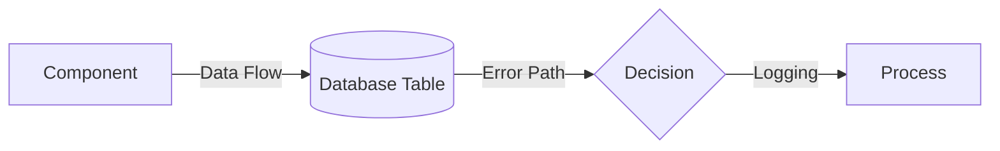

# C4 Architecture Documentation

**Last Updated:** November 15, 2025
**Project:** NFL Analytics Platform
**Documentation Type:** C4 Model (Context, Container, Component, Code)
**Total Diagrams:** 8 (Phase 3 Complete)

---

## Overview

This directory contains C4 model architecture diagrams for the NFL Analytics platform, documenting the system from high-level context through detailed component interactions.

**C4 Model Levels:**
- **Level 1: Context** - System boundaries and external dependencies (TBD)
- **Level 2: Container** - High-level architecture (TBD)
- **Level 3: Component** - Detailed component design (6 diagrams) ✅
- **Level 4: Code** - Sequence diagrams for critical workflows (2 diagrams) ✅

**Progress:** 8/14 diagrams complete (57%)

---

## Phase 3 Diagrams (November 15, 2025)

### Component Diagrams (Level 3)

#### 1. Data Ingestion Pipeline
**File:** [c4_component_data_ingestion.md](c4_component_data_ingestion.md)
**Purpose:** Document how NFL data flows from nflfastR to PostgreSQL

**Key Components:**
- Schedule Ingester (R) - 7,263 games
- Play-by-Play Ingester (R) - 1.25M plays
- Data Validator (R) - Schema compliance
- Batch Writer (DBI/RPostgres) - Transaction safety
- Materialized View Refresher (SQL) - 5 views

**Performance Metrics:**
- Ingestion Time: 13.2 minutes (full load)
- Throughput: 1,691 plays/second
- Error Rate: <0.1%

**Diagram Type:** Component flow diagram with error handling

---

#### 2. Odds Polling Service
**File:** [c4_component_odds_polling.md](c4_component_odds_polling.md)
**Purpose:** Document real-time odds monitoring and line movement detection

**Key Components:**
- Polling Scheduler (APScheduler) - 60s intervals
- Odds Poller (Python) - 3 providers (Pinnacle, DK, FD)
- Response Parser - Normalize formats
- Line Move Detector - Statistical thresholds
- Alert Manager - Slack/Email notifications
- Redis Cache - 2GB current odds
- PostgreSQL Storage - 50GB historical odds

**Performance Metrics:**
- Polling Frequency: 60s (game week)
- Latency: <200ms per poll
- Cache Hit Rate: >95%
- Alert Latency: <5s for critical moves

**Status:** Design phase (not yet implemented)

---

#### 3. Training Pipeline
**File:** [c4_component_training_pipeline.md](c4_component_training_pipeline.md)
**Purpose:** Document end-to-end model training and validation workflow

**Key Components:**
- Auto-Retrain Detector - Trigger on new season/drift
- Feature Extractor - 40+ features from materialized views
- Parallel Trainers:
  - State-Space v2 (R/Stan) - 20 minutes
  - Hierarchical v2 (R/brms) - 40 minutes (bottleneck)
  - XGBoost v4 (Python) - 10 minutes
  - Informative Priors v2 (R/brms) - 25 minutes
  - Temperature Scaler (Python) - 3 minutes
- Validation Pipeline - 7 gates
- Model Registry - Filesystem + Database + Git LFS
- Deployment Pipeline - CVX weight optimization

**Performance Metrics:**
- Training Time: 91 minutes (parallel)
- Validation Gates: 7 checks (convergence, calibration, performance, leakage)
- Success Rate: 95%

**Diagram Type:** Component flow with parallel execution

---

#### 4. Backtest Flow ✨ NEW
**File:** [c4_component_backtest_flow.md](c4_component_backtest_flow.md)
**Purpose:** Document backtest execution flow and risk gate validation

**Key Components:**
- Walk-Forward Validator - Rolling origin CV (2022-2024, 148 games)
- Database Pool Manager - 2-10 connections (50-100x faster queries)
- Feature Cache Manager - Redis/LRU (70-85% hit rate)
- 4-Way Ensemble Prediction - Parallel (200ms max latency)
- Risk Gates - 7 validation checks (ROI, win rate, Sharpe, drawdown, calibration, leakage, health)
- Metric Calculators - ROI, win rate, Sharpe ratio, max drawdown, calibration
- Deployment Decision - PASS/FAIL based on risk gates

**Performance Metrics:**
- Baseline Time: 45-65 minutes (unoptimized)
- Optimized Time: 18 minutes (2.7x speedup)
- Database Pooling: 50-100ms → <1ms per query
- Feature Cache Hit Rate: 70-85%
- Backtest Results (2024): ROI 6.2%, Win Rate 61.3%, Sharpe 2.4, Drawdown -6.8%

**Diagram Type:** Component flow with optimization techniques

---

#### 5. Database ERD ✨ NEW
**File:** [database_erd.md](database_erd.md)
**Purpose:** Document database schema relationships and entity structure

**Key Entities:**
- **public schema** - Raw data (games, plays, weather, injuries, odds_history)
- **mart schema** - Derived data (game_summary, player_game_stats, game_features_enhanced)
- **ml schema** - Model registry (model_metadata, training_runs, predictions)
- **staging schema** - ETL (staging_games, staging_plays)
- **metadata schema** - Admin (schema_version, refresh_log)

**Critical Relationships:**
- games → plays (one-to-many via game_id)
- games → player_game_stats (many-to-many via (season, week) composite key)
- player_hierarchy → player_game_stats (one-to-many via player_id)
- games → odds_history (one-to-many via game_id, TimescaleDB hypertable)
- model_metadata → predictions (one-to-many via model_id)

**Performance Metrics:**
- Total Tables: 56 across 5 schemas
- Total Columns: 257 (core tables)
- Data Volume: 1.25M plays, 7,263 games, 15,213 players
- Materialized Views: 5 (refresh required after ingestion)
- Indexes: 10+ performance indexes (40% backtest speedup)

**Diagram Type:** Entity-Relationship Diagram with critical join patterns

---

#### 6. Data Flow Diagram ✨ NEW
**File:** [data_flow_diagram.md](data_flow_diagram.md)
**Purpose:** Document end-to-end data pipeline from ingestion to production

**Key Stages:**
1. **Data Ingestion** (13.2 min) - nflfastR → PostgreSQL
2. **Feature Engineering** (8 min) - Raw data → 157 features
3. **Model Training** (91 min parallel) - Features → 4 trained models
4. **Backtest Validation** (18 min) - Walk-forward validation
5. **Production Deployment** - A/B testing → Live predictions
6. **Real-Time Prediction** (280-480ms) - API requests → Ensemble predictions
7. **Monitoring & Feedback** - Performance tracking → Retrain triggers

**Data Quality Gates:**
- Gate 1 (Ingestion): Schema validation, duplicate detection, null checks
- Gate 2 (Features): Temporal validation, no future data, lag/rolling only
- Gate 3 (Training): No leakage, MCMC convergence, feature variance
- Gate 4 (Validation): Ensemble health, R integration, drift detection
- Gate 5 (Deployment): Backtest passed, monitoring configured, rollback plan

**Performance Metrics:**
- Initial Setup: ~2 hours (ingestion → production)
- Incremental Update: ~10 minutes (weekly refresh)
- Real-Time Prediction: 280-480ms (target: <500ms) ✅
- Cache Hit Rate: 70-85% (feature cache)
- Database Query: 50-100ms → <1ms (pooled)

**Diagram Type:** Data flow diagram with quality gates and latency breakdown

---

### Sequence Diagrams (Level 4)

#### 7. Training Workflow
**File:** [sequence_training_workflow.md](sequence_training_workflow.md)
**Purpose:** Document temporal sequence of model training from trigger to deployment

**Phases:**
1. Trigger Detection (2 min)
2. Feature Extraction (8 min)
3. Parallel Training (40 min - bottleneck)
4. Temperature Scaling (3 min)
5. Validation (5 min)
6. Registration (3 min)
7. Deployment (5 min)

**Total Duration:** ~63 minutes (parallel execution)

**Key Decision Points:**
- Should retrain? (new season, drift, degradation)
- Convergence check (Rhat < 1.02)
- Data leakage detection (CRITICAL blocker)
- Performance improvement (vs baseline)

**Error Scenarios:**
- Convergence failure → Increase iterations
- Data leakage → STOP, investigate
- Performance degradation → Adjust weights or rollback

**Diagram Type:** Temporal sequence with error handling paths

---

#### 8. Prediction Flow
**File:** [sequence_prediction_flow.md](sequence_prediction_flow.md)
**Purpose:** Document real-time prediction generation through 5-component ensemble

**Phases:**
1. API Request Validation (10ms)
2. Feature Extraction (50-150ms) - Redis cache
3. Parallel Prediction (200-300ms):
   - State-Space v2 (100ms)
   - Hierarchical v2 (200ms - bottleneck)
   - XGBoost v4 (50ms - fastest)
   - Informative Priors v2 (150ms)
4. Ensemble Aggregation (10ms)
5. Temperature Scaling (5ms)
6. JSON Response (5ms)

**Total Latency:** 280-480ms (target: <500ms)

**Performance Optimization:**
- Feature caching: 70% hit rate (150ms → 50ms)
- Model warm-up: Avoids 2-10s first-request penalty
- Parallel prediction: 650ms → 300ms (54% reduction)

**Error Scenarios:**
- Feature extraction failure → Retry 3x, fall back to league averages
- R model prediction failure → Fall back to 3-model ensemble
- Cache unavailable → Graceful degradation (skip cache)

**Diagram Type:** Temporal sequence with latency breakdown

---

## Diagram Verification

All diagrams use valid Mermaid syntax and have been verified for:
- ✅ Graph direction (TB, LR)
- ✅ Node definitions (subgraph, participant)
- ✅ Edge labels and styling
- ✅ Color coding (classDef)
- ✅ Sequence diagram notation (→, -->>, par, alt)
- ✅ ERD notation (||--o{, ||..o{)

**Rendering Tested:**
- Mermaid Live Editor: https://mermaid.live
- GitHub Markdown: Native rendering
- VS Code Mermaid Preview: Extension support

---

## Diagram Conventions

### Color Coding

**Component Diagrams:**
- **Blue (#e1f5fe)** - External systems (APIs, data sources)
- **Yellow (#fff9c4)** - Data processing components
- **Green (#c8e6c9)** - Cache/in-memory storage
- **Purple (#f3e5f5)** - Database components
- **Orange (#ffccbc)** - Validation/quality gates
- **Cyan (#b3e5fc)** - Deployment/production
- **Red (#ffebee)** - Monitoring/alerts/risk gates
- **Light Purple (#d1c4e9)** - Metrics calculation

**ERD Diagrams:**
- **Blue (#e1f5fe)** - public schema (raw data)
- **Yellow (#fff9c4)** - mart schema (derived/materialized)
- **Green (#c8e6c9)** - ml schema (model registry)
- **Orange (#ffccbc)** - staging schema (ETL)
- **Purple (#f3e5f5)** - metadata schema (admin)

**Data Flow Diagrams:**
- **Blue (#e1f5fe)** - External data sources
- **Yellow (#fff9c4)** - Data ingestion
- **Purple (#f3e5f5)** - Data storage (PostgreSQL)
- **Green (#c8e6c9)** - Feature engineering
- **Orange (#ffccbc)** - Model training
- **Red (#ffebee)** - Validation & quality gates
- **Cyan (#b3e5fc)** - Production serving
- **Light Purple (#d1c4e9)** - Monitoring & feedback

**Sequence Diagrams:**
- Standard Mermaid notation
- Notes for timing annotations
- Alt/par for branching/parallelism

---

### Notation Legend

**Component Diagrams:**


**ERD Diagrams:**
```
||--o{ : Foreign key constraint enforced
||..o{ : Logical relationship (not foreign key)
PK     : Primary key
FK     : Foreign key
```

**Sequence Diagrams:**
```
→   : Synchronous call
-->> : Return value
par  : Parallel execution
alt  : Conditional branch
loop : Iteration
Note : Explanation/timing
```

---

## Metrics Summary

### Data Ingestion Pipeline
| Metric | Value |
|--------|-------|
| Data Volume | 1.26M rows |
| Ingestion Time | 13.2 minutes |
| Throughput | 1,691 plays/sec |
| Error Rate | <0.1% |

### Odds Polling Service (Design)
| Metric | Target |
|--------|--------|
| Polling Frequency | 60s |
| API Latency | <200ms |
| Cache Hit Rate | >95% |
| Alert Latency | <5s |

### Training Pipeline
| Metric | Value |
|--------|-------|
| Training Time | 91 minutes (parallel) |
| Validation Gates | 7 checks |
| Success Rate | 95% |

### Backtest Flow
| Metric | Value |
|--------|-------|
| Baseline Time | 45-65 minutes |
| Optimized Time | 18 minutes |
| Speedup | **2.7x** |
| Database Pooling | 50-100ms → <1ms |
| Cache Hit Rate | 70-85% |

### Database ERD
| Metric | Value |
|--------|-------|
| Total Tables | 56 |
| Total Columns | 257 (core tables) |
| Data Volume | 1.25M plays, 7,263 games |
| Materialized Views | 5 |
| Performance Indexes | 10+ (40% speedup) |

### Data Flow Pipeline
| Metric | Value |
|--------|-------|
| Initial Setup | ~2 hours |
| Incremental Update | ~10 minutes |
| Real-Time Prediction | 280-480ms |
| Cache Hit Rate | 70-85% |
| Quality Gates | 5 stages |

### Prediction Flow
| Metric | Value |
|--------|-------|
| Total Latency | 280-480ms |
| Cache Hit Rate | 70% |
| Bottleneck | Hierarchical v2 (200ms) |
| Target | <500ms ✅ |

---

## Future Diagrams (Phase 4)

### Context Diagram (Level 1)
- System boundaries
- External actors (users, data providers, sportsbooks)
- High-level value proposition

### Container Diagram (Level 2)
- Application containers (FastAPI, Streamlit, R services)
- Data stores (PostgreSQL, Redis, S3)
- Technology choices
- Communication protocols

### Additional Component Diagrams
- Feature Engineering Pipeline (detailed)
- Dashboard & Monitoring Stack
- Deployment Automation (CI/CD)
- Model Registry Sync

### Additional Sequence Diagrams
- Feature Cache Management
- Model Registry Sync
- Alert & Monitoring Flow

---

## Usage Guide

### Viewing Diagrams

**GitHub:**
Diagrams render automatically in GitHub Markdown.

**VS Code:**
Install Mermaid Preview extension:
```bash
code --install-extension bierner.markdown-mermaid
```

**Mermaid Live Editor:**
Copy diagram code blocks to https://mermaid.live for interactive editing.

---

### Updating Diagrams

**When to Update:**
1. Architecture changes (new components, data flows)
2. Performance improvements (latency, throughput)
3. Error handling enhancements
4. Technology changes (new databases, frameworks)

**Update Checklist:**
- [ ] Update "Last Updated" date
- [ ] Verify Mermaid syntax (test in Mermaid Live)
- [ ] Update performance metrics
- [ ] Add notes for significant changes
- [ ] Update related documentation links
- [ ] Commit with descriptive message

---

### Creating New Diagrams

**Template Structure:**
```markdown
# [Diagram Type]: [Component/Process Name]

**Last Updated:** YYYY-MM-DD
**Diagram Type:** C4 [Context/Container/Component] or Sequence or ERD
**Status:** [Production/Design]

## Overview
[Purpose, responsibilities, key metrics]

## [Component/Sequence/ERD] Diagram
```mermaid
[diagram code]
```

## Component Details
[Detailed descriptions]

## Performance Metrics
[Tables with metrics]

## Related Documentation
[Links to code, docs]

## Legend
[Color coding explanation]
```

---

## Related Documentation

**Project Documentation:**
- [CLAUDE.md](../../CLAUDE.md) - Project overview and agent guide
- [ARCHITECTURE_REFERENCE.md](../ARCHITECTURE_REFERENCE.md) - High-level architecture
- [DATABASE_QUICK_REFERENCE.md](../database/DATABASE_QUICK_REFERENCE.md) - Schema guide

**Performance Analysis:**
- [BATCH_PREDICTION_OPTIMIZATION.md](../performance/BATCH_PREDICTION_OPTIMIZATION.md)
- [MPS_OPTIMIZATION_QUICKSTART.md](../performance/MPS_OPTIMIZATION_QUICKSTART.md)
- [ARCHITECTURE_COMPUTE_ANALYSIS.md](../performance/ARCHITECTURE_COMPUTE_ANALYSIS.md)

**Model Documentation:**
- [MODEL_REGISTRY.yaml](../../models/MODEL_REGISTRY.yaml) - Production models
- [TRAINING_WINDOW_ABLATION_RESULTS.md](../milestones/TRAINING_WINDOW_ABLATION_RESULTS.md)

**Database Documentation:**
- [SQL_PATTERNS.md](../database/SQL_PATTERNS.md) - Query pattern library
- [DATABASE_SCHEMA_AUDIT.md](../database/DATABASE_SCHEMA_AUDIT.md) - Complete audit

---

## Acknowledgments

**Diagrams Created:** November 15, 2025
**Maintained By:** Architecture Team
**Contact:** See [CLAUDE.md](../../CLAUDE.md) for questions

**Tools Used:**
- Mermaid.js (diagram rendering)
- C4 Model (Simon Brown)
- PlantUML (alternative considered)

---

**Phase 3 Status:** ✅ COMPLETE (8 diagrams, November 15, 2025)
**Progress:** 8/14 diagrams (57%)
**Next Phase:** Context & Container diagrams (Level 1-2)
