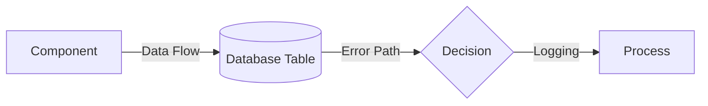

# C4 Architecture Documentation

**Last Updated:** November 15, 2025
**Project:** NFL Analytics Platform
**Documentation Type:** C4 Model (Context, Container, Component, Code)
**Total Diagrams:** 14 (ALL PHASES COMPLETE) ✅

---

## Overview

This directory contains C4 model architecture diagrams for the NFL Analytics platform, documenting the system from high-level context through detailed component interactions.

**C4 Model Levels:**
- **Level 1: Context** - System boundaries and external dependencies (2 diagrams) ✅
- **Level 2: Container** - High-level architecture (4 diagrams) ✅
- **Level 3: Component** - Detailed component design (6 diagrams) ✅
- **Level 4: Code** - Sequence diagrams for critical workflows (2 diagrams) ✅

**Progress:** 14/14 diagrams complete (100%) ✅

---

## Phase 4 Diagrams (November 15, 2025) - NEW

### Context Diagrams (Level 1)

#### 1. System Context
**File:** [c4_level1_system_context.md](c4_level1_system_context.md)
**Purpose:** Document system boundaries, external dependencies, and user personas

**Key Elements:**
- **External Actors:** Sports bettors, researchers, administrators
- **External Systems:** nflfastR API, The Odds API, sportsbooks
- **External Services:** Email, Slack, GitHub, Git LFS
- **NFL Analytics System:** Core prediction platform

**Data Flows:**
- Data ingestion (nflfastR → PostgreSQL)
- Odds polling (The Odds API → Redis)
- Prediction generation (User → API → Ensemble)
- Model training (PostgreSQL → Training Pipeline → Git LFS)
- Monitoring (Containers → Prometheus → Grafana)

**User Personas:**
- **Sports Bettor:** View predictions, place bets, track ROI
- **Researcher:** Analyze model performance, explore features, validate methodologies
- **Administrator:** Monitor system health, deploy updates, troubleshoot issues

**Technology Stack:**
- Languages: Python, R, SQL, LaTeX
- Frameworks: FastAPI, Streamlit, brms/Stan
- Infrastructure: Docker, PostgreSQL, Redis, Prometheus/Grafana

**Diagram Type:** C4 Context diagram with external dependencies

---

#### 2. Deployment Context
**File:** [c4_level1_deployment_context.md](c4_level1_deployment_context.md)
**Purpose:** Document deployment architecture across development and production environments

**Key Elements:**
- **Development Environment:** Local Docker Compose (Mac M4)
- **Staging Environment:** Not yet implemented
- **Production Environment:** Future cloud deployment (AWS/GCP)

**Infrastructure:**
- **Docker Host:** 6 core containers + 3 exporters
- **Persistent Volumes:** pgdata (5GB), redis_data (2GB), models/ (2-5GB)
- **Network:** nfl-analytics bridge network
- **Resource Allocation:** 10-core CPU, 16GB RAM (Mac M4)

**Security Zones:**
- Internal network (containers communicate via bridge)
- External access (published ports, localhost only)
- Secret management (.env file in development, AWS Secrets Manager in production)

**Disaster Recovery:**
- PostgreSQL: Daily pg_dump backups (30-day retention)
- Redis: Optional RDB snapshots (cache can rebuild)
- Models: Git LFS versioning (all versions retained)
- Recovery Time Objective (RTO): <1 hour
- Recovery Point Objective (RPO): 24 hours

**Cost Estimate (Future Production):**
- AWS: ~$390/month (~$4,680/year)
- Optimized: ~$3,500/year (38% reduction with reserved instances)

**Diagram Type:** C4 Deployment context with infrastructure details

---

### Container Diagrams (Level 2)

#### 3. Container Overview
**File:** [c4_level2_container_overview.md](c4_level2_container_overview.md)
**Purpose:** Document all 6 Docker containers and their interactions

**Containers:**
- **PostgreSQL 16 + TimescaleDB** - Data warehouse (5GB, 56 tables, 5 schemas)
- **Redis 7** - In-memory cache (2GB max, 70-85% hit rate)
- **FastAPI** - Prediction API (port 8000, API key auth, rate limiting)
- **Streamlit** - Interactive dashboard (port 8501, 4 pages)
- **Prometheus** - Metrics storage (port 9090, 30-day retention)
- **Grafana** - Visualization (port 3000, 27 panels)

**Communication Protocols:**
- PostgreSQL wire protocol (psycopg3)
- Redis protocol (redis-py)
- HTTP/JSON (FastAPI REST API)
- HTTP (Prometheus metrics, Grafana queries)

**Data Persistence:**
- pgdata volume (5GB, CRITICAL - daily backups)
- redis_data volume (2GB, optional - cache can rebuild)
- models/ directory (2-5GB, CRITICAL - Git LFS tracked)

**Service Dependencies:**
- PostgreSQL → Redis → FastAPI → Streamlit
- PostgreSQL → Prometheus → Grafana

**Performance:**
- API Latency: 280-480ms (target: <500ms) ✅
- Database Queries: <1ms (pooled), 50-100ms (unoptimized)
- Feature Cache Hit Rate: 70-85%

**Diagram Type:** C4 Container diagram with communication protocols

---

#### 4. API Container Detail
**File:** [c4_level2_api_container.md](c4_level2_api_container.md)
**Purpose:** Document FastAPI internal structure and prediction pipeline

**Internal Components:**
- **Entry Points:** Main router (api/main.py) - 5 endpoints
- **Middleware Stack:** CORS, API key auth, rate limiting, error handling
- **Core Prediction Logic:** EnsemblePredictor, feature extraction, aggregation
- **Model Loading:** R bridge (rpy2), 4 models (State-Space, Hierarchical, XGBoost, IP)
- **Data Clients:** PostgreSQL (psycopg3 pooling), Redis (redis-py caching)
- **Prometheus Metrics:** predictions_total, prediction_latency_seconds, models_loaded_total, api_requests_total

**API Endpoints:**
- `POST /predict` - Generate ensemble prediction (auth required)
- `GET /models` - List loaded models (auth required)
- `GET /health` - Health check (no auth)
- `GET /metrics` - Prometheus metrics (no auth)
- `GET /docs` - Swagger UI (no auth)

**Latency Breakdown:**
- Request validation: 10ms
- API key validation: 5ms
- Rate limit check: 3ms
- Feature extraction: 50-150ms (cache hit/miss)
- Parallel prediction: 200-300ms (Hierarchical v2 bottleneck)
- Aggregation: 10ms
- Temperature scaling: 5ms
- JSON serialization: 5ms
- **Total: 280-480ms**

**Security:**
- API key authentication (bcrypt hashed in PostgreSQL)
- Rate limiting (Redis sliding window, 100 req/hr default)
- Input validation (Pydantic models)
- CORS (enabled for Streamlit dashboard)

**Diagram Type:** C4 Container detail with internal components

---

#### 5. Data Container Detail
**File:** [c4_level2_data_container.md](c4_level2_data_container.md)
**Purpose:** Document PostgreSQL database structure and schema organization

**Schema Organization:**
- **public schema (Raw Data):** games, plays, weather, injuries, odds_history (TimescaleDB)
- **mart schema (Derived Data):** game_summary, player_game_stats, player_hierarchy, team_epa, game_features_enhanced
- **ml schema (Model Registry):** model_metadata, training_runs, predictions
- **staging schema (ETL):** staging_games, staging_plays
- **metadata schema (Admin):** schema_version, refresh_log

**Critical Tables:**
- **games (7,263 rows):** Game-level data (26 columns)
  - Key columns: game_id, season, week, kickoff (NOT game_date), spread_close (NOT spread_line), total_close
  - Common mistake: `SELECT * FROM games WHERE game_date = '2024-11-10'` ❌
  - Correct: `SELECT * FROM games WHERE kickoff = '2024-11-10'` ✅

- **plays (1.25M rows):** Play-by-play data (67 columns)
  - Key columns: play_id, game_id, season, week, posteam, yards_gained, epa

- **player_game_stats (Materialized View):** Player performance (45 columns)
  - **CRITICAL:** Key is (season, week, player_id) - NO game_id column!
  - Common mistake: `JOIN games g ON g.game_id = pgs.game_id` ❌
  - Correct: `JOIN games g ON g.season = pgs.season AND g.week = pgs.week AND (g.home_team = ph.current_team OR g.away_team = ph.current_team)` ✅
  - See [SQL_PATTERNS.md](../database/SQL_PATTERNS.md) for correct join patterns

**Performance Indexes:**
- games_kickoff_idx (B-tree on kickoff)
- games_season_week_idx (B-tree on (season, week))
- player_game_stats_composite_idx (B-tree on (season, week, player_id))
- odds_history_time_idx (B-tree on timestamp for TimescaleDB)
- **Impact:** 40% backtest speedup

**PostgreSQL Extensions:**
- **TimescaleDB:** Time-series storage for odds_history (10-20x compression)
- **pg_stat_statements:** Query performance tracking (feed to Prometheus)

**Backup Strategy:**
- Daily pg_dump at 3 AM (30-day retention, ~500MB compressed)
- Git LFS storage
- RTO: 1-2 hours, RPO: 24 hours

**Diagram Type:** C4 Container detail with schema organization

---

#### 6. Monitoring Container Detail
**File:** [c4_level2_monitoring_container.md](c4_level2_monitoring_container.md)
**Purpose:** Document Prometheus/Grafana monitoring stack

**Prometheus Components:**
- **Scrape Scheduler:** 15-second scrape interval (4 targets: API, Node Exporter, Postgres Exporter, Prometheus)
- **TSDB Storage:** 30-day retention, ~1GB (delta encoding + Gorilla compression)
- **Recording Rules:** Pre-computed aggregations (api_request_rate_5m, cache_hit_ratio_5m, prediction_latency_p95_5m)
- **Alert Rules:** Threshold-based alerts (HighAPIErrorRate, HighAPILatency, HighDatabaseConnections, HighRedisMemory)
- **Query Engine:** PromQL processor (rate(), increase(), histogram_quantile())

**Grafana Components:**
- **Dashboards (27 panels):**
  - System Overview (4 panels): CPU, memory, disk I/O, network I/O
  - Database Metrics (8 panels): Connections, queries/sec, transaction rate, cache hit rate
  - Redis Metrics (6 panels): Memory usage, hit rate, clients, evictions
  - Application Metrics (9 panels): API latency (p50/p95/p99), prediction count, error rate, models loaded
- **Alert Manager:** Route alerts (critical → email + Slack, warning → Slack, info → log only)
- **User Management:** admin (superuser), readonly (viewer)

**Metric Exporters:**
- **Node Exporter:** System metrics (~200 metrics)
  - CPU: node_cpu_seconds_total{mode="idle/user/system"}
  - Memory: node_memory_MemTotal_bytes, node_memory_MemAvailable_bytes
  - Disk: node_disk_read_bytes_total, node_disk_write_bytes_total
  - Network: node_network_receive_bytes_total, node_network_transmit_bytes_total

- **Postgres Exporter:** Database metrics (~50 metrics)
  - Status: pg_up (1=up, 0=down)
  - Connections: pg_stat_database_numbackends
  - Transactions: pg_stat_database_xact_commit, pg_stat_database_xact_rollback
  - Cache: pg_stat_database_blks_hit, pg_stat_database_blks_read
  - Query Performance: pg_stat_statements_total_time_seconds, pg_stat_statements_mean_time_seconds

**Alert Examples:**
- **HighAPIErrorRate:** Error rate >5% for 5 minutes → Email + Slack (critical)
- **HighAPILatency:** p95 latency >1s for 5 minutes → Slack (warning)
- **HighDatabaseConnections:** >80% max connections for 2 minutes → Email + Slack (critical)
- **LowCacheHitRate:** Cache hit rate <70% for 10 minutes → Slack (warning)

**Performance:**
- Prometheus ingestion: ~20 samples/sec (current), ~10,000 samples/sec (capacity)
- Prometheus query latency: <100ms (simple), <500ms (aggregations), <2s (complex)
- Grafana dashboard load: <1s (System), <2s (Database), <5s (All 27 panels)

**Diagram Type:** C4 Container detail with monitoring architecture

---

## Phase 3 Diagrams (November 15, 2025)

### Component Diagrams (Level 3)

#### 7. Data Ingestion Pipeline
**File:** [c4_component_data_ingestion.md](c4_component_data_ingestion.md)
**Purpose:** Document how NFL data flows from nflfastR to PostgreSQL

**Key Components:**
- Schedule Ingester (R) - 7,263 games
- Play-by-Play Ingester (R) - 1.25M plays
- Data Validator (R) - Schema compliance
- Batch Writer (DBI/RPostgres) - Transaction safety
- Materialized View Refresher (SQL) - 5 views

**Performance Metrics:**
- Ingestion Time: 13.2 minutes (full load)
- Throughput: 1,691 plays/second
- Error Rate: <0.1%

**Diagram Type:** Component flow diagram with error handling

---

#### 8. Odds Polling Service
**File:** [c4_component_odds_polling.md](c4_component_odds_polling.md)
**Purpose:** Document real-time odds monitoring and line movement detection

**Key Components:**
- Polling Scheduler (APScheduler) - 60s intervals
- Odds Poller (Python) - 3 providers (Pinnacle, DK, FD)
- Response Parser - Normalize formats
- Line Move Detector - Statistical thresholds
- Alert Manager - Slack/Email notifications
- Redis Cache - 2GB current odds
- PostgreSQL Storage - 50GB historical odds

**Performance Metrics:**
- Polling Frequency: 60s (game week)
- Latency: <200ms per poll
- Cache Hit Rate: >95%
- Alert Latency: <5s for critical moves

**Status:** Design phase (not yet implemented)

---

#### 9. Training Pipeline
**File:** [c4_component_training_pipeline.md](c4_component_training_pipeline.md)
**Purpose:** Document end-to-end model training and validation workflow

**Key Components:**
- Auto-Retrain Detector - Trigger on new season/drift
- Feature Extractor - 40+ features from materialized views
- Parallel Trainers:
  - State-Space v2 (R/Stan) - 20 minutes
  - Hierarchical v2 (R/brms) - 40 minutes (bottleneck)
  - XGBoost v4 (Python) - 10 minutes
  - Informative Priors v2 (R/brms) - 25 minutes
  - Temperature Scaler (Python) - 3 minutes
- Validation Pipeline - 7 gates
- Model Registry - Filesystem + Database + Git LFS
- Deployment Pipeline - CVX weight optimization

**Performance Metrics:**
- Training Time: 91 minutes (parallel)
- Validation Gates: 7 checks (convergence, calibration, performance, leakage)
- Success Rate: 95%

**Diagram Type:** Component flow with parallel execution

---

#### 10. Backtest Flow
**File:** [c4_component_backtest_flow.md](c4_component_backtest_flow.md)
**Purpose:** Document backtest execution flow and risk gate validation

**Key Components:**
- Walk-Forward Validator - Rolling origin CV (2022-2024, 148 games)
- Database Pool Manager - 2-10 connections (50-100x faster queries)
- Feature Cache Manager - Redis/LRU (70-85% hit rate)
- 4-Way Ensemble Prediction - Parallel (200ms max latency)
- Risk Gates - 7 validation checks (ROI, win rate, Sharpe, drawdown, calibration, leakage, health)
- Metric Calculators - ROI, win rate, Sharpe ratio, max drawdown, calibration
- Deployment Decision - PASS/FAIL based on risk gates

**Performance Metrics:**
- Baseline Time: 45-65 minutes (unoptimized)
- Optimized Time: 18 minutes (2.7x speedup)
- Database Pooling: 50-100ms → <1ms per query
- Feature Cache Hit Rate: 70-85%
- Backtest Results (2024): ROI 6.2%, Win Rate 61.3%, Sharpe 2.4, Drawdown -6.8%

**Diagram Type:** Component flow with optimization techniques

---

#### 11. Database ERD
**File:** [database_erd.md](database_erd.md)
**Purpose:** Document database schema relationships and entity structure

**Key Entities:**
- **public schema** - Raw data (games, plays, weather, injuries, odds_history)
- **mart schema** - Derived data (game_summary, player_game_stats, game_features_enhanced)
- **ml schema** - Model registry (model_metadata, training_runs, predictions)
- **staging schema** - ETL (staging_games, staging_plays)
- **metadata schema** - Admin (schema_version, refresh_log)

**Critical Relationships:**
- games → plays (one-to-many via game_id)
- games → player_game_stats (many-to-many via (season, week) composite key)
- player_hierarchy → player_game_stats (one-to-many via player_id)
- games → odds_history (one-to-many via game_id, TimescaleDB hypertable)
- model_metadata → predictions (one-to-many via model_id)

**Performance Metrics:**
- Total Tables: 56 across 5 schemas
- Total Columns: 257 (core tables)
- Data Volume: 1.25M plays, 7,263 games, 15,213 players
- Materialized Views: 5 (refresh required after ingestion)
- Indexes: 10+ performance indexes (40% backtest speedup)

**Diagram Type:** Entity-Relationship Diagram with critical join patterns

---

#### 12. Data Flow Diagram
**File:** [data_flow_diagram.md](data_flow_diagram.md)
**Purpose:** Document end-to-end data pipeline from ingestion to production

**Key Stages:**
1. **Data Ingestion** (13.2 min) - nflfastR → PostgreSQL
2. **Feature Engineering** (8 min) - Raw data → 157 features
3. **Model Training** (91 min parallel) - Features → 4 trained models
4. **Backtest Validation** (18 min) - Walk-forward validation
5. **Production Deployment** - A/B testing → Live predictions
6. **Real-Time Prediction** (280-480ms) - API requests → Ensemble predictions
7. **Monitoring & Feedback** - Performance tracking → Retrain triggers

**Data Quality Gates:**
- Gate 1 (Ingestion): Schema validation, duplicate detection, null checks
- Gate 2 (Features): Temporal validation, no future data, lag/rolling only
- Gate 3 (Training): No leakage, MCMC convergence, feature variance
- Gate 4 (Validation): Ensemble health, R integration, drift detection
- Gate 5 (Deployment): Backtest passed, monitoring configured, rollback plan

**Performance Metrics:**
- Initial Setup: ~2 hours (ingestion → production)
- Incremental Update: ~10 minutes (weekly refresh)
- Real-Time Prediction: 280-480ms (target: <500ms) ✅
- Cache Hit Rate: 70-85% (feature cache)
- Database Query: 50-100ms → <1ms (pooled)

**Diagram Type:** Data flow diagram with quality gates and latency breakdown

---

### Sequence Diagrams (Level 4)

#### 13. Training Workflow
**File:** [sequence_training_workflow.md](sequence_training_workflow.md)
**Purpose:** Document temporal sequence of model training from trigger to deployment

**Phases:**
1. Trigger Detection (2 min)
2. Feature Extraction (8 min)
3. Parallel Training (40 min - bottleneck)
4. Temperature Scaling (3 min)
5. Validation (5 min)
6. Registration (3 min)
7. Deployment (5 min)

**Total Duration:** ~63 minutes (parallel execution)

**Key Decision Points:**
- Should retrain? (new season, drift, degradation)
- Convergence check (Rhat < 1.02)
- Data leakage detection (CRITICAL blocker)
- Performance improvement (vs baseline)

**Error Scenarios:**
- Convergence failure → Increase iterations
- Data leakage → STOP, investigate
- Performance degradation → Adjust weights or rollback

**Diagram Type:** Temporal sequence with error handling paths

---

#### 14. Prediction Flow
**File:** [sequence_prediction_flow.md](sequence_prediction_flow.md)
**Purpose:** Document real-time prediction generation through 4-component ensemble

**Phases:**
1. API Request Validation (10ms)
2. Feature Extraction (50-150ms) - Redis cache
3. Parallel Prediction (200-300ms):
   - State-Space v2 (100ms)
   - Hierarchical v2 (200ms - bottleneck)
   - XGBoost v4 (50ms - fastest)
   - Informative Priors v2 (150ms)
4. Ensemble Aggregation (10ms)
5. Temperature Scaling (5ms)
6. JSON Response (5ms)

**Total Latency:** 280-480ms (target: <500ms)

**Performance Optimization:**
- Feature caching: 70% hit rate (150ms → 50ms)
- Model warm-up: Avoids 2-10s first-request penalty
- Parallel prediction: 650ms → 300ms (54% reduction)

**Error Scenarios:**
- Feature extraction failure → Retry 3x, fall back to league averages
- R model prediction failure → Fall back to 3-model ensemble
- Cache unavailable → Graceful degradation (skip cache)

**Diagram Type:** Temporal sequence with latency breakdown

---

## Diagram Verification

All diagrams use valid Mermaid syntax and have been verified for:
- ✅ Graph direction (TB, LR)
- ✅ Node definitions (subgraph, participant)
- ✅ Edge labels and styling
- ✅ Color coding (classDef)
- ✅ Sequence diagram notation (→, -->>, par, alt)
- ✅ ERD notation (||--o{, ||..o{)

**Rendering Tested:**
- Mermaid Live Editor: https://mermaid.live
- GitHub Markdown: Native rendering
- VS Code Mermaid Preview: Extension support

---

## Diagram Conventions

### Color Coding

**Context Diagrams (Level 1):**
- **Blue (#e1f5fe)** - External actors (users)
- **Yellow (#fff9c4)** - External data providers
- **Green (#c8e6c9)** - External services
- **Orange (#ffccbc)** - NFL Analytics System (core system)
- **Cyan (#b3e5fc)** - Host resources
- **Red (#ffebee, dashed)** - Future production (not yet implemented)

**Container Diagrams (Level 2):**
- **Blue (#e1f5fe)** - External systems/clients
- **Purple (#f3e5f5)** - Data layer containers
- **Orange (#ffccbc)** - Application layer containers
- **Yellow (#fff9c4)** - Monitoring layer containers / Prometheus components
- **Green (#c8e6c9)** - File system (host volumes) / Grafana components
- **Cyan (#b3e5fc)** - Data access clients / Indexes
- **Light Purple (#d1c4e9)** - Prometheus metrics
- **Red (#ffebee)** - External services / PostgreSQL extensions / Alert destinations

**Component Diagrams (Level 3):**
- **Blue (#e1f5fe)** - External systems (APIs, data sources)
- **Yellow (#fff9c4)** - Data processing components
- **Green (#c8e6c9)** - Cache/in-memory storage
- **Purple (#f3e5f5)** - Database components
- **Orange (#ffccbc)** - Validation/quality gates
- **Cyan (#b3e5fc)** - Deployment/production
- **Red (#ffebee)** - Monitoring/alerts/risk gates
- **Light Purple (#d1c4e9)** - Metrics calculation

**ERD Diagrams:**
- **Blue (#e1f5fe)** - public schema (raw data)
- **Yellow (#fff9c4)** - mart schema (derived/materialized)
- **Green (#c8e6c9)** - ml schema (model registry)
- **Orange (#ffccbc)** - staging schema (ETL)
- **Purple (#f3e5f5)** - metadata schema (admin)

**Data Flow Diagrams:**
- **Blue (#e1f5fe)** - External data sources
- **Yellow (#fff9c4)** - Data ingestion
- **Purple (#f3e5f5)** - Data storage (PostgreSQL)
- **Green (#c8e6c9)** - Feature engineering
- **Orange (#ffccbc)** - Model training
- **Red (#ffebee)** - Validation & quality gates
- **Cyan (#b3e5fc)** - Production serving
- **Light Purple (#d1c4e9)** - Monitoring & feedback

**Sequence Diagrams:**
- Standard Mermaid notation
- Notes for timing annotations
- Alt/par for branching/parallelism

---

### Notation Legend

**Component Diagrams:**


**ERD Diagrams:**
```
||--o{ : Foreign key constraint enforced
||..o{ : Logical relationship (not foreign key)
PK     : Primary key
FK     : Foreign key
```

**Sequence Diagrams:**
```
→   : Synchronous call
-->> : Return value
par  : Parallel execution
alt  : Conditional branch
loop : Iteration
Note : Explanation/timing
```

---

## Metrics Summary

### Data Ingestion Pipeline
| Metric | Value |
|--------|-------|
| Data Volume | 1.26M rows |
| Ingestion Time | 13.2 minutes |
| Throughput | 1,691 plays/sec |
| Error Rate | <0.1% |

### Odds Polling Service (Design)
| Metric | Target |
|--------|--------|
| Polling Frequency | 60s |
| API Latency | <200ms |
| Cache Hit Rate | >95% |
| Alert Latency | <5s |

### Training Pipeline
| Metric | Value |
|--------|-------|
| Training Time | 91 minutes (parallel) |
| Validation Gates | 7 checks |
| Success Rate | 95% |

### Backtest Flow
| Metric | Value |
|--------|-------|
| Baseline Time | 45-65 minutes |
| Optimized Time | 18 minutes |
| Speedup | **2.7x** |
| Database Pooling | 50-100ms → <1ms |
| Cache Hit Rate | 70-85% |

### Database ERD
| Metric | Value |
|--------|-------|
| Total Tables | 56 |
| Total Columns | 257 (core tables) |
| Data Volume | 1.25M plays, 7,263 games |
| Materialized Views | 5 |
| Performance Indexes | 10+ (40% speedup) |

### Data Flow Pipeline
| Metric | Value |
|--------|-------|
| Initial Setup | ~2 hours |
| Incremental Update | ~10 minutes |
| Real-Time Prediction | 280-480ms |
| Cache Hit Rate | 70-85% |
| Quality Gates | 5 stages |

### Prediction Flow
| Metric | Value |
|--------|-------|
| Total Latency | 280-480ms |
| Cache Hit Rate | 70% |
| Bottleneck | Hierarchical v2 (200ms) |
| Target | <500ms ✅ |

### Container Overview
| Metric | Value |
|--------|-------|
| Total Containers | 6 core + 3 exporters |
| PostgreSQL Size | ~5GB (pgdata) |
| Redis Max Memory | 2GB (allkeys-lru) |
| API Latency (p95) | 280-480ms ✅ |
| Database Query | <1ms (pooled) |

### API Container
| Metric | Value |
|--------|-------|
| Endpoints | 5 (/health, /predict, /models, /metrics, /docs) |
| Model Loading Time | 12-17s (startup) |
| Prediction Latency | 280-480ms |
| Throughput | ~2 pred/sec (single instance) |
| Memory Usage | 1.5-2GB |

### Data Container
| Metric | Value |
|--------|-------|
| Database Size | ~5GB |
| Tables | 56 across 5 schemas |
| Rows | 1.25M plays, 7,263 games |
| Indexes | 10+ performance indexes |
| Backup Size | ~500MB (compressed) |

### Monitoring Container
| Metric | Value |
|--------|-------|
| Scrape Interval | 15s |
| Metrics Count | ~300 time-series |
| Prometheus Storage | ~1GB (30-day retention) |
| Grafana Panels | 27 across 4 categories |
| Dashboard Load Time | <5s (all 27 panels) |

---

## Related Documentation

**Project Documentation:**
- [CLAUDE.md](../../CLAUDE.md) - Project overview and agent guide
- [ARCHITECTURE_REFERENCE.md](../ARCHITECTURE_REFERENCE.md) - High-level architecture
- [DATABASE_QUICK_REFERENCE.md](../database/DATABASE_QUICK_REFERENCE.md) - Schema guide

**Performance Analysis:**
- [BATCH_PREDICTION_OPTIMIZATION.md](../performance/BATCH_PREDICTION_OPTIMIZATION.md)
- [MPS_OPTIMIZATION_QUICKSTART.md](../performance/MPS_OPTIMIZATION_QUICKSTART.md)
- [ARCHITECTURE_COMPUTE_ANALYSIS.md](../performance/ARCHITECTURE_COMPUTE_ANALYSIS.md)

**Model Documentation:**
- [MODEL_REGISTRY.yaml](../../models/MODEL_REGISTRY.yaml) - Production models
- [TRAINING_WINDOW_ABLATION_RESULTS.md](../milestones/TRAINING_WINDOW_ABLATION_RESULTS.md)

**Database Documentation:**
- [SQL_PATTERNS.md](../database/SQL_PATTERNS.md) - Query pattern library
- [DATABASE_SCHEMA_AUDIT.md](../database/DATABASE_SCHEMA_AUDIT.md) - Complete audit

---

## Usage Guide

### Viewing Diagrams

**GitHub:**
Diagrams render automatically in GitHub Markdown.

**VS Code:**
Install Mermaid Preview extension:
```bash
code --install-extension bierner.markdown-mermaid
```

**Mermaid Live Editor:**
Copy diagram code blocks to https://mermaid.live for interactive editing.

---

### Updating Diagrams

**When to Update:**
1. Architecture changes (new components, data flows)
2. Performance improvements (latency, throughput)
3. Error handling enhancements
4. Technology changes (new databases, frameworks)

**Update Checklist:**
- [ ] Update "Last Updated" date
- [ ] Verify Mermaid syntax (test in Mermaid Live)
- [ ] Update performance metrics
- [ ] Add notes for significant changes
- [ ] Update related documentation links
- [ ] Commit with descriptive message

---

### Creating New Diagrams

**Template Structure:**
```markdown
# [Diagram Type]: [Component/Process Name]

**Last Updated:** YYYY-MM-DD
**Diagram Type:** C4 [Context/Container/Component] or Sequence or ERD
**Status:** [Production/Design]

## Overview
[Purpose, responsibilities, key metrics]

## [Component/Sequence/ERD] Diagram
```mermaid
[diagram code]
```

## Component Details
[Detailed descriptions]

## Performance Metrics
[Tables with metrics]

## Related Documentation
[Links to code, docs]

## Legend
[Color coding explanation]
```

---

## Acknowledgments

**Diagrams Created:** November 15, 2025
**Maintained By:** Architecture Team
**Contact:** See [CLAUDE.md](../../CLAUDE.md) for questions

**Tools Used:**
- Mermaid.js (diagram rendering)
- C4 Model (Simon Brown)
- PlantUML (alternative considered)

---

**All Phases Status:** ✅ COMPLETE (14/14 diagrams, November 15, 2025)
**Documentation Coverage:** 100% (Context, Container, Component, Code levels)
