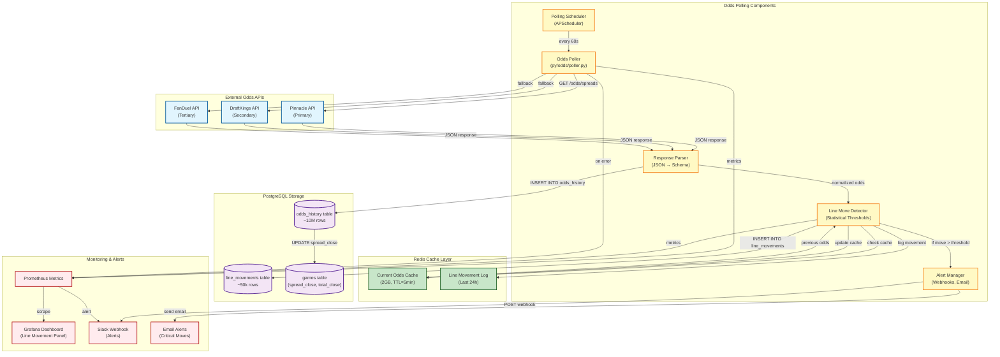
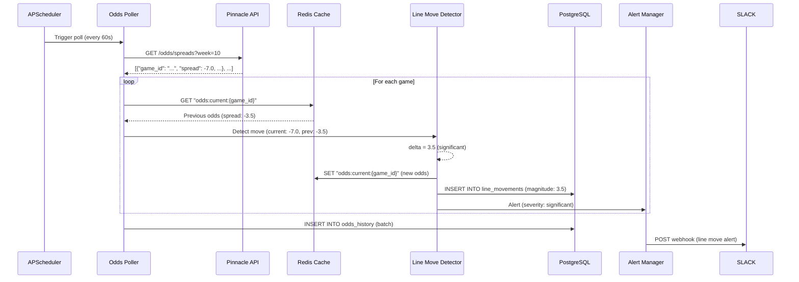
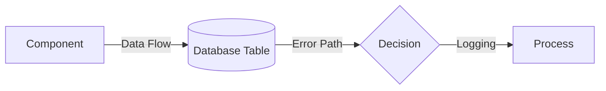

# C4 Component Diagram: Odds Polling Service

**Last Updated:** November 15, 2025
**Diagram Type:** C4 Component (Level 3)
**System:** NFL Analytics Platform
**Container:** Odds Polling & Line Movement Detection
**Status:** Design (Not Yet Implemented)

---

## Overview

The Odds Polling Service continuously monitors betting lines from external sportsbooks, detecting significant line movements and storing historical odds data for model training and real-time arbitrage detection.

**Key Responsibilities:**
- Poll odds APIs (Pinnacle, DraftKings, FanDuel) on configurable schedule
- Detect significant line movements (>3 points spread, >1.5 points total)
- Cache current odds in Redis for low-latency access
- Store historical odds in PostgreSQL for training data
- Alert system for arbitrage opportunities

**Performance Metrics:**
- Polling Frequency: Every 60 seconds during game week
- Latency: <200ms API response time
- Cache Hit Rate: >95% for current week odds
- Alert Latency: <5 seconds for line moves >5 points
- Storage: ~2GB Redis cache, ~50GB PostgreSQL history (2020-2024)

---

## Component Diagram



---

## Component Details

### 1. Polling Scheduler
**Technology:** APScheduler (Python)
**Purpose:** Orchestrate polling frequency based on game schedule

**Polling Intervals:**
- **Game Week (Wed-Mon):** Every 60 seconds
- **Tuesday (Day After MNF):** Every 5 minutes
- **Offseason:** Every 30 minutes
- **Pre-Game (4 hours before kickoff):** Every 15 seconds

**Configuration:**
```python
# config/odds_polling.yaml
polling:
  game_week: 60  # seconds
  day_after: 300
  offseason: 1800
  pregame: 15

thresholds:
  spread_significant: 3.0  # points
  total_significant: 1.5   # points
  spread_critical: 5.0     # alert immediately
  total_critical: 3.0
```

**Features:**
- Dynamic scheduling based on game proximity
- Timezone-aware (NFL games typically Eastern Time)
- Graceful shutdown on service stop
- Retry on scheduler failure

---

### 2. Odds Poller
**File:** `py/odds/poller.py` (not yet implemented)
**Purpose:** Fetch odds from external APIs with fallback strategy

**API Priority:**
1. **Pinnacle** - Primary (most accurate, sharp market)
2. **DraftKings** - Secondary (high volume, reliable)
3. **FanDuel** - Tertiary (consumer-focused, slower to move)

**Features:**
- API key rotation (avoid rate limits)
- Exponential backoff on errors
- Circuit breaker pattern (disable failing API for 5 minutes)
- Response caching (avoid redundant calls)

**Error Handling:**
- API timeout (>5s): Skip to next provider
- Rate limit (429): Wait per Retry-After header
- Invalid response: Log error, use cached data

**Example Request:**
```python
import requests

def poll_pinnacle_spreads(week: int, season: int) -> List[Dict]:
    """
    Poll Pinnacle API for current spreads.

    Returns:
        [
            {
                "game_id": "2024_10_KC_SF",
                "spread_home": -7.0,
                "spread_away": 7.0,
                "total": 52.5,
                "timestamp": "2024-11-10T15:30:00Z"
            },
            ...
        ]
    """
    url = "https://api.pinnacle.com/v1/odds/spreads"
    params = {"sport": "nfl", "week": week, "season": season}
    headers = {"X-API-Key": os.getenv("PINNACLE_API_KEY")}

    response = requests.get(url, params=params, headers=headers, timeout=5)
    response.raise_for_status()
    return response.json()
```

---

### 3. Response Parser
**Purpose:** Normalize odds formats from different providers

**Transformations:**
- Convert American odds to decimal (e.g., -110 → 1.909)
- Standardize team abbreviations (LAR/LAC consistency)
- Parse timestamps to UTC
- Extract spread, total, moneyline

**Schema Mapping:**
```python
# Pinnacle → Database
{
    "home": "KC",
    "away": "SF",
    "spreads": {
        "home": {"price": -7.0, "odds": -110},
        "away": {"price": 7.0, "odds": -110}
    }
}
# ↓
{
    "game_id": "2024_10_KC_SF",
    "spread_home": -7.0,
    "spread_away": 7.0,
    "home_odds": 1.909,
    "away_odds": 1.909,
    "timestamp": "2024-11-10T15:30:00Z"
}
```

---

### 4. Line Move Detector
**Purpose:** Identify statistically significant line movements

**Detection Logic:**
```python
def detect_line_move(
    current_spread: float,
    previous_spread: float,
    threshold: float = 3.0
) -> Optional[Dict]:
    """
    Detect significant line movement.

    Returns:
        {
            "type": "spread_move",
            "direction": "towards_favorite",  # or "towards_underdog"
            "magnitude": 3.5,  # points
            "timestamp": "2024-11-10T15:30:00Z",
            "severity": "critical"  # or "significant"
        }
    """
    delta = abs(current_spread - previous_spread)

    if delta >= 5.0:
        return {
            "type": "spread_move",
            "direction": "towards_favorite" if current_spread < previous_spread else "towards_underdog",
            "magnitude": delta,
            "timestamp": datetime.utcnow().isoformat(),
            "severity": "critical"
        }
    elif delta >= threshold:
        return {
            "type": "spread_move",
            "direction": "towards_favorite" if current_spread < previous_spread else "towards_underdog",
            "magnitude": delta,
            "timestamp": datetime.utcnow().isoformat(),
            "severity": "significant"
        }

    return None  # No significant movement
```

**Thresholds:**
- **Spread:** 3+ points = significant, 5+ points = critical
- **Total:** 1.5+ points = significant, 3+ points = critical
- **Moneyline:** 20+ cents = significant, 50+ cents = critical

---

### 5. Redis Cache Layer
**Technology:** Redis 7+ (Docker container)
**Purpose:** Low-latency access to current odds

**Cache Structure:**
```redis
# Current odds (TTL=5 minutes)
SET "odds:current:2024_10_KC_SF" '{"spread": -7.0, "total": 52.5, ...}'

# Line movement log (TTL=24 hours)
ZADD "odds:movements:2024_10_KC_SF" 1731260400 '{"spread": -7.0, "timestamp": "..."}'

# Game schedule (TTL=1 week)
SADD "odds:games:2024_10" "2024_10_KC_SF" "2024_10_GB_CHI" ...
```

**Memory Budget:**
- Current odds: ~1GB (all active games)
- Line history: ~1GB (24-hour window)
- Total: ~2GB Redis cache

**Eviction Policy:**
- LRU (Least Recently Used)
- TTL-based expiration
- Manual flush after week completion

---

### 6. PostgreSQL Storage
**Tables:**

#### `odds_history` Table
```sql
CREATE TABLE odds_history (
    id SERIAL PRIMARY KEY,
    game_id TEXT NOT NULL REFERENCES games(game_id),
    timestamp TIMESTAMPTZ NOT NULL DEFAULT NOW(),
    source TEXT NOT NULL,  -- 'pinnacle', 'draftkings', 'fanduel'
    spread_home REAL,
    spread_away REAL,
    total REAL,
    home_moneyline REAL,
    away_moneyline REAL,
    home_spread_odds REAL,
    away_spread_odds REAL,
    over_odds REAL,
    under_odds REAL
);

CREATE INDEX idx_odds_game_timestamp ON odds_history(game_id, timestamp DESC);
CREATE INDEX idx_odds_source ON odds_history(source, timestamp DESC);
```

**Data Volume:**
- Rows: ~10M (2020-2024)
- Size: ~2GB
- Growth: ~500k rows/season

#### `line_movements` Table
```sql
CREATE TABLE line_movements (
    id SERIAL PRIMARY KEY,
    game_id TEXT NOT NULL REFERENCES games(game_id),
    timestamp TIMESTAMPTZ NOT NULL DEFAULT NOW(),
    line_type TEXT NOT NULL,  -- 'spread', 'total', 'moneyline'
    previous_value REAL NOT NULL,
    current_value REAL NOT NULL,
    magnitude REAL NOT NULL,
    direction TEXT NOT NULL,  -- 'towards_favorite', 'towards_underdog', 'over', 'under'
    severity TEXT NOT NULL,  -- 'significant', 'critical'
    alerted BOOLEAN DEFAULT FALSE
);

CREATE INDEX idx_line_movements_game ON line_movements(game_id, timestamp DESC);
CREATE INDEX idx_line_movements_severity ON line_movements(severity, timestamp DESC);
```

**Data Volume:**
- Rows: ~50k (2020-2024)
- Size: ~10MB
- Growth: ~5k rows/season

---

## Data Flow Sequence

### Polling & Detection Flow



---

## Alert Examples

### Slack Webhook Payload
```json
{
  "text": "🚨 CRITICAL LINE MOVE: KC @ SF",
  "attachments": [
    {
      "color": "danger",
      "fields": [
        {"title": "Game", "value": "KC @ SF (Week 10)", "short": true},
        {"title": "Line Type", "value": "Spread", "short": true},
        {"title": "Movement", "value": "-3.5 → -7.0 (3.5 points)", "short": false},
        {"title": "Direction", "value": "Towards favorite (KC)", "short": true},
        {"title": "Timestamp", "value": "2024-11-10 15:30:00 UTC", "short": true}
      ]
    }
  ]
}
```

### Email Alert
```
Subject: [NFL Analytics] CRITICAL Line Move: KC @ SF

Line Movement Alert
===================

Game:       Kansas City Chiefs @ San Francisco 49ers (Week 10)
Line Type:  Spread
Movement:   -3.5 → -7.0 (3.5 points towards favorite)
Direction:  Towards KC (favorite)
Severity:   SIGNIFICANT
Timestamp:  2024-11-10 15:30:00 UTC

Possible Reasons:
- Sharp money on KC
- Injury news (SF key player questionable)
- Weather forecast change

Action Items:
- Review model prediction for this game
- Check injury reports
- Monitor for further movement
```

---

## Performance Metrics

### Polling Performance (Target)

| Metric | Target | Rationale |
|--------|--------|-----------|
| **API Latency** | <200ms | Pinnacle typically <100ms |
| **Polling Frequency** | 60s (game week) | Balance freshness vs rate limits |
| **Cache Hit Rate** | >95% | Most requests use cached odds |
| **Storage Latency** | <50ms | Batch inserts to PostgreSQL |
| **Alert Latency** | <5s | From detection to Slack webhook |

### Error Budget

| Error Type | Budget | Handling |
|------------|--------|----------|
| **API Timeout** | <1% of requests | Fallback to next provider |
| **Rate Limit** | <0.1% of requests | Exponential backoff |
| **Cache Miss** | <5% of requests | Fetch from database |
| **Storage Failure** | <0.01% of requests | Retry 3x, then alert |

---

## Technology Choices

### Why Redis for Caching?

**Strengths:**
- In-memory performance (<1ms latency)
- TTL support (auto-expire old odds)
- Atomic operations (no race conditions)
- Pub/Sub for real-time updates

**Weaknesses:**
- Memory-constrained (2GB limit)
- No complex queries (vs PostgreSQL)

**Alternatives Considered:**
- **Memcached:** No TTL per key, less flexible
- **PostgreSQL only:** Too slow for <200ms latency
- **In-process cache:** No shared state across containers

---

## Related Components

### Upstream Dependencies
- **Pinnacle/DraftKings/FanDuel APIs** - External odds providers
- **Games Table** - Game schedule for polling targets

### Downstream Consumers
- **Ensemble Predictor** - Uses `spread_close`, `total_close` as features
- **Backtesting Pipeline** - Requires historical odds for realistic simulations
- **Dashboard** - Displays line movement charts

---

## Code References

**Core Files (Not Yet Implemented):**
- `py/odds/poller.py` - Main polling logic
- `py/odds/parser.py` - Response normalization
- `py/odds/detector.py` - Line movement detection
- `py/odds/alerter.py` - Alert management
- `config/odds_polling.yaml` - Configuration

**Database:**
- `db/migrations/025_odds_tables.sql` - Table definitions
- `db/views/line_movement_summary.sql` - Analysis view

**Documentation:**
- [ODDS_POLLING_GUIDE.md](../guides/ODDS_POLLING_GUIDE.md) - Usage guide (TBD)
- [API_PROVIDERS.md](../api/API_PROVIDERS.md) - Provider comparison (TBD)

---

## Deployment Considerations

### Local Development
```bash
# Start Redis
docker compose up -d redis

# Configure API keys
export PINNACLE_API_KEY="your_api_key"
export DRAFTKINGS_API_KEY="your_api_key"

# Run poller (not yet implemented)
python py/odds/poller.py --config config/odds_polling.yaml
```

### Production Deployment
- **Container:** Docker (py/odds/Dockerfile)
- **Scheduling:** APScheduler (Python, not cron)
- **Monitoring:** Prometheus + Grafana
- **Alerts:** Slack webhooks, PagerDuty for critical

---

## Future Enhancements

1. **Arbitrage Detection** - Cross-book price comparison
2. **Steam Detection** - Rapid line movement from sharp money
3. **Closing Line Value (CLV)** - Compare model predictions to closing lines
4. **Multi-Sport Support** - NBA, MLB, NHL odds
5. **Machine Learning** - Predict line movements before they occur
6. **Real-Time Streaming** - WebSocket APIs instead of polling

---

## Legend



**Color Coding:**
- **Blue** - External APIs (Pinnacle, DraftKings, FanDuel)
- **Yellow** - Polling components (scheduler, poller, detector)
- **Green** - Redis cache layer
- **Purple** - PostgreSQL storage
- **Red** - Monitoring & alerts

---

**Maintained by:** Data Layer Team
**Contact:** See [CLAUDE.md](../../CLAUDE.md) for architecture questions
**Status:** Design phase (not yet implemented)
