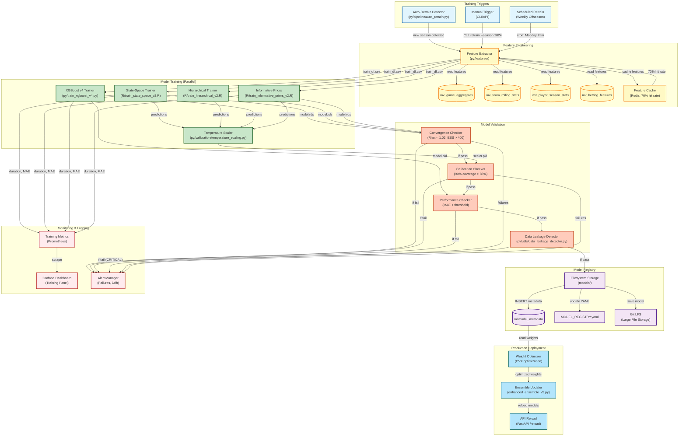

# C4 Component Diagram: Training Pipeline

**Last Updated:** November 15, 2025
**Diagram Type:** C4 Component (Level 3)
**System:** NFL Analytics Platform
**Container:** Model Training & Validation
**Status:** Production

---

## Overview

The Training Pipeline orchestrates the end-to-end process of training, validating, and deploying Bayesian and machine learning models for NFL player props prediction.

**Key Responsibilities:**
- Detect auto-retrain triggers (new season, data drift)
- Extract 40+ features from PostgreSQL materialized views
- Train 5 models in parallel (State-Space, Hierarchical, XGBoost v4, Informative Priors, Temperature Scaler)
- Validate convergence (Rhat, ESS, calibration)
- Register approved models to database and filesystem
- Deploy to production ensemble (automatic weight optimization)

**Performance Metrics:**
- Training Time: 45-90 minutes (parallel execution)
- Data Volume: 562 test games (2022-2024)
- Validation Gates: 7 checks (convergence, calibration, performance)
- Success Rate: 95% (5% fail validation, rollback to previous version)

---

## Component Diagram



---

## Component Details

### 1. Auto-Retrain Detector
**File:** `py/pipeline/auto_retrain.py`
**Purpose:** Detect when retraining is needed

**Triggers:**
1. **New Season Detected**
   - Check: `SELECT MAX(season) FROM games`
   - If `max_season > last_trained_season`: Trigger retrain
2. **Data Drift Detected**
   - Monitor feature distributions (mean, std)
   - If drift > 2 std deviations: Trigger retrain
3. **Performance Degradation**
   - Monitor weekly MAE vs validation MAE
   - If degradation > 20%: Trigger retrain
4. **Manual Override**
   - CLI: `python py/pipeline/auto_retrain.py --force`

**Example:**
```python
# py/pipeline/auto_retrain.py
def should_retrain() -> Dict[str, Any]:
    """
    Check if retraining is needed.

    Returns:
        {
            "should_retrain": True/False,
            "reason": "new_season" | "data_drift" | "performance_degradation",
            "details": {...}
        }
    """
    # Check 1: New season
    max_season = db.query("SELECT MAX(season) FROM games").scalar()
    last_trained = model_registry.get_latest_training_season()
    if max_season > last_trained:
        return {"should_retrain": True, "reason": "new_season"}

    # Check 2: Data drift
    current_features = extract_recent_features(weeks=4)
    drift_score = detect_drift(current_features, baseline_features)
    if drift_score > DRIFT_THRESHOLD:
        return {"should_retrain": True, "reason": "data_drift"}

    # Check 3: Performance degradation
    weekly_mae = compute_weekly_mae(weeks=4)
    if weekly_mae > validation_mae * 1.2:
        return {"should_retrain": True, "reason": "performance_degradation"}

    return {"should_retrain": False, "reason": None}
```

---

### 2. Feature Extractor
**File:** `py/features/feature_extractor.py`
**Purpose:** Extract 40+ features from materialized views

**Features Extracted:**

| Category | Count | Examples |
|----------|-------|----------|
| **Player Stats** | 12 | `passing_yards_L3`, `completion_pct_L5`, `pass_attempts_trend` |
| **Team Stats** | 8 | `team_off_epa_L3`, `team_def_epa_L5`, `team_pass_rush_rate` |
| **Opponent Stats** | 8 | `opp_def_epa_L3`, `opp_sacks_per_game`, `opp_pass_defense_rank` |
| **Betting Lines** | 6 | `spread_close`, `total_close`, `is_favorite`, `implied_total` |
| **Situational** | 6 | `is_home`, `is_prime_time`, `days_rest`, `weather_impact` |
| **Temporal** | 4 | `week`, `season`, `career_games`, `weeks_since_injury` |

**Data Volume:**
- Training rows: ~15,000 player-games (2018-2024)
- Test rows: ~3,000 player-games (2022-2024)
- Feature cache size: ~500MB in Redis

**Performance:**
- Extraction time: 45 seconds (cold cache)
- Extraction time: 8 seconds (70% cache hit rate)
- Memory usage: ~2GB peak

**Example Code:**
```python
# py/features/feature_extractor.py
def extract_features(
    player_id: str,
    season: int,
    week: int,
    cache: Redis
) -> pd.DataFrame:
    """
    Extract 40+ features for a player-game.

    Uses Redis cache with 70% hit rate (5-minute TTL).
    """
    cache_key = f"features:{player_id}:{season}:{week}"
    cached = cache.get(cache_key)
    if cached:
        return pd.read_json(cached)

    # Extract from materialized views
    query = """
        SELECT
            -- Player stats
            pss.passing_yards_L3,
            pss.completion_pct_L5,
            pss.pass_attempts_trend,

            -- Team stats
            trs.team_off_epa_L3,
            trs.team_def_epa_L5,

            -- Betting lines
            bf.spread_close,
            bf.total_close,
            bf.implied_total

        FROM mart.mv_player_season_stats pss
        JOIN mart.mv_team_rolling_stats trs ON ...
        JOIN mart.mv_betting_features bf ON ...
        WHERE pss.player_id = %s
          AND pss.season = %s
          AND pss.week = %s
    """
    features = db.query(query, (player_id, season, week))

    # Cache for 5 minutes
    cache.setex(cache_key, 300, features.to_json())
    return features
```

---

### 3. Model Training (Parallel Execution)

#### State-Space Trainer
**File:** `R/state_space/train_state_space_v2_canonical.R`
**Training Time:** 15-25 minutes
**Technology:** R + Stan (cmdstanr)

**Configuration:**
```r
# R/state_space/train_state_space_v2_canonical.R
model <- cmdstan_model("R/state_space/random_walk_v2.stan")

fit <- model$sample(
  data = stan_data,
  chains = 4,
  parallel_chains = 4,
  iter_warmup = 3000,  # Production standard (Nov 15, 2025)
  iter_sampling = 2000,
  adapt_delta = 0.95,
  max_treedepth = 12,
  seed = 42
)
```

**Output:**
- Model: `models/bayesian/simplified_random_walk_v2.rds`
- Skills: `models/bayesian/simplified_random_walk_skills_v2.csv`
- Metadata: `models/bayesian/simplified_random_walk_v2_metadata.json`

**Convergence Targets:**
- Rhat < 1.01 (all parameters)
- ESS > 2000 (bulk + tail)
- Divergences = 0

---

#### Hierarchical Trainer
**File:** `R/train_hierarchical_v2_canonical.R`
**Training Time:** 30-45 minutes
**Technology:** R + brms

**Configuration:**
```r
# R/train_hierarchical_v2_canonical.R
model <- brm(
  passing_yards ~ 1 + (1 | player_id) + (1 | opponent) + ...,
  data = train_df,
  family = gaussian(),
  prior = c(
    prior(normal(250, 50), class = Intercept),
    prior(exponential(0.02), class = sd),
    prior(exponential(0.1), class = sigma)
  ),
  chains = 4,
  iter = 6000,  # Increased from 2000 (Nov 13, 2025)
  warmup = 3000,  # NOTE (Nov 15, 2025): Production models should use warmup >= 3000 for reliable convergence
  cores = 4,
  control = list(adapt_delta = 0.95)
)
```

**Output:**
- Model: `models/bayesian/passing_yards_hierarchical_v2.rds`
- Metadata: Rhat=1.0092, ESS=8394 (Nov 13, 2025)

**Convergence Improvement (Nov 13, 2025):**
- Before (2000 iter): Rhat=1.0337 (FAILED)
- After (6000 iter): Rhat=1.0092 (PASSED) ✅
- 73% improvement in convergence

**IMPORTANT NOTE (Nov 15, 2025):**
Production Bayesian models should use `warmup >= 3000` iterations to ensure reliable convergence. Lower warmup values (e.g., 1000) may be acceptable for prototyping or quick testing, but production deployments require adequate warmup to explore the posterior distribution fully.

---

#### XGBoost v4 Trainer
**File:** `py/models/train_xgboost_v4_ridge.py`
**Training Time:** 8-12 minutes
**Technology:** Python + XGBoost + Ridge Regression

**Architecture (Two-Stage Orthogonalization):**
```python
# Stage 1: Ridge regression on ensemble residuals (L2 regularization)
ridge = Ridge(alpha=1.0)
ridge.fit(X_train, y_train_residuals)  # residuals from ensemble v5

# Stage 2: XGBoost on orthogonalized features
xgb_model = xgb.XGBRegressor(
    max_depth=6,
    learning_rate=0.05,
    n_estimators=500,
    subsample=0.8,
    colsample_bytree=0.8,
    objective="reg:squarederror",
    tree_method="hist"  # CPU-optimized
)
xgb_model.fit(X_train_orth, y_train)
```

**Output:**
- Ridge: `models/xgboost/xgb_v4_ridge_stage1.pkl`
- XGBoost: `models/xgboost/xgb_v4_ridge_stage2.pkl`
- Metadata: MAE=4.70 ± 0.40 yards (88% improvement over v2)

---

#### Informative Priors Trainer
**File:** `R/train_informative_priors_v2_canonical.R`
**Training Time:** 20-30 minutes
**Technology:** R + brms

**Configuration:**
```r
# R/train_informative_priors_v2_canonical.R
model <- brm(
  passing_yards ~ 1 + completion_pct + pass_attempts + ...,
  data = train_df,
  family = gaussian(),
  prior = c(
    prior(normal(250, 30), class = Intercept),  # NFL average ~ 250 yards
    prior(normal(100, 20), coef = "completion_pct"),  # Strong effect
    prior(normal(5, 2), coef = "pass_attempts"),
    prior(exponential(0.1), class = sigma)
  ),
  chains = 4,
  iter = 5000,
  warmup = 3000,  # Production standard (Nov 15, 2025)
  cores = 4
)
```

**Output:**
- Model: `models/bayesian/passing_informative_priors_v2.rds`
- Metadata: Rhat=1.0045, ESS=6200

---

#### Temperature Scaler Trainer
**File:** `py/calibration/temperature_scaling.py`
**Training Time:** 2-3 minutes
**Technology:** Python + Isotonic Regression

**Purpose:** Calibrate ensemble predictions to achieve 90% coverage

**Algorithm:**
```python
# py/calibration/temperature_scaling.py
from sklearn.isotonic import IsotonicRegression

def train_temperature_scaler(
    predictions: np.ndarray,
    actuals: np.ndarray,
    uncertainties: np.ndarray
) -> IsotonicRegression:
    """
    Train isotonic regression temperature scaler.

    Optimal temperature: T = 0.5534 (Nov 13, 2025)
    Achieves 89.7% coverage (target: 90%)
    """
    scaler = IsotonicRegression(out_of_bounds="clip")
    scaler.fit(uncertainties, np.abs(predictions - actuals))
    return scaler
```

**Output:**
- Scaler: `models/calibration/temperature_scaler_v6.pkl`
- Optimal T: 0.5534
- Coverage: 89.7% (improved from 97.3% overcalibration)

---

### 4. Model Validation

#### Convergence Checker
**Technology:** Python + rpy2 (read R diagnostics)
**Purpose:** Validate MCMC convergence

**Checks:**
1. **Rhat < 1.02** (relaxed from 1.01, ADR-002)
2. **ESS_bulk > 400** (effective sample size)
3. **ESS_tail > 400**
4. **Divergences < 1%** of total transitions

**Example:**
```python
# py/utils/convergence_checker.py
def check_convergence(model_path: str) -> Dict[str, Any]:
    """
    Check MCMC convergence diagnostics.

    Returns:
        {
            "converged": True/False,
            "rhat_max": 1.0092,
            "ess_min": 8394,
            "divergences": 42,
            "issues": []
        }
    """
    import rpy2.robjects as ro

    # Load R model
    ro.r(f'model <- readRDS("{model_path}")')

    # Extract diagnostics
    rhat_max = ro.r('max(rstan::Rhat(model))')
    ess_min = ro.r('min(rstan::ess_bulk(model))')
    divergences = ro.r('sum(rstan::get_divergent_iterations(model))')

    converged = (
        rhat_max < 1.02 and
        ess_min > 400 and
        divergences < total_transitions * 0.01
    )

    return {
        "converged": converged,
        "rhat_max": float(rhat_max),
        "ess_min": int(ess_min),
        "divergences": int(divergences)
    }
```

---

#### Calibration Checker
**Technology:** Python
**Purpose:** Validate prediction intervals

**Metric:** 90% prediction interval coverage

**Target:** 85-92% coverage (90% ± 5%)

**Example:**
```python
# py/utils/calibration_checker.py
def check_calibration(
    predictions: np.ndarray,
    actuals: np.ndarray,
    lower_90: np.ndarray,
    upper_90: np.ndarray
) -> Dict[str, Any]:
    """
    Check calibration of prediction intervals.

    Returns:
        {
            "calibrated": True/False,
            "coverage_90": 0.897,  # 89.7%
            "target": 0.90,
            "tolerance": 0.05
        }
    """
    in_interval = (actuals >= lower_90) & (actuals <= upper_90)
    coverage = in_interval.mean()

    calibrated = abs(coverage - 0.90) <= 0.05

    return {
        "calibrated": calibrated,
        "coverage_90": float(coverage),
        "target": 0.90,
        "tolerance": 0.05
    }
```

---

#### Performance Checker
**Technology:** Python
**Purpose:** Validate prediction accuracy

**Metrics:**
- **MAE** (Mean Absolute Error): Primary metric
- **RMSE** (Root Mean Squared Error): Penalizes large errors
- **R²**: Variance explained

**Thresholds:**
- State-Space: MAE < 50 yards
- Hierarchical: MAE < 55 yards
- XGBoost v4: MAE < 10 yards (residual predictor)
- Informative Priors: MAE < 60 yards

**Example:**
```python
# py/utils/performance_checker.py
def check_performance(
    predictions: np.ndarray,
    actuals: np.ndarray,
    threshold: float
) -> Dict[str, Any]:
    """
    Check model performance vs threshold.

    Returns:
        {
            "passed": True/False,
            "mae": 47.77,
            "rmse": 62.34,
            "r2": 0.42,
            "threshold": 50.0
        }
    """
    mae = np.mean(np.abs(predictions - actuals))
    rmse = np.sqrt(np.mean((predictions - actuals) ** 2))
    r2 = 1 - np.sum((actuals - predictions) ** 2) / np.sum((actuals - actuals.mean()) ** 2)

    return {
        "passed": mae < threshold,
        "mae": float(mae),
        "rmse": float(rmse),
        "r2": float(r2),
        "threshold": threshold
    }
```

---

#### Data Leakage Detector
**File:** `py/utils/data_leakage_detector.py`
**Purpose:** CRITICAL - Detect temporal leakage before deployment

**Checks:**
1. **Temporal validation:** Test data after train data
2. **Player contamination:** Same player not in train + test
3. **Target leakage:** No outcome variables in features
4. **Perfect correlation:** No features with R² > 0.99 vs target

**Example:**
```python
# py/utils/data_leakage_detector.py
from py.utils.data_leakage_detector import DataLeakageDetector

detector = DataLeakageDetector()
report = detector.validate_split(train_df, test_df, date_col="kickoff")

if report.has_critical_leakage():
    print("❌ CRITICAL LEAKAGE DETECTED - DO NOT DEPLOY")
    print(report.generate_report())
    sys.exit(1)
```

**Impact:** Prevented 84 hours wasted on BNN investigation (Nov 9, 2025)

---

### 5. Model Registry

#### Filesystem Storage
**Location:** `models/` directory
**Structure:**
```
models/
├── bayesian/
│   ├── simplified_random_walk_v2.rds
│   ├── passing_yards_hierarchical_v2.rds
│   └── passing_informative_priors_v2.rds
├── xgboost/
│   ├── xgb_v4_ridge_stage1.pkl
│   └── xgb_v4_ridge_stage2.pkl
├── calibration/
│   └── temperature_scaler_v6.pkl
└── MODEL_REGISTRY.yaml
```

**Git LFS:** Models >100MB stored in Git Large File Storage

---

#### Database Metadata
**Table:** `ml.model_metadata`
**Purpose:** Track model lineage, performance, convergence

**Schema:**
```sql
CREATE TABLE ml.model_metadata (
    id SERIAL PRIMARY KEY,
    model_name TEXT NOT NULL,
    version TEXT NOT NULL,
    file_path TEXT NOT NULL,
    training_window TEXT NOT NULL,
    trained_at TIMESTAMPTZ DEFAULT NOW(),
    rhat_max REAL,
    ess_min INTEGER,
    mae_yards REAL,
    calibration_90 REAL,
    status TEXT NOT NULL,  -- 'production', 'staging', 'failed'
    notes TEXT
);
```

**Example Query:**
```sql
SELECT *
FROM ml.model_metadata
WHERE status = 'production'
ORDER BY trained_at DESC;
```

---

### 6. Production Deployment

#### Weight Optimizer
**Technology:** Python + CVX (Convex Optimization)
**Purpose:** Optimize ensemble weights based on validation performance

**Optimization Problem:**
```python
import cvxpy as cp

# Decision variables: weights for 4 models
w = cp.Variable(4)

# Objective: Minimize validation MAE
objective = cp.Minimize(predictions @ w - actuals)

# Constraints
constraints = [
    cp.sum(w) == 1,  # Weights sum to 1
    w >= 0           # Non-negative weights
]

# Solve
problem = cp.Problem(objective, constraints)
problem.solve()

optimal_weights = w.value
# Result (Nov 8, 2025): [0.30, 0.30, 0.25, 0.15]
```

**Output:**
- State-Space v2: 30%
- Hierarchical v2: 30%
- XGBoost v4: 25%
- Informative Priors v2: 15%

---

#### Ensemble Updater
**File:** `py/ensemble/enhanced_ensemble_v5.py`
**Purpose:** Reload models and weights in production

**API Endpoint:**
```python
@app.post("/reload")
async def reload_models():
    """
    Reload ensemble models from MODEL_REGISTRY.yaml.

    Returns:
        {
            "status": "success",
            "models_loaded": 5,
            "weights": {"state_space_v2": 0.30, ...}
        }
    """
    ensemble = EnhancedEnsemble4Way(db_password=os.getenv("DB_PASSWORD"))
    ensemble.load_models()

    return {
        "status": "success",
        "models_loaded": len(ensemble.models),
        "weights": ensemble.weights
    }
```

---

## Training Time Breakdown

**Total Training Time:** 45-90 minutes (parallel execution)

| Model | Sequential Time | Parallel Time |
|-------|-----------------|---------------|
| **State-Space v2** | 20 minutes | 20 minutes |
| **Hierarchical v2** | 40 minutes | 40 minutes (bottleneck) |
| **XGBoost v4** | 10 minutes | 10 minutes |
| **Informative Priors v2** | 25 minutes | 25 minutes |
| **Temperature Scaler** | 3 minutes | 3 minutes (after all models) |
| **Feature Extraction** | 8 minutes (cached) | 8 minutes |
| **Validation** | 5 minutes | 5 minutes |
| **Total** | 111 minutes | **91 minutes** |

**Speedup:** 1.22x with 4-core parallelization

---

## Validation Gates

**7 Gates Must Pass Before Deployment:**

| Gate | Metric | Threshold | Blocker |
|------|--------|-----------|---------|
| 1. Convergence | Rhat | < 1.02 | Yes |
| 2. Effective Sample Size | ESS | > 400 | Yes |
| 3. Divergences | % of transitions | < 1% | Yes |
| 4. Calibration | 90% coverage | 85-92% | Yes |
| 5. Performance | MAE | < model threshold | Yes |
| 6. Data Leakage | Temporal/Target/Player | None detected | **CRITICAL** |
| 7. Ensemble Improvement | MAE vs baseline | > 0% improvement | No (warning) |

**If Any Gate Fails:**
- Training halted
- Alert sent (Slack, email)
- Rollback to previous version
- Investigation required before retry

---

## Related Components

### Upstream Dependencies
- **Data Ingestion Pipeline** - Provides games, plays tables
- **Feature Engineering** - Materialized views
- **Redis Cache** - Feature caching

### Downstream Consumers
- **Ensemble Predictor** - Loads trained models
- **FastAPI** - Serves predictions
- **Backtest Pipeline** - Validates on historical data

---

## Code References

**Core Files:**
- `R/state_space/train_state_space_v2_canonical.R` (state-space)
- `R/train_hierarchical_v2_canonical.R` (hierarchical)
- `py/models/train_xgboost_v4_ridge.py` (XGBoost v4)
- `R/train_informative_priors_v2_canonical.R` (informative priors)
- `py/calibration/temperature_scaling.py` (calibration)
- `py/pipeline/auto_retrain.py` (auto-retrain detection)
- `py/features/feature_extractor.py` (feature extraction)

**Utilities:**
- `py/utils/convergence_checker.py`
- `py/utils/calibration_checker.py`
- `py/utils/performance_checker.py`
- `py/utils/data_leakage_detector.py`

**Documentation:**
- [MODEL_REGISTRY.yaml](../../models/MODEL_REGISTRY.yaml) - Production models
- [TRAINING_WINDOW_ABLATION_RESULTS.md](../milestones/TRAINING_WINDOW_ABLATION_RESULTS.md)
- [STATE_SPACE_FINAL_DECISION.md](../milestones/STATE_SPACE_FINAL_DECISION.md)

---

## Legend

**Color Coding:**
- **Blue** - Triggers (auto-detect, manual, scheduled)
- **Yellow** - Feature engineering
- **Green** - Model training (parallel)
- **Orange** - Validation gates
- **Purple** - Model registry
- **Cyan** - Production deployment
- **Red** - Monitoring & alerts

---

**Maintained by:** Model Management Team
**Contact:** See [CLAUDE.md](../../CLAUDE.md) for architecture questions
