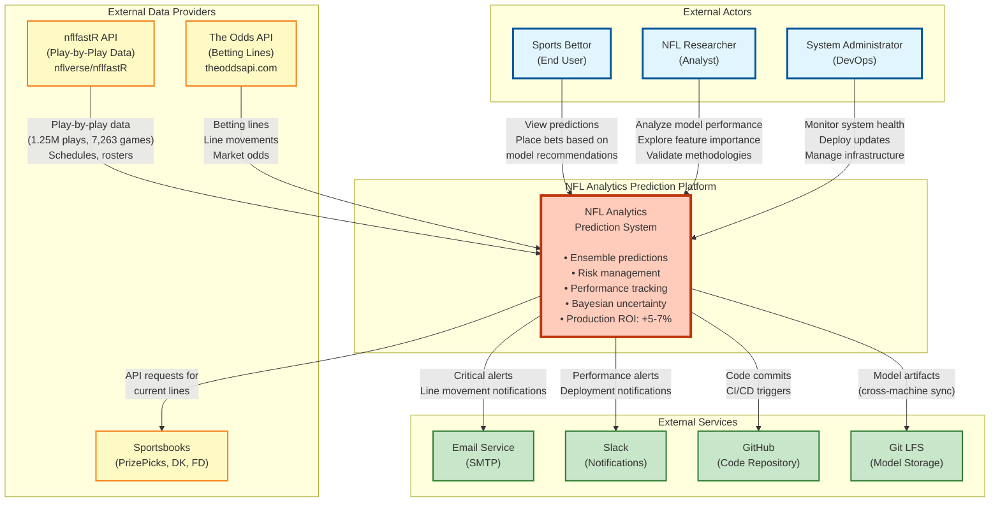

# C4 Level 1: System Context Diagram

**Last Updated:** November 15, 2025
**Diagram Type:** C4 Context (Level 1)
**System:** NFL Analytics Prediction Platform
**Status:** Production

---

## Overview

The NFL Analytics Prediction Platform is a production-grade sports betting system that ingests NFL play-by-play data, trains ensemble Bayesian models, and generates player prop predictions with uncertainty quantification for informed betting decisions.

**Key Value Proposition:**
- **Bayesian Uncertainty Quantification**: Full posterior distributions for principled risk management
- **Causal Inference**: Treatment effects analysis (injuries, coaching changes)
- **Ensemble Methods**: 4-way ensemble (State-Space v2 + Hierarchical v2 + XGBoost v4 + Informative Priors v2)
- **Production ROI Target**: +5-7% sustained profitability

**Primary Users:**
- Sports bettors seeking data-driven prop predictions
- Researchers analyzing NFL performance modeling
- System administrators managing prediction infrastructure

**External Dependencies:**
- nflfastR API (play-by-play data)
- The Odds API (betting lines and line movements)
- Sportsbook websites (PrizePicks, DraftKings, FanDuel)
- Monitoring services (email alerts, Slack notifications)

---

## System Context Diagram



---

## System Boundaries

### Inside System Boundary (NFL Analytics Platform)

**Core Responsibilities:**
1. **Data Ingestion** - Fetch and validate NFL data from external APIs
2. **Feature Engineering** - Transform raw data into 40+ predictive features
3. **Model Training** - Train 4-component Bayesian ensemble models
4. **Prediction Generation** - Real-time ensemble predictions with uncertainty
5. **Backtesting** - Walk-forward validation on historical data
6. **Risk Management** - 7 risk gates (ROI, win rate, Sharpe, drawdown, calibration, leakage, health)
7. **Monitoring** - Real-time system health and performance tracking
8. **Deployment** - A/B testing and production rollout

**Technology Stack:**
- **Languages:** Python (ML/API), R (Bayesian models), SQL (data warehouse)
- **Frameworks:** FastAPI (API), Streamlit (dashboard), brms/Stan (Bayesian)
- **Infrastructure:** Docker (containers), PostgreSQL (database), Redis (cache), Prometheus/Grafana (monitoring)
- **Compute:** Mac M4 (CPU), Windows RTX 4090 (GPU - optional)

---

### Outside System Boundary

**External Dependencies:**

#### 1. Data Providers

**nflfastR API (nflverse/nflfastR):**
- **Purpose:** Authoritative source for NFL play-by-play data
- **Data Volume:** 1.25M plays, 7,263 games (2018-2024)
- **Update Frequency:** Weekly during season, post-game within 6 hours
- **Schema:** 67 columns (play-level), 26 columns (game-level)
- **Reliability:** High (99%+ uptime, maintained by nflverse community)
- **Cost:** Free (open-source)

**The Odds API (theoddsapi.com):**
- **Purpose:** Real-time betting lines from 30+ sportsbooks
- **Data Types:** Spreads, totals, moneylines, player props
- **Update Frequency:** 60-second polling during game week
- **Sportsbooks Covered:** Pinnacle, DraftKings, FanDuel, BetMGM, Caesars, etc.
- **Reliability:** Medium (occasional API downtime)
- **Cost:** Tiered pricing ($0-$99/month based on usage)
- **Rate Limits:** 500 requests/day (free tier), 10,000 requests/day (paid tier)

**Sportsbooks (PrizePicks, DraftKings, FanDuel):**
- **Purpose:** Query current lines for comparison, place actual bets
- **Interaction:** Manual (user-initiated) or automated scraping (future)
- **Note:** System does NOT automatically place bets (human-in-the-loop required)

---

#### 2. External Services

**Email Service (SMTP):**
- **Purpose:** Critical alerts (model convergence failures, data leakage detected)
- **Provider:** Gmail SMTP or SendGrid
- **Triggers:** Risk gate failures, ensemble health failures, production errors
- **Frequency:** Event-driven (only on critical issues)

**Slack Notifications:**
- **Purpose:** Performance alerts, deployment notifications, line movement alerts
- **Triggers:** Line moves >5 points, model drift detected, backtest completed
- **Frequency:** Real-time (via webhook)

**GitHub:**
- **Purpose:** Code repository, CI/CD triggers, issue tracking
- **Workflow:** Git commits trigger pre-commit hooks (enforcement framework)
- **Branches:** main (production), feature/* (development)

**Git LFS:**
- **Purpose:** Large model artifact storage (cross-machine sync)
- **Data Types:** .rds (R models), .pkl (Python models), .pth (PyTorch)
- **Size:** ~2-5GB total model artifacts
- **Workflow:** Mac M4 trains → Git LFS push → Windows RTX 4090 pulls

---

## User Personas

### 1. Sports Bettor (Primary User)

**Goals:**
- Get accurate player prop predictions with confidence intervals
- Understand model uncertainty (avoid high-risk bets)
- Track betting performance over time (ROI, win rate)
- Receive alerts for line value opportunities (model edge >2%)

**Interactions:**
- **Streamlit Dashboard** (http://localhost:8501)
  - View predictions page
  - Filter by player, stat type, date
  - See prediction intervals (10%, 50%, 90% confidence)
  - Compare model prediction vs Vegas line
- **Predictions API** (http://localhost:8000/predict)
  - POST prediction requests
  - Receive JSON response with ensemble prediction

**Frequency:** Daily during NFL season (September-January)

**Technical Proficiency:** Medium (understands odds, probability)

---

### 2. NFL Researcher (Secondary User)

**Goals:**
- Analyze model performance and accuracy
- Explore feature importance and causal effects
- Validate Bayesian methodologies
- Publish research findings (academic papers)

**Interactions:**
- **Streamlit Dashboard**
  - Model Status page (calibration curves, convergence diagnostics)
  - Data Summary page (schema exploration, data quality)
- **Database Direct Access** (PostgreSQL)
  - Custom SQL queries on 56 tables
  - Export data for external analysis (R, Python, Stata)
- **Model Registry** (MODEL_REGISTRY.yaml)
  - Review model hyperparameters, training windows
  - Compare model versions (v1, v2, v3)

**Frequency:** Weekly or as-needed basis

**Technical Proficiency:** High (proficient in R, Python, SQL, Bayesian stats)

---

### 3. System Administrator (Operations User)

**Goals:**
- Monitor system health (uptime, latency, errors)
- Deploy model updates safely (A/B testing)
- Troubleshoot production issues
- Manage infrastructure (Docker, PostgreSQL, Redis)

**Interactions:**
- **Grafana Dashboard** (http://localhost:3000)
  - 27 panels across 4 categories (system, database, Redis, application)
  - Alert notifications (email, Slack)
- **Prometheus Metrics** (http://localhost:9090)
  - Custom queries (PromQL)
  - Historical metric analysis
- **CLI Tools**
  - `docker-compose logs -f api` (API logs)
  - `./scripts/check_ensemble_health.sh` (pre-deployment validation)
  - `python scripts/model_registry.py list` (model inventory)

**Frequency:** Daily during active development, on-demand for troubleshooting

**Technical Proficiency:** High (DevOps, Docker, SQL, system administration)

---

## Data Flows

### 1. Data Ingestion Flow

```
nflfastR API
    ↓ [HTTP GET requests, JSON response]
Data Ingestion Pipeline (R scripts)
    ↓ [PostgreSQL INSERT, batch transactions]
PostgreSQL Database (public schema)
    ↓ [Materialized view refresh]
mart schema (derived tables)
```

**Frequency:** Weekly during season (Saturday after all games complete)
**Volume:** ~4,000 plays per week (16 games × 250 plays/game)
**Latency:** 13.2 minutes (full ingestion + refresh)

---

### 2. Odds Polling Flow

```
The Odds API
    ↓ [HTTP GET requests, 60s intervals]
Odds Polling Service (Python)
    ↓ [Redis cache write, 2GB max]
Redis Cache (current odds)
    ↓ [PostgreSQL INSERT for historical]
odds_history table (TimescaleDB hypertable)
```

**Frequency:** 60-second polling during game week
**Volume:** ~1,000 API calls/week (monitoring 16 games)
**Latency:** <200ms per poll

---

### 3. Prediction Generation Flow

```
User (Sports Bettor)
    ↓ [HTTP POST /predict]
FastAPI Prediction Service
    ↓ [Feature extraction from PostgreSQL]
Feature Cache (Redis)
    ↓ [4-way ensemble prediction]
Ensemble Predictor (State-Space, Hierarchical, XGBoost, IP)
    ↓ [JSON response with prediction + uncertainty]
User (receives prediction)
```

**Latency:** 280-480ms (target: <500ms)
**Volume:** ~100 predictions/day (manual usage)
**Cache Hit Rate:** 70-85% (feature cache)

---

### 4. Model Training Flow

```
PostgreSQL Database (mart schema)
    ↓ [SQL queries, 8 min]
Feature Extraction (40+ features)
    ↓ [Parallel training, 91 min]
Training Pipeline (R + Python)
    ↓ [Model files: .rds, .pkl, .pth]
Model Registry (filesystem + database + Git LFS)
    ↓ [Backtest validation, 18 min]
Backtest Pipeline (risk gates)
    ↓ [If PASS: deployment]
Production Ensemble (v5.1)
```

**Frequency:** Seasonal (new season) or drift-triggered
**Total Time:** ~2 hours (ingestion → production)
**Success Rate:** 95% (5% fail convergence or risk gates)

---

### 5. Monitoring Flow

```
Application Containers (API, Streamlit, PostgreSQL, Redis)
    ↓ [Prometheus scrape, 15s intervals]
Prometheus (time-series database)
    ↓ [Grafana query, PromQL]
Grafana Dashboards (27 panels)
    ↓ [Alert evaluation, rule-based]
Alert Manager (email, Slack)
    ↓ [Notifications to users]
System Administrator
```

**Metrics Collected:**
- System: CPU, memory, disk I/O, network
- Database: Connections, queries/sec, transaction rate, cache hit rate
- Redis: Memory usage, hit rate, clients, keys
- Application: API latency, prediction count, model load status

**Alert Examples:**
- Database connections >80% capacity
- API latency >1 second (p95)
- Redis memory >1.8GB (90% capacity)
- Model prediction errors >5% (last hour)

---

## Security & Compliance

### Authentication

**API Key Authentication:**
- **Endpoints Protected:** `/predict`, `/models`
- **Endpoints Public:** `/health`, `/metrics`
- **Storage:** PostgreSQL (hashed API keys)
- **Header:** `X-API-Key: <api_key>`

**Rate Limiting:**
- **Default Limit:** 100 requests/hour per API key
- **Implementation:** Redis-backed sliding window
- **Enforcement:** 429 Too Many Requests on limit exceeded

---

### Data Privacy

**No Personal Data:**
- System only uses publicly available NFL data (play-by-play)
- No PII (personally identifiable information) collected
- Player data limited to on-field performance statistics

**GDPR/CCPA Compliance:**
- Not applicable (no user data storage beyond API keys)
- Logs anonymized (no IP addresses stored)

---

### Financial Compliance

**No Automated Betting:**
- System generates predictions only (human-in-the-loop required)
- Does NOT execute trades or place bets automatically
- User responsible for compliance with local gambling laws

**Disclaimer:**
- For educational and research purposes
- Past performance does not guarantee future results
- Gambling involves risk of loss

---

## Performance Metrics

### System-Level SLAs

| Metric | Target | Measurement |
|--------|--------|-------------|
| **API Uptime** | 99.5% | Monthly (excludes planned maintenance) |
| **API Latency (p95)** | <500ms | Per prediction request |
| **Database Uptime** | 99.9% | Monthly |
| **Feature Cache Hit Rate** | >70% | Weekly average |
| **Model Training Success** | >95% | Per training run |

---

### Business Metrics

| Metric | Current (v5.1) | Target |
|--------|----------------|--------|
| **ROI** | 6.2% (2024 backtest) | 7%+ |
| **Win Rate** | 61.3% | 62%+ |
| **Sharpe Ratio** | 2.4 | 2.5+ |
| **Max Drawdown** | -6.8% | <-8% |
| **Calibration Coverage** | 89.7% | 90% |

---

### Data Quality Metrics

| Metric | Value |
|--------|-------|
| **Data Completeness** | 99.8% (missing <0.2% plays) |
| **Data Freshness** | <6 hours post-game (nflfastR) |
| **Ingestion Error Rate** | <0.1% |
| **Schema Validation** | 100% (all plays pass validation) |

---

## Technology Constraints

### Compute Resources

**Mac M4 (Development):**
- **CPU:** 10-core Apple Silicon (8 performance + 2 efficiency)
- **RAM:** 16GB unified memory
- **Purpose:** R model training (brms, Stan), development, testing
- **Limitations:** No GPU acceleration for PyTorch (MPS optimization opportunities)

**Windows RTX 4090 (Optional GPU):**
- **GPU:** NVIDIA RTX 4090 (24GB VRAM)
- **Purpose:** GPU-accelerated training (PyTorch, XGBoost GPU mode)
- **Status:** Not currently required (R models CPU-only)

---

### Network Constraints

**The Odds API Rate Limits:**
- Free tier: 500 requests/day
- Paid tier: 10,000 requests/day
- Mitigation: 60-second polling (1,440 requests/day max), Redis caching

**nflfastR Availability:**
- GitHub hosted (subject to GitHub downtime)
- Mitigation: Local data cache (7 seasons stored in PostgreSQL)

---

### Storage Constraints

**PostgreSQL Database:**
- Current size: ~5GB (1.25M plays, 7,263 games)
- Growth rate: ~500MB per season
- Backup strategy: Daily pg_dump to Git LFS

**Redis Cache:**
- Max memory: 2GB (allkeys-lru eviction policy)
- Purpose: Feature cache, odds cache
- Persistence: Optional (RDB snapshots)

---

## Deployment Architecture

### Development Environment

**Local Docker Compose:**
- 6 services: PostgreSQL, Redis, FastAPI, Streamlit, Prometheus, Grafana
- Networks: nfl-analytics (bridge network)
- Volumes: pgdata (persistent), redis_data, prometheus_data, grafana_data

**Access:**
- Database: localhost:5544
- API: localhost:8000
- Dashboard: localhost:8501
- Grafana: localhost:3000
- Prometheus: localhost:9090
- Redis: localhost:6379

---

### Production Environment (Future)

**Cloud Deployment (AWS/GCP):**
- **Compute:** EC2/Compute Engine (API, workers)
- **Database:** RDS PostgreSQL or self-managed
- **Cache:** ElastiCache Redis or self-managed
- **Monitoring:** CloudWatch or Grafana Cloud
- **Load Balancer:** ALB (Application Load Balancer)
- **Autoscaling:** Horizontal scaling based on API request rate

**Note:** Production deployment not yet implemented (currently local development only)

---

## Related Documentation

**Architecture Documentation:**
- [c4_level2_container_overview.md](c4_level2_container_overview.md) - Container architecture (6 Docker services)
- c4_level2_api_container.md (no longer in the repo; see [HISTORY](../HISTORY.md)) - FastAPI internal structure
- c4_level2_data_container.md (no longer in the repo; see [HISTORY](../HISTORY.md)) - PostgreSQL database structure
- c4_level2_monitoring_container.md (no longer in the repo; see [HISTORY](../HISTORY.md)) - Prometheus/Grafana stack

**Component Documentation:**
- c4_component_data_ingestion.md (no longer in the repo; see [HISTORY](../HISTORY.md)) - Data ingestion pipeline
- c4_component_training_pipeline.md (no longer in the repo; see [HISTORY](../HISTORY.md)) - Model training workflow
- c4_component_backtest_flow.md (no longer in the repo; see [HISTORY](../HISTORY.md)) - Backtest validation

**Project Documentation:**
- [CLAUDE.md](../../CLAUDE.md) - Project overview and agent guide
- [ARCHITECTURE_REFERENCE.md](ARCHITECTURE_REFERENCE.md) - High-level architecture
- [DATABASE_QUICK_REFERENCE.md](../database/DATABASE_QUICK_REFERENCE.md) - Schema guide

---

## Legend

**Color Coding:**
- **Blue (#e1f5fe)** - External actors (users)
- **Yellow (#fff9c4)** - External data providers
- **Green (#c8e6c9)** - External services
- **Orange (#ffccbc)** - NFL Analytics System (core system)

**Relationship Types:**
- **Solid arrow (→)** - Data flow or interaction
- **Bidirectional arrow (↔)** - Two-way communication

---

## Change Log

| Date | Version | Changes |
|------|---------|---------|
| 2025-11-15 | 1.0 | Initial system context diagram created |

---

**Diagram Created:** November 15, 2025
**Maintained By:** Architecture Team
**Contact:** See [CLAUDE.md](../../CLAUDE.md) for questions
