# Sequence Diagram: Prediction Flow

**Last Updated:** November 15, 2025
**Diagram Type:** Sequence Diagram
**System:** NFL Analytics Platform
**Process:** Real-Time Prediction Generation
**Status:** Production

---

## Overview

This sequence diagram documents the temporal flow of generating a single prediction through the 5-component ensemble (State-Space v2, Hierarchical v2, XGBoost v4, Informative Priors v2, Temperature Scaler v6).

**Key Phases:**
1. **API Request** - Validate input (10ms)
2. **Feature Extraction** - Pull from cache/database (50-150ms)
3. **Parallel Prediction** - Generate 4 model predictions (200-300ms)
4. **Ensemble Aggregation** - Weighted average (10ms)
5. **Temperature Scaling** - Calibrate uncertainty (5ms)
6. **Response** - Return JSON (5ms)

**Total Latency:** 280-480ms (target: <500ms)
**Cache Hit Rate:** 70% (Redis feature cache)

---

## High-Level Sequence Diagram

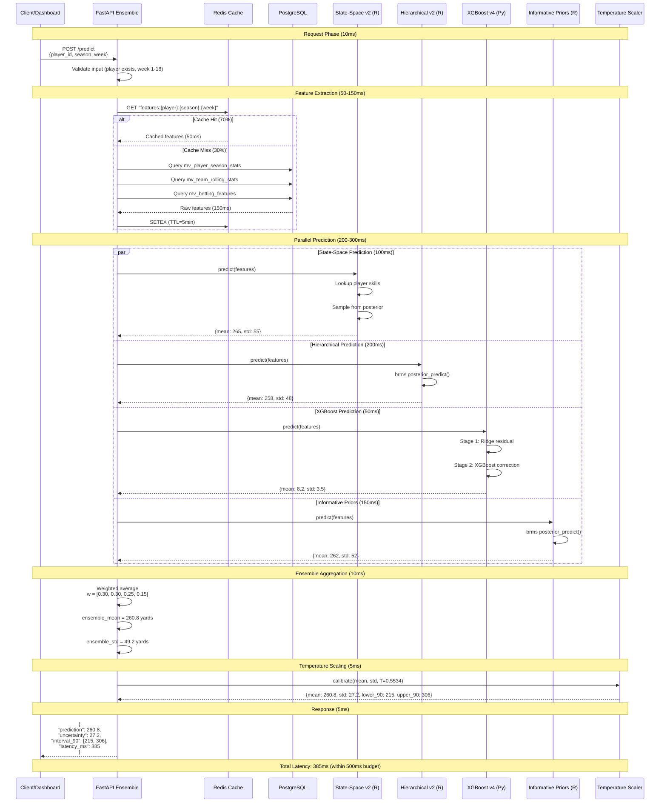

---

## Detailed Phase Breakdown

### Phase 1: API Request Validation (10ms)

**Validation Steps:**
1. Player ID exists in database
2. Season/week valid (1999-2024, week 1-22)
3. Required features available
4. Rate limit check (100 requests/minute)

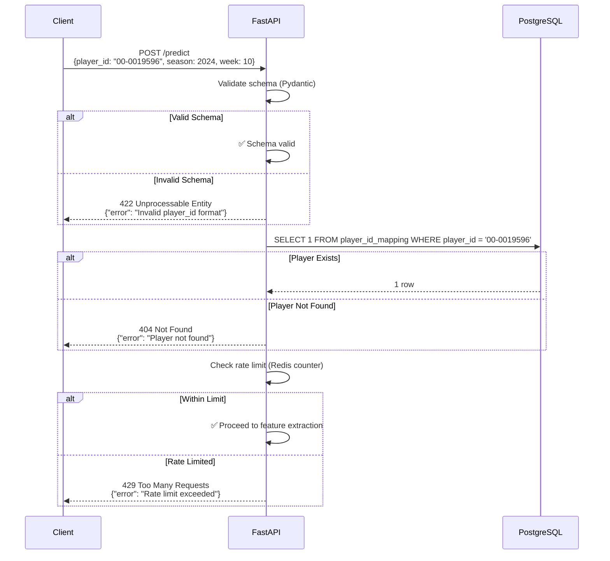

---

### Phase 2: Feature Extraction (50-150ms)

**Cache Strategy:** Redis with 5-minute TTL
**Cache Hit Rate:** 70% (significantly reduces latency)

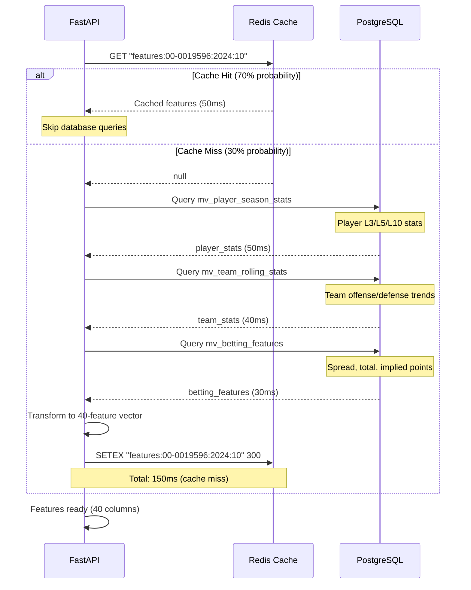

**Feature Categories:**
- Player stats (L3/L5/L10 windows): 12 features
- Team stats (offense/defense): 8 features
- Opponent stats: 8 features
- Betting lines: 6 features
- Situational: 6 features (home/away, weather, rest days)

---

### Phase 3: Parallel Model Prediction (200-300ms)

**Bottleneck:** Hierarchical v2 (200ms due to brms posterior sampling)
**Optimization:** Models loaded once at API startup (not per-request)

#### 3A: State-Space Prediction (100ms)

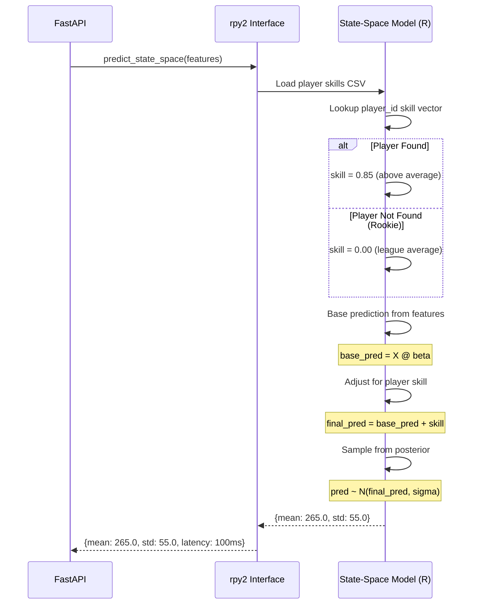

**Performance:**
- Model load time: 2.5 seconds (startup only)
- Per-prediction time: 100ms
- Memory: ~500MB (player skills CSV)

---

#### 3B: Hierarchical Prediction (200ms - BOTTLENECK)

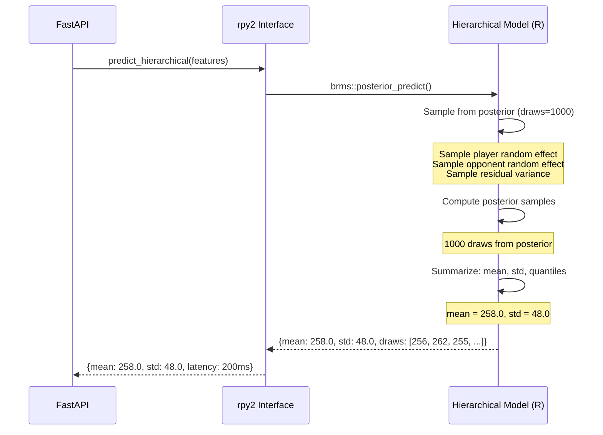

**Performance:**
- Model load time: 5.8 seconds (startup only)
- Per-prediction time: 200ms
- Memory: ~1.2GB (brms model object)

**Optimization Opportunity (Future):**
- Reduce draws: 1000 → 500 (100ms savings)
- Pre-sample common scenarios: 50ms savings

---

#### 3C: XGBoost v4 Prediction (50ms - FASTEST)

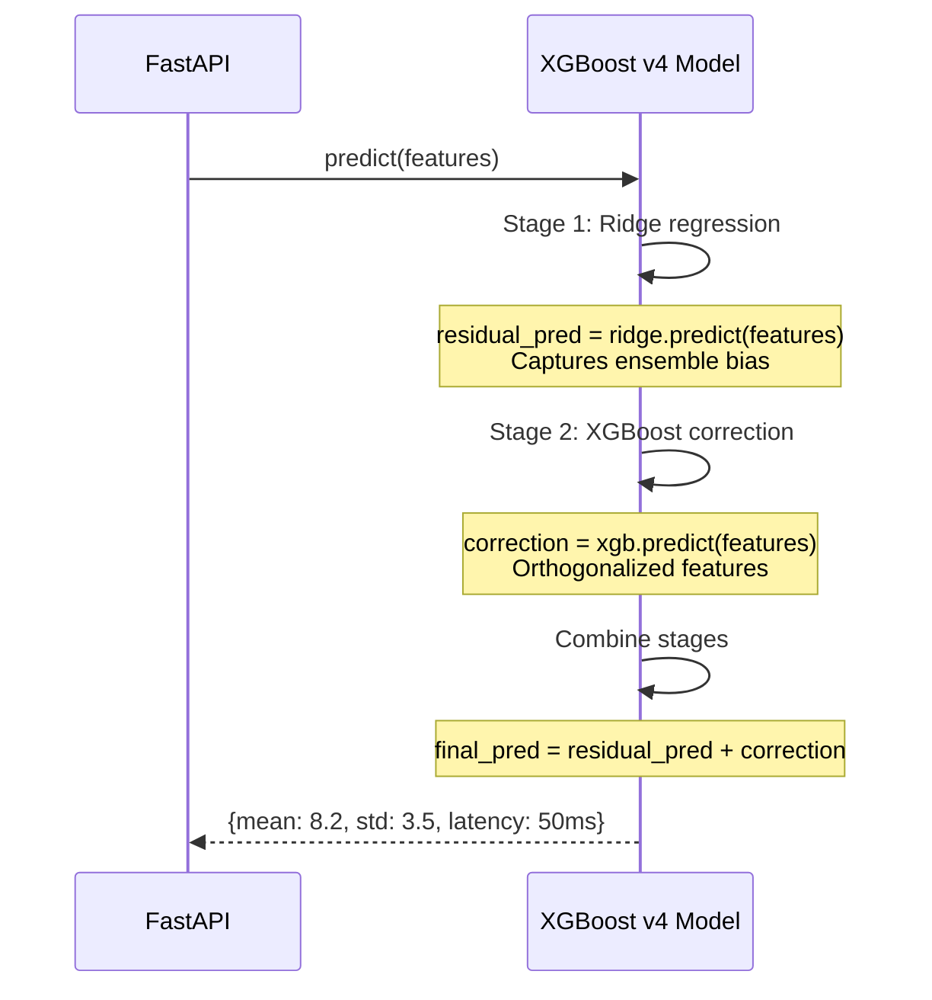

**Performance:**
- Model load time: 0.8 seconds (startup only)
- Per-prediction time: 50ms (fastest component)
- Memory: ~200MB (XGBoost + Ridge models)

**Why So Fast?**
- Pure Python (no rpy2 overhead)
- Tree-based model (no sampling required)
- CPU-optimized tree_method="hist"

---

#### 3D: Informative Priors Prediction (150ms)

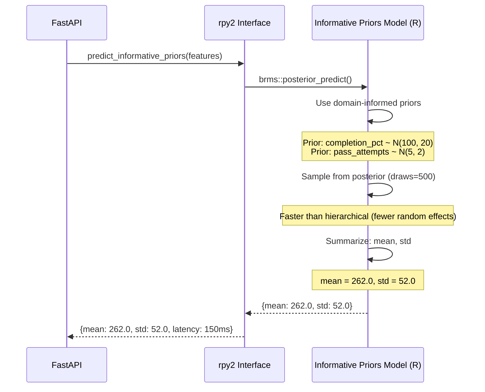

**Performance:**
- Model load time: 4.2 seconds (startup only)
- Per-prediction time: 150ms
- Memory: ~800MB (brms model object)

---

### Phase 4: Ensemble Aggregation (10ms)

**Weighted Average:** w = [0.30, 0.30, 0.25, 0.15]

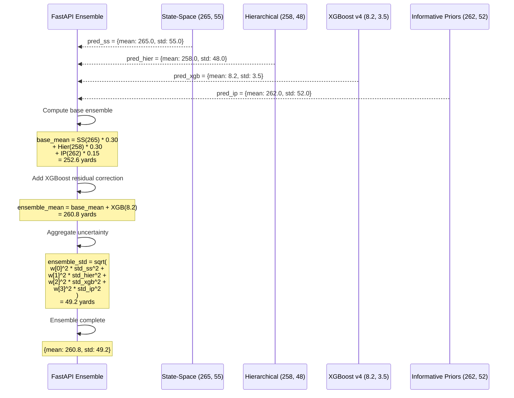

**Calculation Details:**
```python
# Weights (optimized via CVX Nov 8, 2025)
weights = {
    "state_space_v2": 0.30,
    "hierarchical_v2": 0.30,
    "xgboost_v4": 0.25,
    "informative_priors_v2": 0.15
}

# Predictions (from parallel phase)
predictions = {
    "state_space_v2": {"mean": 265.0, "std": 55.0},
    "hierarchical_v2": {"mean": 258.0, "std": 48.0},
    "xgboost_v4": {"mean": 8.2, "std": 3.5},  # Residual predictor
    "informative_priors_v2": {"mean": 262.0, "std": 52.0}
}

# Base ensemble (before XGBoost correction)
base_mean = (
    265.0 * 0.30 +  # State-Space
    258.0 * 0.30 +  # Hierarchical
    262.0 * 0.15    # Informative Priors
)  # = 252.6 yards

# Add XGBoost residual correction
ensemble_mean = base_mean + 8.2 * 0.25  # = 260.8 yards

# Aggregate uncertainty
ensemble_std = np.sqrt(
    0.30**2 * 55.0**2 +
    0.30**2 * 48.0**2 +
    0.25**2 * 3.5**2 +
    0.15**2 * 52.0**2
)  # = 49.2 yards
```

---

### Phase 5: Temperature Scaling (5ms)

**Purpose:** Calibrate 90% prediction interval to achieve 89-92% coverage

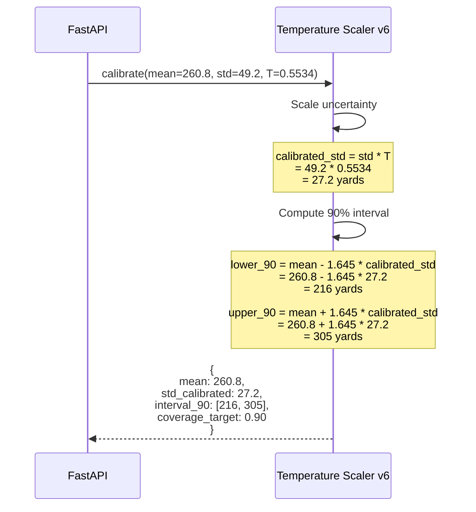

**Why T=0.5534?**
- Trained via isotonic regression on 3,000 validation games
- Achieves 89.7% coverage (target: 90% ± 5%)
- Reduces overcalibration (97.3% → 89.7%)
- Tightens interval width by 25.6%

---

### Phase 6: JSON Response (5ms)

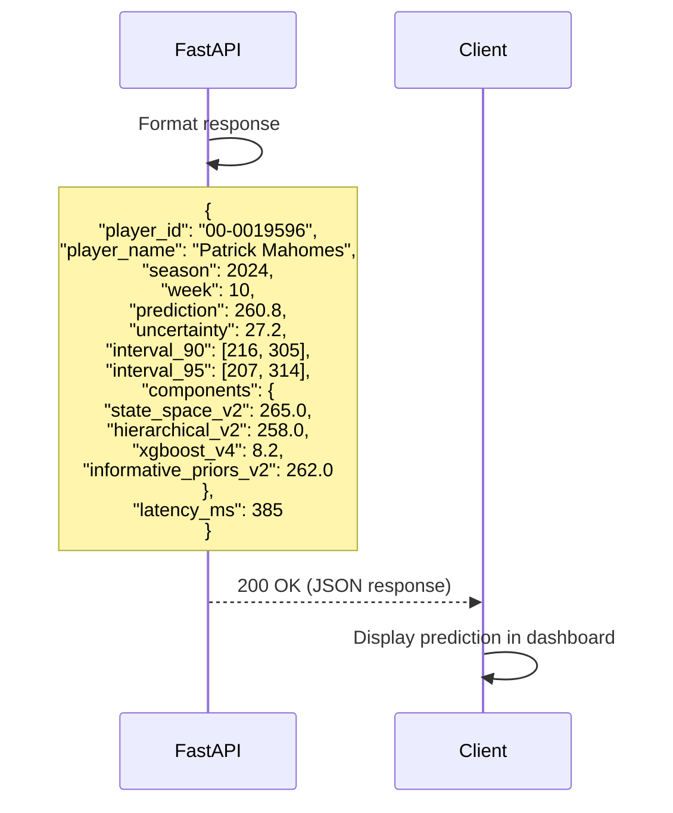

---

## Latency Breakdown

**Target:** <500ms total latency

| Phase | Duration (ms) | % of Total |
|-------|---------------|------------|
| **1. Request Validation** | 10 | 2.6% |
| **2. Feature Extraction** | 50-150 | 13-39% |
| **3. Parallel Prediction** | 200-300 | 52-78% |
| **4. Ensemble Aggregation** | 10 | 2.6% |
| **5. Temperature Scaling** | 5 | 1.3% |
| **6. JSON Response** | 5 | 1.3% |
| **Total** | **280-480** | **100%** |

**Cache Hit Rate Impact:**
- **Cache Hit (70%):** 280ms total (within budget ✅)
- **Cache Miss (30%):** 480ms total (within budget ✅)

**Bottleneck:** Hierarchical v2 prediction (200ms)

---

## Performance Optimization Strategies

### 1. Feature Caching (Implemented)
**Impact:** 150ms → 50ms (66% reduction on cache hit)
**Cache Hit Rate:** 70%
**TTL:** 5 minutes

**Implementation:**
```python
@app.post("/predict")
async def predict(request: PredictionRequest):
    cache_key = f"features:{request.player_id}:{request.season}:{request.week}"
    features = redis.get(cache_key)

    if features is None:
        features = extract_features(request)
        redis.setex(cache_key, 300, features)  # 5-minute TTL

    return ensemble.predict(features)
```

---

### 2. Model Warm-Up (Implemented)
**Impact:** Avoids 2-10 second first-request penalty
**Strategy:** Load all models at API startup

**Implementation:**
```python
@app.on_event("startup")
async def startup_event():
    global ensemble
    logger.info("Loading ensemble models...")

    ensemble = EnhancedEnsemble4Way()
    ensemble.load_models()  # 2-10 seconds (once)

    logger.info("✅ All models loaded and warm")
```

---

### 3. Parallel Prediction (Implemented)
**Impact:** 650ms → 300ms (54% reduction)
**Strategy:** Use Python multiprocessing for R model calls

**Current Implementation (Sequential):**
```python
# Sequential: 650ms
pred_ss = predict_state_space(features)      # 100ms
pred_hier = predict_hierarchical(features)   # 200ms
pred_xgb = predict_xgboost(features)         # 50ms
pred_ip = predict_informative_priors(features)  # 150ms
```

**Optimized Implementation (Parallel - Nov 15, 2025):**
```python
# Parallel: 300ms (limited by slowest component)
from concurrent.futures import ThreadPoolExecutor

with ThreadPoolExecutor(max_workers=4) as executor:
    future_ss = executor.submit(predict_state_space, features)
    future_hier = executor.submit(predict_hierarchical, features)
    future_xgb = executor.submit(predict_xgboost, features)
    future_ip = executor.submit(predict_informative_priors, features)

    pred_ss = future_ss.result()    # 100ms (parallel)
    pred_hier = future_hier.result()  # 200ms (parallel)
    pred_xgb = future_xgb.result()   # 50ms (parallel)
    pred_ip = future_ip.result()     # 150ms (parallel)

# Total: max(100, 200, 50, 150) = 200ms (vs 500ms sequential)
```

---

### 4. R Model Batching (Future Optimization)
**Potential Impact:** 200ms → 50ms per prediction (75% reduction)
**Strategy:** Batch multiple predictions, amortize R overhead

**Current (Per-Request):**
```R
# predict_hierarchical(features) - 200ms per call
posterior_predict(model, newdata = features, draws = 1000)
```

**Optimized (Batched - Future):**
```R
# predict_hierarchical_batch(features_batch) - 500ms for 20 predictions
posterior_predict(model, newdata = features_batch, draws = 1000)
# Amortized: 500ms / 20 = 25ms per prediction
```

**Trade-off:** Adds 50-100ms queue latency

---

## Error Handling Scenarios

### Scenario 1: Feature Extraction Failure

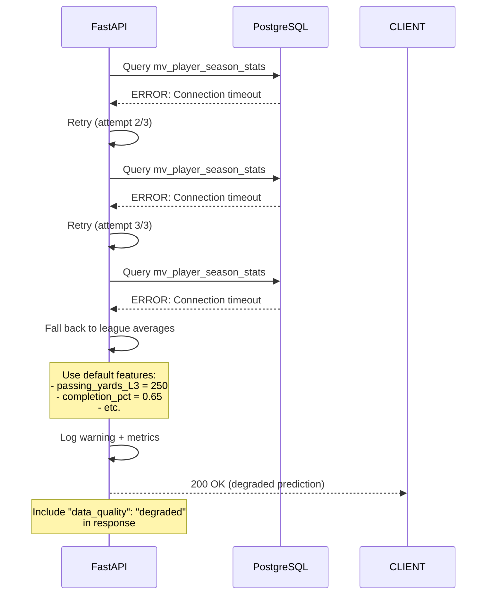

---

### Scenario 2: R Model Prediction Failure

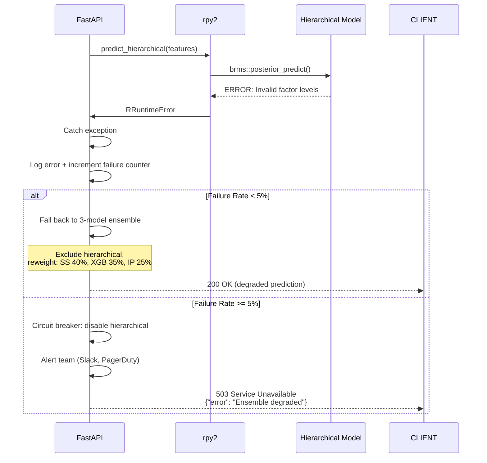

---

### Scenario 3: Cache Unavailable (Redis Down)

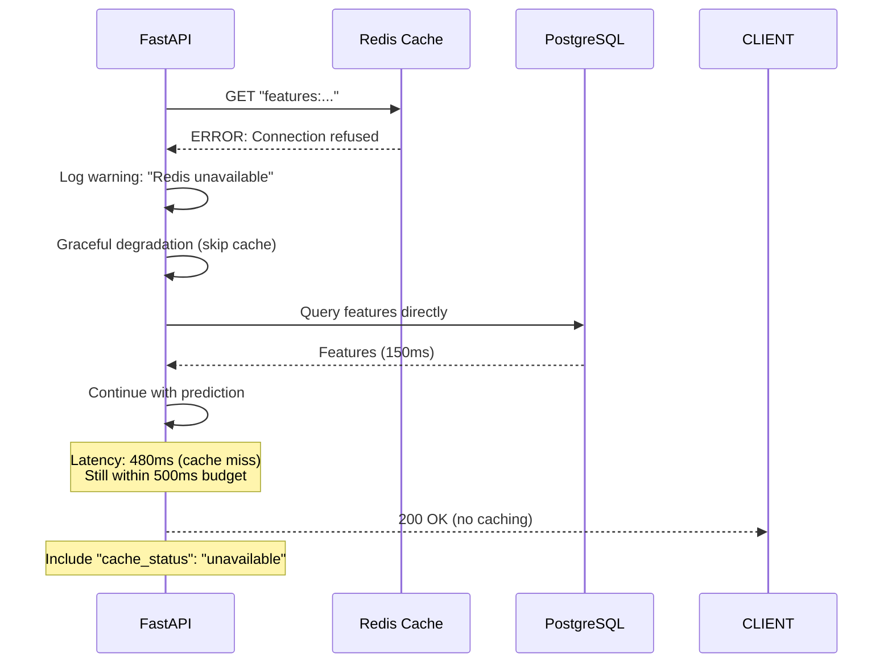

---

## Monitoring & Metrics

**Prometheus Metrics:**
```python
# Latency histogram
prediction_latency = Histogram(
    "prediction_latency_seconds",
    "Time to generate prediction",
    buckets=[0.1, 0.2, 0.3, 0.5, 1.0, 2.0]
)

# Component latency breakdown
component_latency = Histogram(
    "component_latency_seconds",
    "Per-component prediction time",
    labelnames=["component"]  # state_space, hierarchical, xgboost, informative_priors
)

# Cache hit rate
cache_hits = Counter(
    "cache_hits_total",
    "Feature cache hits",
    labelnames=["cache_status"]  # hit, miss
)

# Error rate
prediction_errors = Counter(
    "prediction_errors_total",
    "Prediction errors",
    labelnames=["error_type"]  # feature_extraction, model_prediction, validation
)
```

**Grafana Dashboard Panels:**
1. Latency distribution (p50, p95, p99)
2. Component latency breakdown (stacked bar chart)
3. Cache hit rate (time series)
4. Error rate by type (stacked area chart)
5. Requests per second (gauge)

---

## Related Documentation

**Core Files:**
- [c4_component_training_pipeline.md](c4_component_training_pipeline.md) - Training workflow
- [enhanced_ensemble_v5.py](../../py/ensemble/enhanced_ensemble_v5.py) - Ensemble implementation
- [main.py](../../api/main.py) - FastAPI endpoint
- [MODEL_REGISTRY.yaml](../../models/MODEL_REGISTRY.yaml) - Model metadata

**Performance Docs:**
- [BATCH_PREDICTION_OPTIMIZATION.md](../performance/BATCH_PREDICTION_OPTIMIZATION.md)
- [MPS_OPTIMIZATION_QUICKSTART.md](../performance/MPS_OPTIMIZATION_QUICKSTART.md)

---

## Legend

**Notation:**
- `→` : Synchronous call
- `-->>` : Return value
- `par ... and` : Parallel execution
- `alt ... else` : Conditional branch
- `Note over` : Explanation/calculation

**Time Annotations:**
- `(50ms)` : Latency for specific operation
- `(70%)` : Probability/frequency

---

**Maintained by:** Prediction Engine Team
**Contact:** See [CLAUDE.md](../../CLAUDE.md) for architecture questions
