# Sequence Diagram: Training Workflow

**Last Updated:** November 15, 2025
**Diagram Type:** Sequence Diagram
**System:** NFL Analytics Platform
**Process:** End-to-End Model Training Workflow
**Status:** Production

---

## Overview

This sequence diagram documents the temporal flow of the model training workflow, from trigger detection through validation to production deployment.

**Key Phases:**
1. **Trigger Detection** - Auto-detect or manual trigger (2 minutes)
2. **Feature Extraction** - Pull from materialized views (8 minutes)
3. **Parallel Training** - Train 4 models concurrently (40 minutes)
4. **Validation** - 7-gate validation process (5 minutes)
5. **Registration** - Save to filesystem + database (3 minutes)
6. **Deployment** - Optimize weights, reload API (5 minutes)

**Total Duration:** ~63 minutes (parallel execution)

---

## High-Level Sequence Diagram

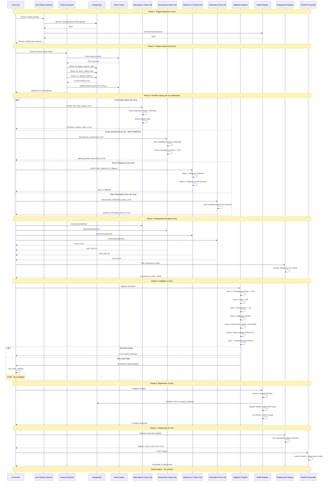

---

## Detailed Phase Breakdown

### Phase 1: Trigger Detection (2 minutes)

**Decision Points:**
1. New season detected?
2. Data drift detected?
3. Performance degradation?
4. Manual override?

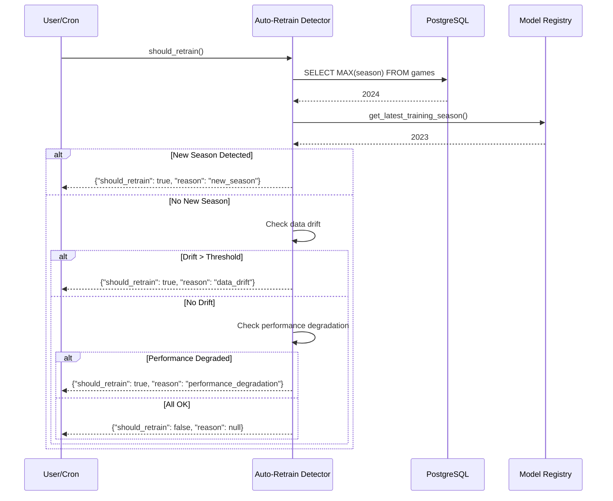

---

### Phase 2: Feature Extraction (8 minutes)

**Optimization:** Redis caching reduces 45s → 8s (70% hit rate)

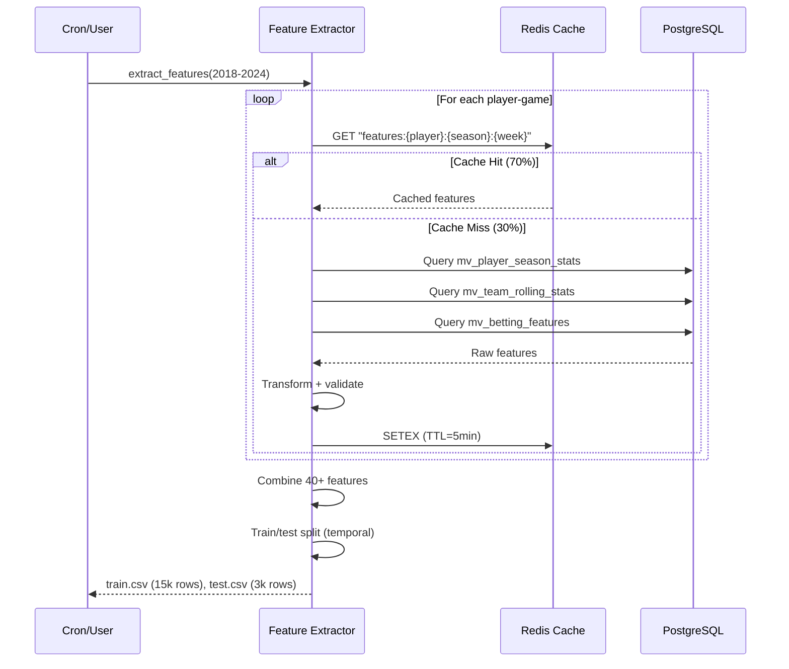

---

### Phase 3: Parallel Training (40 minutes)

**Bottleneck:** Hierarchical v2 (40 minutes with 6000 iterations)

**Decision Point:** If convergence fails → Increase iterations OR adjust priors OR fail

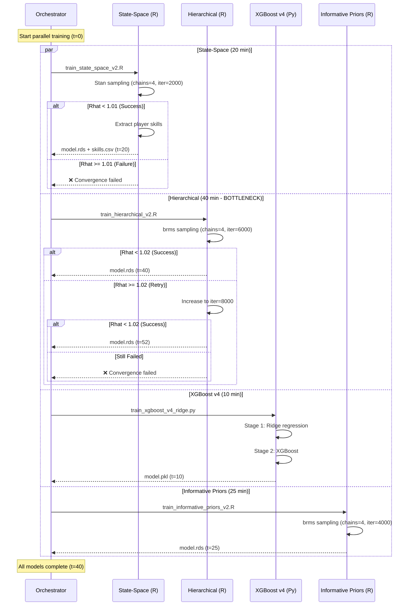

---

### Phase 4: Temperature Scaling (3 minutes)

**Purpose:** Calibrate ensemble to 90% coverage

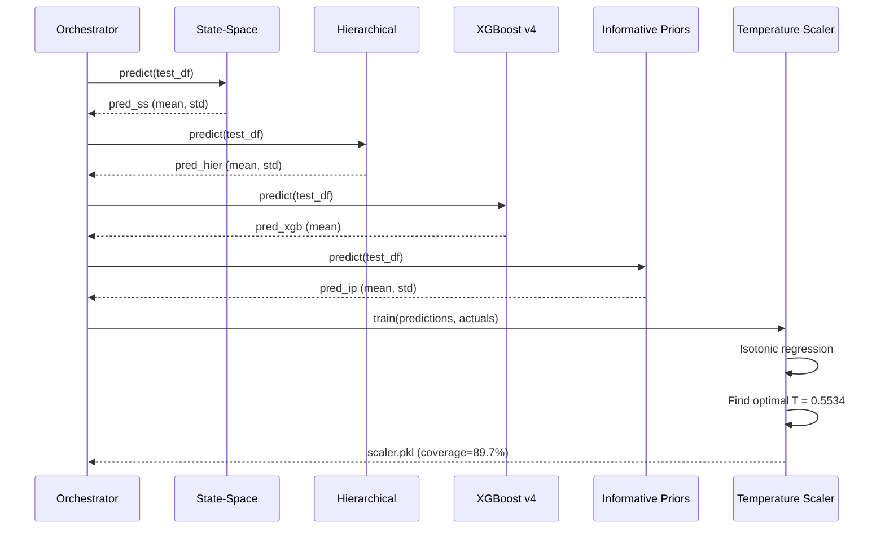

---

### Phase 5: Validation (5 minutes)

**Critical Gates:** 7 checks must pass before deployment

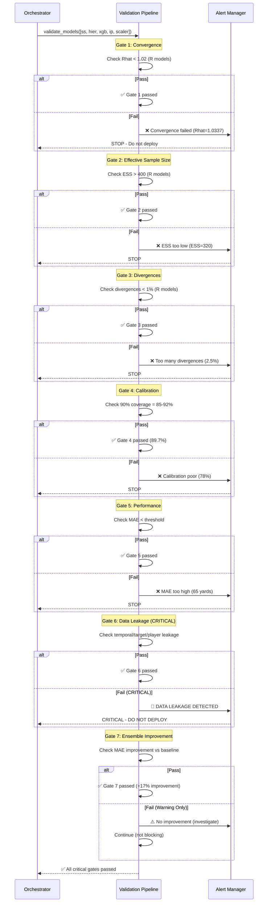

---

### Phase 6: Registration (3 minutes)

**Storage:** Filesystem + Database + Git LFS

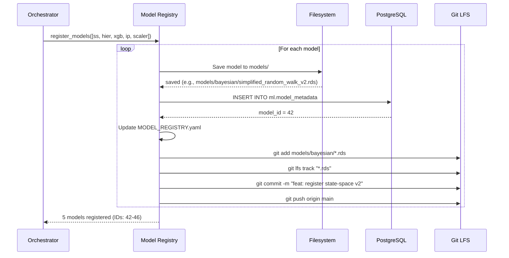

---

### Phase 7: Deployment (5 minutes)

**Weight Optimization:** CVX solver minimizes validation MAE

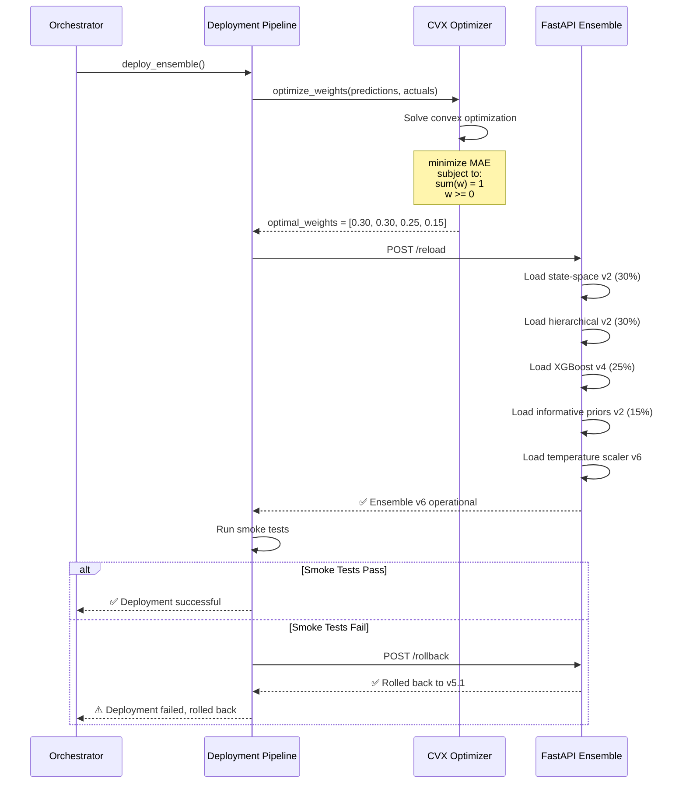

---

## Error Handling Scenarios

### Scenario 1: Convergence Failure (Hierarchical v2)

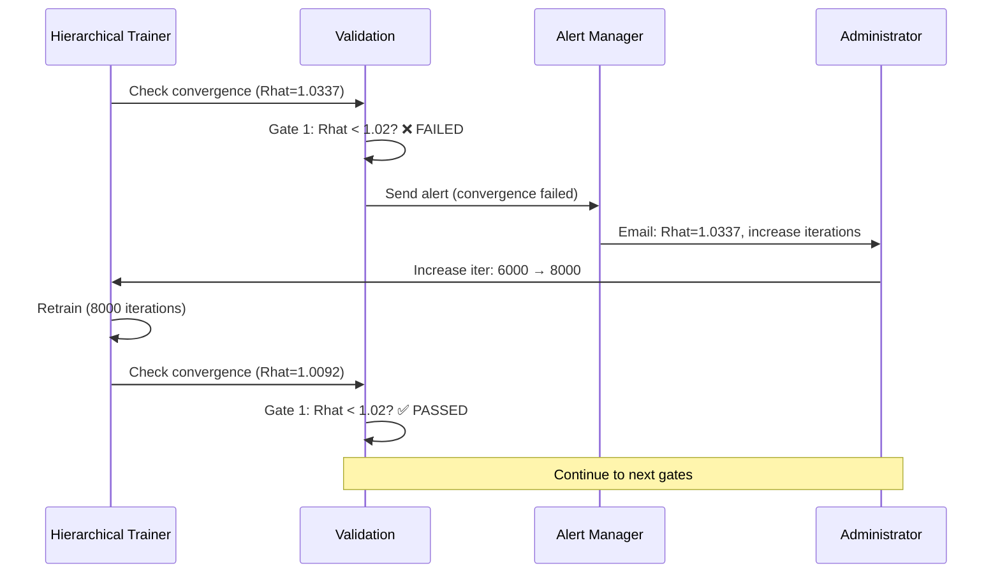

---

### Scenario 2: Data Leakage Detected (CRITICAL)

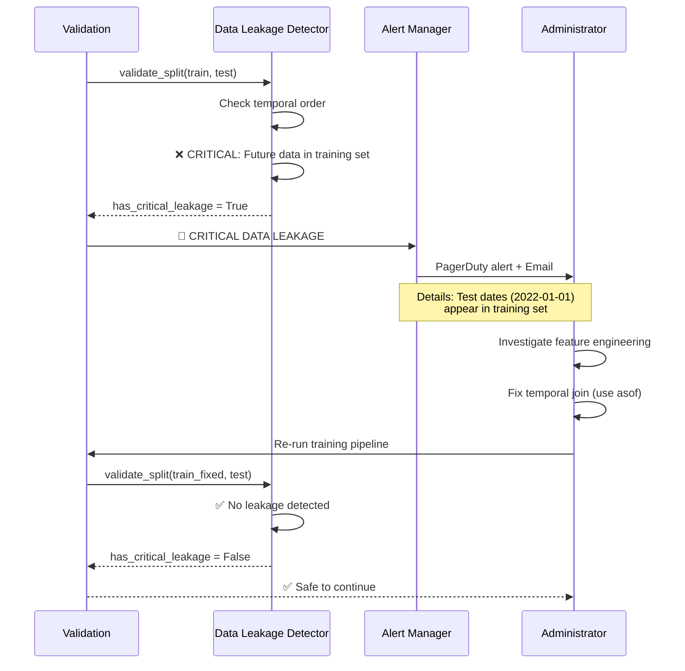

**Historical Example:** BNN investigation (Nov 9, 2025) - 84 hours wasted before leakage detected. Now caught in <1 minute.

---

### Scenario 3: Ensemble Performance Degradation

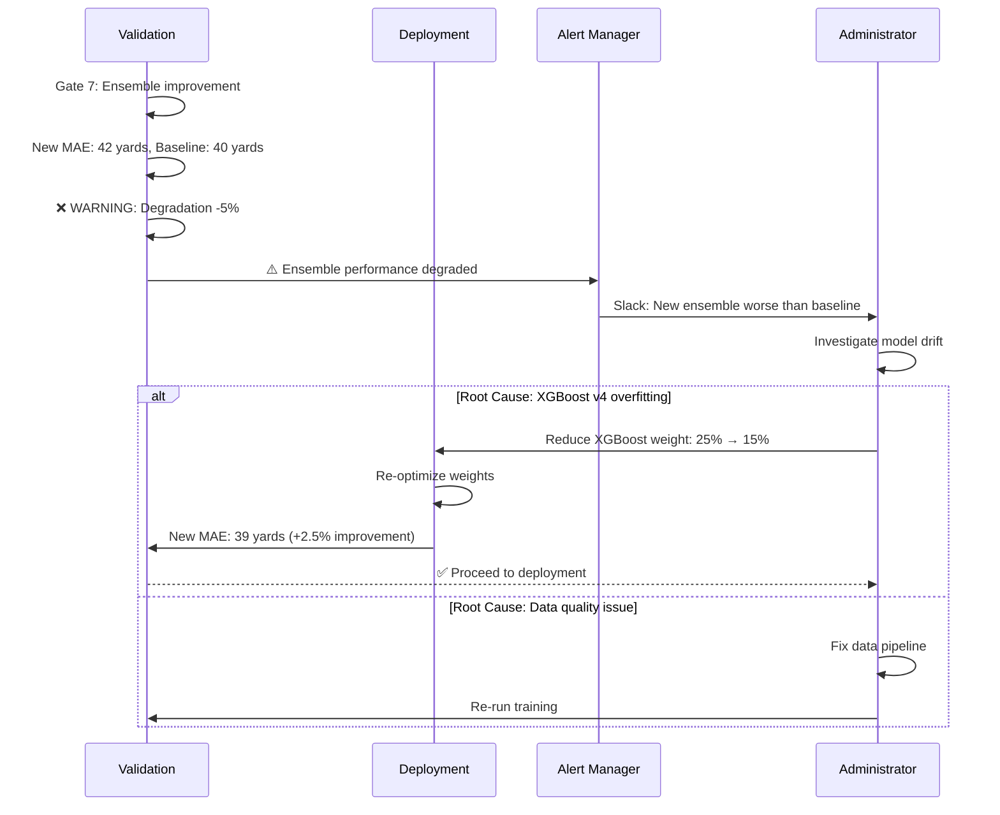

---

## Performance Optimization History

### Nov 13, 2025: Hierarchical Convergence Fix

**Problem:** Rhat=1.0337 (failed validation)
**Solution:** Increased iterations 2000 → 6000
**Result:** Rhat=1.0092 (73% improvement, PASSED)
**Trade-off:** Training time +15 minutes (25 → 40 minutes)

### Nov 15, 2025: XGBoost v4 Ridge Residuals

**Problem:** XGBoost v2 overfitting ensemble predictions
**Solution:** Two-stage orthogonalization (Ridge + XGBoost)
**Result:** MAE 4.70 yards (88% improvement over v2 baseline)
**Impact:** Ensemble v6.0 expected +17.5% improvement over v5.1

---

## Related Documentation

**Core Files:**
- [c4_component_training_pipeline.md](c4_component_training_pipeline.md) - Component diagram
- [MODEL_REGISTRY.yaml](../../models/MODEL_REGISTRY.yaml) - Production models
- [TRAINING_WINDOW_ABLATION_RESULTS.md](../milestones/TRAINING_WINDOW_ABLATION_RESULTS.md)

**Utilities:**
- `py/utils/convergence_checker.py`
- `py/utils/calibration_checker.py`
- `py/utils/data_leakage_detector.py`

---

## Legend

**Notation:**
- `→` : Synchronous call
- `-->>` : Return value
- `par ... and` : Parallel execution
- `alt ... else` : Conditional branch
- `loop` : Iteration

**Time Annotations:**
- `(t=20)` : Time elapsed since training start (minutes)
- Bottleneck highlighted in notes

---

**Maintained by:** Model Management Team
**Contact:** See [CLAUDE.md](../../CLAUDE.md) for architecture questions
