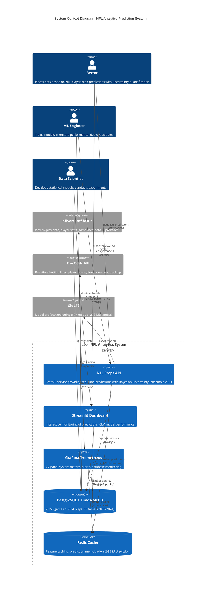

# C4 Context Diagram - NFL Analytics System

**Purpose:** System-level view showing external dependencies and user interactions

**Date:** November 14, 2025

**Version:** 1.0

---

## Mermaid C4 Context Diagram



---

## System Overview

### NFL Analytics System

**Mission:** Production-grade NFL player props betting system using Bayesian uncertainty quantification to achieve +5-7% ROI.

**Key Components:**
1. **Prediction API (FastAPI)** - Real-time ensemble predictions (4-way: State-Space, Hierarchical, XGBoost, Informative Priors)
2. **Dashboard (Streamlit)** - Interactive monitoring, model status, data summaries
3. **Monitoring Stack (Grafana/Prometheus)** - 27-panel dashboard, alerting, system health
4. **Database (PostgreSQL + TimescaleDB)** - 7,263 games, 1.25M plays, 56 tables
5. **Cache (Redis)** - Feature caching (5-20ms hit), 2GB LRU eviction

---

## External Systems

### 1. nflverse/nflfastR (Data Provider)

**Purpose:** Canonical source for NFL play-by-play data, player stats, game metadata

**Integration:**
- R packages: `nflverse`, `nflfastR`, `nflreadr`
- Ingestion scripts: `R/ingestion/ingest_pbp.R`, `R/ingestion/ingest_schedules.R`
- Update frequency: Weekly during season, daily for current week
- Data range: 2006-2024 (historical), 2025 (live updates)

**Schema Mapping:**
- `nflverse::load_pbp()` → `public.plays` table
- `nflverse::load_schedules()` → `public.games` table
- `nflverse::load_player_stats()` → `mart.player_game_stats` table

**Critical Conventions:**
- Use `kickoff` (not `game_date`) for temporal joins
- Team abbreviations: LAR/LAC (not LA)
- Player IDs: GSIS format (e.g., `00-0036355`)

---

### 2. The Odds API (Betting Lines Provider)

**Purpose:** Real-time betting lines, player props, line movement tracking

**Integration:**
- Service: `py/data/odds_update_service.py`
- Docker container: `odds-fetcher` (optional profile)
- Poll interval: 15 minutes (900s) during game days
- Cost: $0.50 per 1,000 requests

**Features:**
- Game spreads, totals, moneylines
- Player props (passing yards, TDs, rushing yards)
- Line movement detection (threshold: 5.0 points)
- Alert webhooks for significant line changes

**Schema:**
- `public.odds_history` - Historical betting lines
- `public.player_prop_odds` - Player-specific props

---

### 3. Git LFS (Model Artifact Storage)

**Purpose:** Version control for trained models (67+ files, up to 298 MB)

**Tracked Extensions:**
- `.pkl` - Pickled Python models (BNN, XGBoost)
- `.rds` - R/Stan models (Hierarchical, State-Space)
- `.pth` - PyTorch checkpoints (BNN v3.1)
- `.json` - Model metadata, hyperparameters

**Key Models:**
- `models/bayesian/simplified_random_walk_v2.rds` (State-Space, 47.77 MAE)
- `models/bayesian/passing_yards_hierarchical_v2.rds` (Hierarchical)
- `models/xgboost/hybrid_static_incremental_v1.json` (Hybrid XGBoost)
- `models/bayesian/passing_informative_priors_v2.rds` (Informative Priors)

**Workflow:**
```bash
# Track new model
git lfs track "models/bayesian/*.rds"
git add .gitattributes models/

# Fetch models after clone
git lfs pull
```

---

## User Personas

### 1. Bettor

**Goals:**
- Get accurate predictions with uncertainty quantification
- Monitor Closing Line Value (CLV) and ROI
- Track bet performance across seasons

**Interactions:**
- `/predict` API endpoint (HTTPS/JSON)
- Streamlit dashboard "Predictions" page
- Expected response time: 145ms (cached: 5-20ms)

**Key Metrics:**
- 90% confidence intervals
- Temperature-scaled calibration (T=0.5534)
- Expected ROI: +5.5-7.5%

---

### 2. ML Engineer

**Goals:**
- Deploy model updates via Docker
- Monitor API health and latency
- Ensure cache hit rates >50%

**Interactions:**
- Docker Compose orchestration
- Grafana dashboards (27 panels)
- Prometheus alerts (API downtime, high latency)

**Tools:**
- `docker-compose up -d` - Deploy services
- `http://localhost:3000` - Grafana
- `http://localhost:9090` - Prometheus

---

### 3. Data Scientist

**Goals:**
- Analyze model performance (MAE, calibration)
- Query database for feature engineering
- Conduct backtests on historical data

**Interactions:**
- PostgreSQL direct queries (psycopg2)
- Streamlit "Model Status" page
- R/Python analysis scripts

**Key Tables:**
- `mart.player_game_stats` - Player-level stats
- `public.plays` - Play-by-play data
- `ml.training_runs` - Model training history

---

## System Boundaries

**Inside NFL Analytics System:**
- FastAPI prediction service
- Streamlit dashboard
- PostgreSQL database
- Redis cache
- Grafana/Prometheus monitoring

**Outside System (External Dependencies):**
- nflverse/nflfastR (data ingestion)
- The Odds API (betting lines)
- Git LFS (model storage)

**Interface Protocols:**
- HTTP/REST (API, dashboard, monitoring)
- PostgreSQL wire protocol (database)
- Redis protocol (cache)
- File I/O (model loading)

---

## Technology Stack

**Languages:**
- Python 3.11+ (FastAPI, PyMC, XGBoost)
- R 4.3+ (brms, Stan, nflverse)
- SQL (PostgreSQL 16)

**Infrastructure:**
- Docker Compose (7 services)
- Git LFS (model versioning)
- MacBook M4 (CPU-optimized training)

**Key Libraries:**
- **Python:** FastAPI, PyMC, XGBoost, pandas, numpy, scikit-learn
- **R:** brms, cmdstanr, tidyverse, nflverse
- **Database:** psycopg2, TimescaleDB extension
- **Monitoring:** Prometheus, Grafana, Node Exporter

---

## Data Flow Summary

1. **Ingestion:** nflverse → PostgreSQL (weekly updates)
2. **Odds Polling:** The Odds API → PostgreSQL (15-minute intervals)
3. **Feature Engineering:** PostgreSQL → Redis cache
4. **Prediction:** FastAPI → PostgreSQL (features) → Ensemble models → Redis (cache)
5. **Monitoring:** Prometheus → PostgreSQL/Redis metrics → Grafana dashboards

---

## Security Considerations

**Credentials:**
- Database password: Environment variable `DB_PASSWORD`
- Redis password: Environment variable `REDIS_PASSWORD`
- Odds API key: Environment variable `ODDS_API_KEY`

**Network:**
- Internal Docker network: `nfl-analytics`
- External ports: 8000 (API), 8501 (Streamlit), 3000 (Grafana), 9090 (Prometheus)
- CORS: Configurable origins (`CORS_ORIGINS` env var)

**Access Control:**
- Grafana: Admin user (`admin / sicillionbillions`)
- PostgreSQL: Role-based access (dro user)
- API: No authentication (internal network only)

---

## Performance Characteristics

**Prediction Latency:**
- Cache hit: 5-20ms (Redis)
- Cache miss: 145ms (database + ensemble)
- Cold start: 5-8s (container restart with cache warming)

**Data Volume:**
- Games: 7,263 (2006-2024)
- Plays: 1,254,173
- Models: 67+ files (up to 298 MB)

**Scalability:**
- Horizontal: Multiple API replicas (stateless)
- Vertical: Redis memory (2GB LRU eviction)
- Database: TimescaleDB for time-series queries

---

**Author:** Claude Code (Sonnet 4.5)
**Date:** November 14, 2025
**Version:** 1.0
**Related Docs:** `c4_container.md`, `c4_component_ensemble.md`
