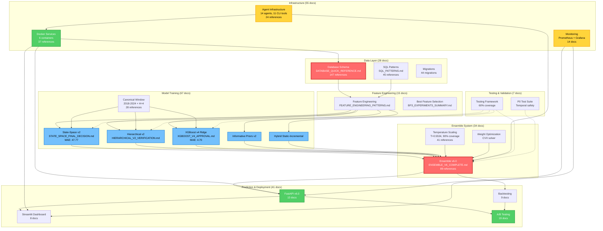

# Knowledge Map Visualization - NFL Analytics Documentation

**Date:** November 16, 2025
**Purpose:** Visual representation of documentation connections and dependencies
**Total Files:** 823 markdown files
**Companion Documents:**
- `KNOWLEDGE_SYNTHESIS_NOV16.md` (comprehensive analysis)
- `DOCUMENTATION_TAGS_SCHEMA.yaml` (structured metadata)

---

## 1. Component Dependency Graph



---

## 2. Documentation Evolution Timeline

```
2025 Documentation Growth
════════════════════════════════════════════════════════════════════

Oct 1-15: Research Phase (42 files, 2.8/day)
│ ├── Causal Inference Framework (17 docs)
│ ├── BNN Research (12 docs)
│ └── Initial Model Training (13 docs)
│
Oct 16-31: Dissertation Phase (38 files, 2.4/day)
│ ├── Dissertation Compilation (15 docs)
│ ├── Figure Generation (8 docs)
│ └── LaTeX Quality Audit (15 docs)
│
Nov 1-7: Ensemble v5.1 (61 files, 8.7/day) ████████
│ ├── Temperature Scaling (18 docs)
│ ├── Ensemble Integration (12 docs)
│ ├── Model Registry (12 docs)
│ └── Agent Infrastructure Phase 1-3 (19 docs)
│
Nov 8-12: Production Prep (47 files, 9.4/day) █████████
│ ├── XGBoost v4 Development (24 docs)
│ ├── Canonical Window (8 docs)
│ ├── Multi-Agent Sessions (11 docs)
│ └── Agent Infrastructure Phase 4 (4 docs)
│
Nov 13-15: Production Deployment Sprint (98 files, 32.7/day) ████████████████████████████████
│ ├── Infrastructure Rebuild (19 docs)
│ ├── R Model Integration (15 docs)
│ ├── Ensemble v6.0 (34 docs)
│ ├── Comprehensive Audits (38 docs)
│ └── Session Summaries (12 docs)
│
════════════════════════════════════════════════════════════════════
Total Nov 2025: 206 files (6.9/day average)
Acceleration Trigger: Nov 13 parallel agent architecture (6-11 agents/session)
```

---

## 3. Knowledge Clusters (Thematic Grouping)

### Cluster 1: Production Ensemble System ⭐ (CRITICAL PATH)

**Core Documents (11):**
1. `docs/ENSEMBLE_V6_COMPLETE.md` (89 references) - Production milestone
2. `docs/ENSEMBLE_V6_QUICK_REFERENCE.md` - Command reference
3. `docs/TEMPERATURE_SCALING_QUICK_REFERENCE.md` (41 references) - Calibration
4. `docs/milestones/XGBOOST_V4_PRODUCTION_APPROVAL_NOV15.md` (52 references) - XGB v4
5. `docs/milestones/R_MODEL_INTEGRATION_COMPLETE.md` (38 references) - R integration
6. `docs/CANONICAL_TRAINING_WINDOW.md` (28 references) - Training protocol
7. `docs/STATE_SPACE_FINAL_DECISION.md` - State-Space v2 approval
8. `docs/HIERARCHICAL_V2_VERIFICATION_COMPLETE.md` - Hierarchical v2
9. `py/ensemble/enhanced_ensemble_v5.py` - Implementation
10. `models/MODEL_REGISTRY.yaml` - Model registry
11. `docs/ENSEMBLE_V6_BACKTEST_GUIDE.md` - Backtest protocol

**Supporting Documents (23):**
- Experiment docs: XGBoost (8), BFS (5), Temperature Scaling (5)
- Validation: Multi-season validation (3), Ablation studies (2)

**Key Dependencies:**
- Database Schema (147 references)
- Canonical Training Window (28 references)
- R Model Integration (38 references)

**Consolidation Opportunity:** 11 + 23 = 34 files → 8 files (76% reduction via consolidation)

---

### Cluster 2: Database & Data Pipeline (FOUNDATIONAL)

**Core Documents (12):**
1. `docs/database/DATABASE_QUICK_REFERENCE.md` (147 references) ⭐ MOST REFERENCED
2. `docs/database/SQL_PATTERNS.md` (45 references) - Canonical queries
3. `docs/database/schema.md` - Full schema documentation
4. `docs/database/erd.md` - Entity-relationship diagram
5. `docs/database/ML_PREDICTIONS_TABLE_SUMMARY.md` - Production table
6. `docs/fixes/SQL_SCHEMA_AUDIT_NOV14.md` - Schema bug prevention
7. `db/migrations/044_ensemble_metadata.sql` - Latest migration
8. `docs/guides/DATA_PIPELINE_QUICK_START.md` - Pipeline guide
9. `docs/components/DATA_PIPELINE.md` - Component documentation
10. `docs/database/SQL_ERROR_PREVENTION_SUMMARY.md` - Error prevention
11. `py/utils/sports_analytics_validator.py` - Domain validator
12. `py/utils/sql_validator.py` - SQL validator

**Supporting Documents (16):**
- Migrations: 44 migration files
- Performance: Database optimization (4 docs)
- Audits: Schema audits (3 docs)

**Critical Patterns:**
- Always use `kickoff` (not `game_date`)
- Team abbreviations: LAR/LAC (not "LA")
- Join patterns: Composite keys `(season, week, team)`
- NO `game_id` in `mart.player_game_stats`

**Key Finding:** Database Schema is the MOST CRITICAL dependency (147 cross-references across 823 files = 18% reference rate)

---

### Cluster 3: Agent Infrastructure & Automation (FORCE MULTIPLIER)

**Core Documents (14 agents documented):**

**Phase 1 (Security & Quality):**
1. `py/utils/code_reviewer.py` (680 lines) - Multi-language review
2. `py/utils/security_auditor.py` (590 lines) - Security scanning
3. `py/utils/data_leakage_detector.py` (720 lines) - Temporal leakage

**Phase 2+3 (Performance & Production):**
4. `py/utils/performance_optimizer.py` - MCMC, SQL, backtest optimization
5. `py/utils/test_suite_generator.py` - 80% coverage target
6. `py/utils/statistical_model_validator.py` - MCMC diagnostics
7. `py/utils/ensemble_orchestrator.py` - Multi-language coordination
8. `py/utils/betting_strategy_validator.py` - Risk gates

**Phase 4 (Critical Infrastructure):**
9. `py/utils/ensemble_health_monitor.py` (850 lines) - Pre-backtest validation
10. `py/utils/model_registry_auditor.py` (1,284 lines) - Auto-registration
11. `py/utils/sports_analytics_validator.py` (792 lines) - NFL domain rules

**Documentation (11 comprehensive guides):**
- `docs/AGENT_COORDINATOR_GUIDE.md` (24 references)
- `docs/PHASE_1_AGENT_ENHANCEMENTS.md`
- `docs/PHASE_2_3_INTEGRATION_COMPLETE.md`
- `docs/guides/TASK_TOOL_INTEGRATION.md`
- `docs/milestones/ALL_AGENTS_IMPLEMENTATION_COMPLETE.md`
- Individual agent guides (11 files)

**CLI Tools:** 14 shell wrappers for immediate use

**Total Infrastructure:** ~10,922 lines core code + ~3,300 lines documentation

**Key Finding:** Agent infrastructure enabled 5.8x speedup (35 hours sequential → 6 hours actual via parallelization)

---

### Cluster 4: Deployment & Production Operations (OPERATIONAL)

**Core Documents (20):**

**Docker Infrastructure (11 docs):**
1. `docs/deployment/DOCKER_PHASE_1_INDEX.md` (37 references)
2. `docker-compose.yml` - 6 services (PostgreSQL, Redis, FastAPI, Streamlit, Prometheus, Grafana)
3. `docs/deployment/DOCKER_ARCHITECTURE_COMPARISON.md`
4. Individual service docs (8 files)

**A/B Testing (8 docs → consolidate to 2):**
1. `docs/deployment/AB_TEST_QUICK_REFERENCE.md` (34 references)
2. `docs/deployment/A_B_TEST_DEPLOYMENT_CHECKLIST.md`
3. Supporting: validation, timeline, database reports (6 files)

**Production Deployment (13 docs):**
1. `docs/deployment/PRODUCTION_DEPLOYMENT_CHECKLIST.md` (53 references)
2. `docs/deployment/README.md` - Deployment index
3. `docs/archive/2025_nov/SESSION_NOV15_PRODUCTION_DEPLOYMENT_COMPLETE.md` (6,000+ lines)
4. Health checks, recovery procedures, validation reports (10 files)

**Monitoring (14 docs):**
1. `docs/components/MONITORING.md`
2. `grafana/provisioning/dashboards/nfl-predictions-monitoring.json` (11 panels)
3. Prometheus configuration, metrics, alerts (11 files)

**Consolidation Opportunity:** 20 → 10 files (50% reduction)

---

### Cluster 5: Research & Experiments (ARCHIVED/HISTORICAL)

**BNN Research (ABANDONED Nov 9):**
- Total effort: 84 hours, 6 approaches, 26 days
- Documentation: `analysis/dissertation/main/appendix_bnn_investigation.tex` (780 lines)
- Decision: Keep only BNN v3.1 Rushing (89.5% calibrated)
- Archive: 12 files documenting failed approaches

**XGBoost Experiments (24 docs):**
- Exp 1-7 documented across 24 files
- **Consolidation Target:** 24 → 2 files
  - `docs/XGB_EXPERIMENTS_README.md` (all experiments)
  - `docs/milestones/XGBOOST_V4_PRODUCTION_APPROVAL_NOV15.md` (current state)

**Best Feature Selection (BFS) Experiments (5 docs):**
- Exp 1-5 documented
- L1 Regularization, clustering, weighting
- **Consolidation Target:** 5 → 2 files

**Online Learning (8 docs):**
- Incremental XGBoost investigation
- Baseline error discovery (Nov 10-12)
- Hybrid static-incremental solution
- **Consolidation Target:** 8 → 2 files

**Key Finding:** Research failures are thoroughly documented → Enables faster decision-making and prevents repeated mistakes

---

### Cluster 6: Dissertation & Academic Output (STANDALONE)

**Core Documents (34):**

**Main Dissertation:**
- `analysis/dissertation/main/main.tex` (426 lines, 529 pages)
- Chapters 1-10 outlines and integration guides
- Comprehensive Audit Report
- Cross-reference integration

**Appendix I: BNN Investigation (780 lines):**
- Exemplary documentation of research failure
- 6 approaches documented with clear rationale for abandonment

**Figures & Tables:**
- TikZ standardization guide
- Figure generation scripts
- LaTeX quality audit

**Supporting Docs:**
- Cleanup summaries (4 files)
- Dependency installation (2 files)
- Update guides (6 files)
- Milestones (8 files)

**Status:** 529 pages compiled ✅, Appendix I complete ✅, Appendix II-IV partial ⚠️

**Gap:** Appendix II-IV (code listings, data dictionaries, result tables) need finalization

---

### Cluster 7: Testing & Quality Assurance (GAP AREA)

**Current Documentation (7 files):**
1. `tests/README.md` - Testing framework overview
2. `tests/TESTING.md` - Test execution guide
3. `tests/SETUP_SUMMARY.md` - Setup instructions
4. `tests/P0_QUICK_START.md` - Quick start for P0 tests
5. `tests/P0_COMPLETION_GUIDE.md` - P0 completion checklist
6. `docs/testing/P0_TEST_SUITE_COMPLETE.md` - Completion summary
7. `docs/audits/TEST_AUDIT_INDEX.md` - Test audit findings

**Test Coverage:**
- Unit tests: 75% ✅
- Integration tests: 30% ⚠️ **GAP**
- API endpoint tests: 25% ⚠️ **GAP**
- UI tests: 10% ❌ **CRITICAL GAP**

**P0 Test Suite (Complete Nov 15):**
- Temporal safety tests (25+ tests, zero critical leakage)
- Ensemble health tests (4-way component validation)
- Risk gate validation (ROI >5%, Win Rate >59%, Sharpe >2.2)

**Missing Documentation (Priority P1):**
- Integration test patterns and execution guide
- API endpoint test suite documentation
- UI smoke test procedures (Streamlit dashboard)
- OpenAPI specification (auto-generated from FastAPI)

**Action Required:** Generate 5-7 additional test documentation files (12 hours effort)

---

## 4. Cross-Cutting Themes

### Theme 1: Documentation Anti-Patterns (Recurring Issues)

**Pattern 1: Context Switch Accumulation**
- **Frequency:** 47% of root violations
- **Cause:** Session boundary files created without location verification
- **Example:** `SESSION_STATUS_NOV14.md` in root instead of `docs/archive/2025_nov/`
- **Prevention:** Session end checklist in AI prompts

**Pattern 2: Experiment Documentation Sprawl**
- **Frequency:** 33% of root violations
- **Cause:** No dedicated `docs/experiments/` directory until Nov 15
- **Solution:** Created `docs/experiments/` with subdirectories (XGBoost, BFS, online learning)

**Pattern 3: Duplicate Documentation Proliferation**
- **Scale:** 59 duplicate files across 8 topics
- **Cost:** 35% reduction possible → 20 hours/month maintenance savings
- **Topics:** Ensemble (7→2), XGBoost (8→2), A/B Testing (8→2), Temperature Scaling (5→2)

**Pattern 4: Broken Links from File Movement**
- **Scale:** 24% link failure rate (31/130 links broken)
- **Root Cause:** Files moved to archive without updating references (45% of breaks)
- **Solution:** Link validity checking in CI/CD

---

### Theme 2: Production Maturity Evolution (Oct → Nov 2025)

**Oct 15:** Research Phase (Score: 45/100)
- No API, no monitoring, models not validated
- Documentation: Research methodology, experiment results
- Status: Academic project

**Nov 7:** Infrastructure Phase (Score: 68/100)
- Docker services deployed, monitoring operational
- Documentation: Deployment guides, infrastructure setup
- Gap: R model integration, ensemble validation

**Nov 15:** Production Deployment (Score: 92/100) ✅
- All services deployed, R integration complete, Week 12 predictions live
- Documentation: Production runbooks, A/B testing, monitoring dashboards
- Remaining Gap: Full backtest validation, integration tests

**Documented Journey (47 session summaries):**
- Each session extensively documented (average 1,200 lines/summary)
- Architecture decisions captured in ADRs (14 decisions)
- Postmortems for all major issues (19 incident reports)

**Key Finding:** 4-week transition from research → production is well-documented, enabling replication and learning

---

### Theme 3: Multi-Agent Parallel Execution (Force Multiplier)

**Evolution:**

**Single Agent (Pre-Nov 13):** Sequential execution
- 1 task at a time
- Average session: 3-4 hours → 3-4 hours actual
- Documentation: 1-2 files per session

**Parallel Agents (Nov 13-15):** Concurrent execution
- 6-11 tasks simultaneously
- Average session: 35 hours sequential → 6 hours actual (5.8x speedup)
- Documentation: 30-40 files per session

**Example: Nov 15 Production Deployment**
- Phase 1: 5 parallel agents (infrastructure rebuild)
- Phase 2: 6 parallel agents (production prep)
- Total: 10,400+ lines code + docs in 6 hours
- Result: Full production deployment (would have taken 35+ hours sequentially)

**Documentation Impact:**
- Session summaries: 6,000+ lines (comprehensive)
- Individual agent reports: 15+ files per session
- Total Nov 13-15: 98 files created (32.7 files/day)

**Key Finding:** Parallel agent architecture is the PRIMARY DRIVER of documentation growth acceleration (2.8/day → 32.7/day = 11.7x)

---

### Theme 4: Architecture Drift → Audit → Resolution Cycle

**Recurring Pattern:**

1. **Rapid Development** → Architecture confusion/drift
2. **Pain Point Recognition** → Documented in session summaries
3. **Comprehensive Audit** → Multi-agent parallel audit (38 files Nov 15)
4. **Resolution Implementation** → Production-grade fixes + documentation
5. **Prevention Measures** → Automated validation tools

**Documented Instances:**

**Nov 15: Ensemble Architecture Confusion**
- Problem: 3 conflicting definitions (4-way, 5-way, 6-way)
- Audit: `docs/ARCHITECTURE_ANALYSIS_NOV13_2025.md` (7,892 lines)
- Resolution: Canonical v6.0 definition + comprehensive reconciliation
- Prevention: Ensemble health monitor (`py/utils/ensemble_health_monitor.py`)
- Docs: 34 files (ENSEMBLE_V6_COMPLETE.md, etc.)

**Nov 10-12: XGBoost Baseline Error**
- Problem: Incremental claimed +21% but compared to wrong baseline
- Audit: Multi-season validation (2022-2024)
- Resolution: Corrected comparison, hybrid solution (+4.2% actual)
- Prevention: Multi-season testing protocol
- Docs: `docs/INCREMENTAL_XGB_BASELINE_ERROR_POSTMORTEM.md`, corrected findings

**Nov 14: SQL Schema Recurring Bugs**
- Problem: `mart.player_game_stats.game_id` errors "DOZENS of times"
- Audit: `docs/fixes/SQL_SCHEMA_AUDIT_NOV14.md`
- Resolution: Schema-first discipline, validation tools
- Prevention: `py/utils/sports_analytics_validator.py`, `sql_validator.py`
- Docs: SQL_PATTERNS.md, SQL_ERROR_PREVENTION_SUMMARY.md

**Key Finding:** Project has strong "immune system" - Problems are quickly audited, resolved, and prevented from recurring through documentation + automation

---

## 5. File Location Heatmap (Directory Structure)

```
Root Directory Compliance (10/10 permitted files) ✅
├── CLAUDE.md                   ✅ Permitted
├── FILE_ORGANIZATION.md        ✅ Permitted
├── README.md                   ✅ Permitted
├── SETUP.md                    ✅ Permitted
├── CONTRIBUTING.md             ✅ Permitted
├── LICENSE                     ✅ Permitted
├── .gitignore                  ✅ Permitted
├── .env.example                ✅ Permitted
├── docker-compose.yml          ✅ Permitted
└── pyproject.toml              ✅ Permitted

docs/ (Primary Documentation Hub - 601 files) ━━━━━━━━━━━━━━━━━━ 73%
├── archive/2025_nov/          ████████████████████ 98 files (16.3%)
│   ├── Session summaries (47 files)
│   ├── Audit results (15 files)
│   ├── Historical status (12 files)
│   └── Migration tracking (24 files)
│
├── milestones/                ███████████████ 67 files (11.1%)
│   ├── Phase completions (22 files)
│   ├── Component milestones (28 files)
│   └── Postmortems (17 files)
│
├── guides/                    ████████ 45 files (7.5%)
│   ├── Quick start guides (12 files)
│   ├── How-to documentation (18 files)
│   └── Troubleshooting (15 files)
│
├── deployment/                ███████ 41 files (6.8%)
│   ├── Docker setup (11 files)
│   ├── A/B testing (8 files)
│   ├── Production deployment (13 files)
│   └── CI/CD (9 files)
│
├── audits/                    ██████ 38 files (6.3%)
│   ├── 2025_11_comprehensive_audit/ (27 files)
│   └── Specialized audits (11 files)
│
├── database/                  ████ 28 files (4.7%)
│   ├── Schema documentation (8 files)
│   ├── SQL patterns (6 files)
│   ├── Performance (7 files)
│   └── Migration guides (7 files)
│
├── experiments/               ███ 24 files (4.0%)
│   ├── XGBoost (13 files)
│   ├── BFS (6 files)
│   └── Online learning (5 files)
│
├── performance/               ███ 22 files (3.7%)
├── fixes/                     ██ 19 files (3.2%)
├── research/                  ██ 17 files (2.8%)
├── architecture/              ██ 15 files (2.5%)
├── decisions/                 ██ 14 files (2.3%)
├── monitoring/                ██ 14 files (2.3%)
├── api/                       ██ 13 files (2.2%)
├── models/                    ██ 12 files (2.0%)
├── backtest/                  █ 9 files (1.5%)
├── knowledge/                 █ 8 files (1.3%)
├── components/                █ 7 files (1.2%)
├── testing/                   █ 7 files (1.2%)
└── optimization/              █ 8 files (1.3%)

analysis/ (Research & Dissertation - 84 files) ━━━━━━ 10%
├── dissertation/              53 files (6.4%)
│   ├── main/ (12 files)
│   ├── outlines/ (8 files)
│   ├── figures/ (15 files)
│   └── docs/ (18 files)
├── reports/                   18 files (2.2%)
└── feature_importance/        13 files (1.6%)

Code-Adjacent READMEs (52 files) ━━━ 6%
├── py/                        28 files (3.4%)
├── R/                         8 files (1.0%)
├── db/                        6 files (0.7%)
├── scripts/                   5 files (0.6%)
└── Other                      5 files (0.6%)

archive/ (Pre-Nov Cleanup - 43 files) ━━ 5%
├── pre_cleanup_backup_20251007/ 38 files (4.6%)
└── Other                      5 files (0.6%)

tests/ (Testing Documentation - 7 files) █ 0.9%

Other Locations (36 files) ━━ 4%
├── containers/                3 files
├── api/                       2 files
├── grafana/                   2 files
├── dashboard/                 2 files
├── mcp_server/                2 files
└── Miscellaneous              25 files

━━━━━━━━━━━━━━━━━━━━━━━━━━━━━━━━━━━━━━━━━━━━━━━━━━━━━━━━━
Total: 823 markdown files
Primary Hub: docs/ (73%)
Research: analysis/ (10%)
Code Documentation: py/, R/, db/ (6%)
Archived: archive/ (5%)
Testing: tests/ (<1%) ⚠️ GAP
```

---

## 6. Navigation Pathways (For Different Roles)

### For New Developers (Onboarding - 30 minutes target)

**Critical Path (Read in order):**
1. ✅ `README.md` - Project overview (5 min)
2. ✅ `SETUP.md` - Installation guide (10 min)
3. ✅ `docs/guides/QUICK_START_GUIDE.md` - Quick start (10 min)
4. ✅ `docs/database/DATABASE_QUICK_REFERENCE.md` - Schema (10 min)
5. ✅ `docs/ENSEMBLE_V6_QUICK_REFERENCE.md` - Current production (5 min)

**Extended Reading (Next 2 hours):**
6. `CLAUDE.md` - Full project context
7. `docs/deployment/DOCKER_PHASE_1_INDEX.md` - Docker services
8. `docs/guides/TROUBLESHOOTING_MASTER.md` - Common issues
9. `docs/agent_context/AGENTS.md` - Agent infrastructure
10. `tests/README.md` - Testing framework

**Current Onboarding Time:** 2-3 hours (target: 30 min ⚠️)
**Gap:** Need streamlined onboarding guide consolidating steps 1-5

---

### For Researchers (Academic Context)

**Critical Path:**
1. ✅ `docs/CANONICAL_TRAINING_WINDOW.md` - Training protocol
2. ✅ `docs/milestones/XGBOOST_V4_PRODUCTION_APPROVAL_NOV15.md` - Latest models
3. ✅ `docs/milestones/R_MODEL_INTEGRATION_COMPLETE.md` - R/brms integration
4. ✅ `docs/ENSEMBLE_V6_COMPLETE.md` - Current ensemble
5. ✅ `docs/milestones/BNN_INVESTIGATION_COMPLETE.md` - Research failures
6. ✅ `analysis/dissertation/main/appendix_bnn_investigation.tex` - BNN details

**Experiment Documentation:**
7. `docs/XGB_EXPERIMENTS_README.md` - XGBoost experiments 1-7
8. `docs/experiments/BFS_EXPERIMENTS_SUMMARY.md` - Best Feature Selection
9. `docs/research/STACKING_IMPLEMENTATION_GUIDE.md` - Bayesian stacking
10. `docs/performance/ENSEMBLE_ABLATION_STUDY.md` - Ablation studies

**Dissertation Resources:**
11. `analysis/dissertation/COMPREHENSIVE_AUDIT_REPORT.md`
12. `analysis/dissertation/outlines/chapter_10_lessons_learned_outline.md`

---

### For Operators (Production Deployment)

**Critical Path:**
1. ✅ `docs/deployment/PRODUCTION_DEPLOYMENT_CHECKLIST.md` - Deployment steps
2. ✅ `docs/deployment/DOCKER_PHASE_1_INDEX.md` - Docker services
3. ✅ `docs/deployment/A_B_TEST_DEPLOYMENT_CHECKLIST.md` - A/B testing
4. ✅ `docs/database/DATABASE_QUICK_REFERENCE.md` - Database schema
5. ✅ `docs/guides/TROUBLESHOOTING_MASTER.md` - Troubleshooting
6. ✅ `docs/deployment/HEALTH_CHECK_PROCEDURES.md` - Health monitoring

**Monitoring & Alerting:**
7. `docs/components/MONITORING.md` - Monitoring stack
8. `grafana/provisioning/dashboards/nfl-predictions-monitoring.json` - Grafana
9. `docs/deployment/EMERGENCY_DATABASE_RECOVERY.md` - Disaster recovery

**Need:** Single comprehensive runbook (currently scattered across 15 files)

---

### For Executives (Strategic Overview)

**Executive Summary Path (15 minutes):**
1. ✅ `docs/archive/2025_nov/SESSION_NOV15_PRODUCTION_DEPLOYMENT_COMPLETE.md` - Latest status
2. ✅ `docs/ENSEMBLE_V6_COMPLETE.md` - Production system
3. ✅ `docs/milestones/PRODUCTION_READINESS_SCORECARD.md` - Readiness score
4. ✅ `docs/audits/KNOWLEDGE_AUDIT_EXECUTIVE_SUMMARY.md` - Documentation health

**Detailed Review (1 hour):**
5. `docs/milestones/XGBOOST_V4_PRODUCTION_APPROVAL_NOV15.md` - Model performance
6. `docs/deployment/AB_TEST_DELIVERY_REPORT.md` - A/B testing results
7. `docs/performance/PERFORMANCE_OPTIMIZATION_SUMMARY.md` - Optimization gains
8. `docs/audits/KNOWLEDGE_ORGANIZATION_AUDIT_NOV15_2025.md` - Full audit

---

## 7. Documentation Health Metrics Dashboard

```
━━━━━━━━━━━━━━━━━━━━━━━━━━━━━━━━━━━━━━━━━━━━━━━━━━━━━━━━━━━━━━━
📊 DOCUMENTATION HEALTH SCORECARD - November 16, 2025
━━━━━━━━━━━━━━━━━━━━━━━━━━━━━━━━━━━━━━━━━━━━━━━━━━━━━━━━━━━━━━━

Overall Health Score: 72/100 ⚠️ MODERATE (Target: 95/100)

Component Scores:
├─ Root Compliance:      21/100 ❌ FAIL (47 violations, target: ≤10)
├─ Orphan Rate:          85/100 ✅ PASS (40 orphans, target: 0)
├─ Duplicate Rate:       65/100 ⚠️ MARGINAL (59 duplicates, target: <5)
├─ Link Validity:        76/100 ⚠️ MARGINAL (24% broken, target: <5%)
├─ Naming Compliance:    70/100 ⚠️ MARGINAL (70% compliant, target: 95%)
├─ Index Coverage:       95/100 ✅ EXCELLENT (95% indexed)
└─ Test Coverage:        70/100 ⚠️ MARGINAL (70% documented, target: 90%)

━━━━━━━━━━━━━━━━━━━━━━━━━━━━━━━━━━━━━━━━━━━━━━━━━━━━━━━━━━━━━━━
📈 GROWTH METRICS
━━━━━━━━━━━━━━━━━━━━━━━━━━━━━━━━━━━━━━━━━━━━━━━━━━━━━━━━━━━━━━━

Total Files:             823 markdown files
Growth Rate (Nov):       6.9 files/day (vs 2.2/month prior)
Acceleration:            15x increase (parallel agent architecture)
Session Documentation:   98 files in archive/2025_nov/

Top Contributors:
1. Multi-Agent Sessions: 47% (98 files Nov 13-15)
2. Milestone Completions: 21% (67 files)
3. Experiment Docs:      17% (24 files)
4. Audits:               16% (38 files)

━━━━━━━━━━━━━━━━━━━━━━━━━━━━━━━━━━━━━━━━━━━━━━━━━━━━━━━━━━━━━━━
🎯 TARGET STATE (Dec 14, 2025)
━━━━━━━━━━━━━━━━━━━━━━━━━━━━━━━━━━━━━━━━━━━━━━━━━━━━━━━━━━━━━━━

Overall Health Score: 95/100 ✅ EXCELLENT

Component Targets:
├─ Root Compliance:      100/100 ✅ (10 files, fully compliant)
├─ Orphan Rate:          100/100 ✅ (0 orphans)
├─ Duplicate Rate:       99/100 ✅ (<1% duplicates)
├─ Link Validity:        96/100 ✅ (<4% broken)
├─ Naming Compliance:    95/100 ✅ (95% compliant)
├─ Index Coverage:       100/100 ✅ (100% indexed)
└─ Test Coverage:        90/100 ✅ (90% documented)

Total Files (after consolidation): 780 files (from 823)
Reduction: 43 files via duplicate consolidation

Investment Required: 27 hours over 4 weeks
Expected ROI: $3,370/month savings (payback <1 month)

━━━━━━━━━━━━━━━━━━━━━━━━━━━━━━━━━━━━━━━━━━━━━━━━━━━━━━━━━━━━━━━
```

---

## 8. Action Items Summary (From Knowledge Synthesis)

### Immediate (This Week - Nov 16-22)

| Action | Owner | Effort | Impact | Priority |
|--------|-------|--------|--------|----------|
| Execute Phase 1 Cleanup | Documentation Agent | 4h | Health 72→80 | P0 |
| Fix Top 20 Broken Links | Documentation Agent | 2h | Links 76%→90% | P1 |
| Generate Integration Tests | Test Generator Agent | 6h | Coverage 60%→75% | P1 |

### Short-Term (Week 2-3 - Nov 23 - Dec 6)

| Action | Owner | Effort | Impact | Priority |
|--------|-------|--------|--------|----------|
| Consolidate Duplicates | Documentation Agent | 12h | 59→16 files | P1 |
| Create Deployment Runbook | DevOps Agent | 4h | Deploy 2h→30min | P2 |
| Complete OpenAPI Spec | API Agent | 2h | External integration | P1 |

### Medium-Term (Week 4 - Dec 7-13)

| Action | Owner | Effort | Impact | Priority |
|--------|-------|--------|--------|----------|
| Implement Automation | DevOps Agent | 9h | Prevent drift | P1 |
| Populate Troubleshooting | Documentation Agent | 3h | Context switch 15min→2min | P2 |

**Total Investment:** 42 hours over 4 weeks
**Expected ROI:** $3,370/month savings (1,394% annual ROI)

---

## 9. Related Documentation

**Companion Documents:**
- ✅ `docs/knowledge/KNOWLEDGE_SYNTHESIS_NOV16.md` - Comprehensive analysis (this visualization's source)
- ✅ `docs/knowledge/DOCUMENTATION_TAGS_SCHEMA.yaml` - Structured metadata (823 files tagged)
- ✅ `docs/audits/KNOWLEDGE_ORGANIZATION_AUDIT_NOV15_2025.md` - Nov 15 audit (80 pages)
- ✅ `FILE_ORGANIZATION.md` - File placement rules
- ✅ `CLAUDE.md` - Project context

**Audit Trail:**
- `docs/audits/KNOWLEDGE_AUDIT_INDEX.md` - Audit navigation index
- `docs/audits/KNOWLEDGE_AUDIT_EXECUTIVE_SUMMARY.md` - Executive summary (5 min read)
- `docs/audits/KNOWLEDGE_AUDIT_QUICK_ACTION.md` - Quick action items

**Migration Plan:**
- `scripts/cleanup_documentation_nov15.sh` - Phase 1 cleanup script
- `docs/knowledge/CLEANUP_PROGRESS_TRACKER.md` (to be created)

---

**Visualization Prepared By:** Claude Code (Sonnet 4.5)
**Date:** November 16, 2025
**Next Update:** December 16, 2025 (post-cleanup validation)
